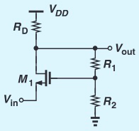
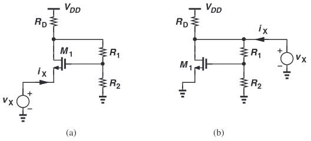

# 예제 12.7 — 귀환 CG 단의 네 성분, 개루프·폐루프 이득과 I/O 임피던스

## 원문
그림 12.11은 그림 12.2 귀환 회로의 트랜지스터 레벨 실현을 보여 준다. 단순화를 위해 $\lambda = 0$과 $R_1 + R_2 \gg R_D$라고 가정한다. (a) 귀환 시스템의 네 가지 성분을 밝혀라. (b) 개루프와 폐루프 전압 이득을 결정하라. (c) 개루프와 폐루프 I/O 임피던스를 결정하라.

## 조건
- 회로: Fig 12.11, Fig 12.2 귀환 회로(비반전 증폭기)의 트랜지스터 레벨 실현
  - $M_1$ (NMOS): 게이트는 분배기 $R_1$–$R_2$의 가운데 노드, 소스는 입력 $V_{in}$, 드레인은 $R_D$를 거쳐 $V_{DD}$이고 출력 $V_{out}$
  - $R_1$, $R_2$: 출력 $V_{out}$과 접지 사이 분배기
- 가정: $\lambda = 0$, $R_1 + R_2 \gg R_D$
- 소자 값은 주어지지 않음 (답은 $g_m$, $R_D$, $R_1$, $R_2$의 식으로) (원문에 없음)
- 귀환 시스템의 네 성분: 피드포워드(순방향) 시스템, 출력 감지 장치, 귀환 회로망(귀환율 $K = X_F/Y$), 비교(반송) 장치(오차 $E = X - X_F$) (본문 정의, 원문에 없음)
- 식 (12.2): $\dfrac{Y}{X} = \dfrac{A_1}{1 + KA_1}$ (본문 식, 원문에 없음)

## 구할 것
- (a) 귀환 시스템의 네 가지 성분
- (b) 개루프와 폐루프 전압 이득
- (c) 개루프와 폐루프 입력·출력 임피던스

## 상속·참조
- 본문 Fig 12.1 (교재 643쪽, 이 파일의 그림 목록에는 넣지 않음, 크롭은 fig12-01.png): 입력 $X$ → 덧셈기(+ $X$, − $X_F$) → 순방향 $A_1$ → 출력 $Y$, $Y$를 감지해 귀환 회로망 $K$를 거쳐 $X_F$가 덧셈기로. 네 성분 정의 (643쪽): (1) 피드포워드 시스템, (2) 출력 감지 장치, (3) 귀환 회로망($K = X_F/Y$), (4) 비교 또는 반송 장치($E = X - X_F$)
- 본문 Fig 12.2 (예제 12.1, 교재 644쪽, 이 파일의 그림 목록에는 넣지 않음, 크롭은 fig12-02.png): 연산 증폭기 $A_1$ (+ 입력 = $X$, − 입력 = $X_F$, 출력 = $Y$), `R1: Y – X_F`, `R2: X_F – 접지`. 귀환율 $K = R_2/(R_1 + R_2)$
- 식 (12.2): $\dfrac{Y}{X} = \dfrac{A_1}{1 + KA_1}$

## 회로 — Fig 12.11
```spice
RD  VDD   Vout  {R_D}
M1  Vout  n1    Vin  nmos
R1  Vout  n1    {R_1}
R2  n1    0     {R_2}
```
- 단자: VDD = 전원, 값 미지정 (T 전원 기호) / Vin = 입력, M1 소스 (개방 원) / Vout = 출력 (개방 원)
- 표시: 노드 라벨 V_DD (T 기호 오른쪽), V_in (입력 원 왼쪽), V_out (출력 원 오른쪽) / 소자 라벨 R_D (저항 왼쪽), M1 (트랜지스터 왼쪽, 소스 화살표 바로 왼쪽 위), R1, R2 (각 저항 오른쪽) / 부호 없음 / 화살표 없음 / 수치·면적 라벨 없음
- 배치: 왼쪽 세로줄 위→아래 V_DD T 기호, R_D, 드레인 접속점, M1 / M1은 좌우 반전된 NMOS (게이트가 오른쪽, 드레인 위·소스 아래 인출선이 왼쪽, 소스 화살표는 채널에서 왼쪽 바깥을 향함) / 소스에서 세로선이 아래로 내려가 왼쪽으로 꺾여 V_in 원에서 끝남 / 드레인 접속점에서 가로선이 오른쪽으로 가 R1 위 접속점을 지나 V_out 원까지 / 오른쪽 세로줄 위→아래 R1 위 접속점, R1, 게이트 접속점(n1), R2, 접지 / M1 게이트에서 가로선이 오른쪽으로 곧장 n1 접속점 / 접속점 (세 갈래 이상, 3곳): 드레인 = 위 R_D + 아래 M1 드레인 + 오른쪽 가로선 (점), R1 위 = 왼쪽 가로선 + 아래 R1 + 오른쪽 V_out 선 (점), n1 = 위 R1 + 아래 R2 + 왼쪽 게이트 선 (점) / 교차: 없음



## 답 (검증용)
- (a) 순방향 시스템(주 증폭기)은 $M_1$과 $R_D$, 즉 공통 게이트 단. $R_1$, $R_2$는 감지 장치와 귀환 회로망으로 $V_{out}R_2/(R_1 + R_2)$를 뺄셈기에 반송. 소신호 드레인 전류가 게이트와 소스 전압의 차에 비례하므로 $M_1$ 자신이 뺄셈기: $i_D = g_m(v_G - v_S)$ (식 12.30)
- (b) 개루프 $A_0 \approx g_mR_D$ (식 12.31), 폐루프 $\dfrac{v_{out}}{v_{in}} = \dfrac{A_0}{1 + KA_0} = \dfrac{g_mR_D}{1 + \dfrac{R_2}{R_1 + R_2}g_mR_D}$ (식 12.32, 12.33)
- (c) 개루프 $R_{in,open} = 1/g_m$, $R_{out,open} = R_D$ (식 12.34, 12.35, CG 단과 같음). 폐루프 (Fig 12.12(a), (b)로 회로를 풀어): $\dfrac{v_X}{i_X} = \dfrac{1}{g_m}\left(1 + \dfrac{R_2}{R_1 + R_2}g_mR_D\right)$ (입력, 식 12.38), $\dfrac{v_X}{i_X} = \dfrac{R_D}{1 + \dfrac{R_2}{R_1 + R_2}g_mR_D}$ (출력, 식 12.43). 입력 저항은 $1 + g_mR_DR_2/(R_1 + R_2)$배 증가, 출력 저항은 같은 인수만큼 감소

### 정답 회로 — Fig 12.12(a)
```spice
RD  VDD  n1  {R_D}
M1  n1   n2  n3  nmos
R1  n1   n2  {R_1}
R2  n2   0   {R_2}
VX  n3   0   {v_X}
```
- 단자: VDD = 전원, 값 미지정 (T 전원 기호) / 입력 쪽 개방 단자 없음, 테스트 전압원 v_X가 M1 소스를 구동
- 표시: 노드 라벨 V_DD (T 기호 오른쪽) / 소자 라벨 R_D (저항 왼쪽), M1 (트랜지스터 오른쪽 위, 드레인 인출선 오른쪽), R1, R2 (각 저항 오른쪽), v_X (전압원 원 왼쪽) / 부호 v_X 원 오른쪽 위 +, 오른쪽 아래 − / 화살표 "i_X": v_X에서 M1 소스로 가는 가로 도선, 오른쪽 방향(소스 쪽으로), 도선 위, 글자는 화살표 위 / 수치·면적 라벨 없음
- 배치: Fig 12.11과 같은 V_DD–R_D–드레인 접속점–M1 세로줄, M1 좌우 반전 NMOS / 드레인 접속점에서 가로선이 오른쪽으로 가 모서리에서 아래로 꺾여 R1 (V_out 원 없음) / R1–R2 사이 접속점(n2)에 왼쪽 게이트 선 / M1 소스에서 세로선이 내려가 왼쪽으로 꺾이고 다시 아래로 꺾여 v_X 위 단자, v_X 아래 접지 / R2 아래 접지 / 접속점 (세 갈래 이상, 2곳): 드레인 = 위 R_D + 아래 M1 드레인 + 오른쪽 가로선 (점), n2 = 위 R1 + 아래 R2 + 왼쪽 게이트 선 (점) / 교차: 없음

### 정답 회로 — Fig 12.12(b)
```spice
RD  VDD  n1  {R_D}
M1  n1   n2  0   nmos
R1  n1   n2  {R_1}
R2  n2   0   {R_2}
VX  n1   0   {v_X}
```
- 단자: VDD = 전원, 값 미지정 (T 전원 기호) / 출력 쪽 개방 단자 없음, 테스트 전압원 v_X가 R1 위 노드(출력)를 구동
- 표시: 노드 라벨 V_DD (T 기호 오른쪽) / 소자 라벨 R_D (저항 왼쪽), M1 (트랜지스터 왼쪽, 소스 화살표 위), R1, R2 (각 저항 오른쪽), v_X (전압원 원 오른쪽) / 부호 v_X 원 왼쪽 위 +, 왼쪽 아래 − / 화살표 "i_X": v_X에서 R1 위 접속점으로 가는 가로 도선, 왼쪽 방향(회로 쪽으로), 도선 위, 글자는 화살표 위 / 수치·면적 라벨 없음
- 배치: V_DD–R_D–드레인 접속점–M1 세로줄, M1 좌우 반전 NMOS / M1 소스에서 세로선이 내려가 왼쪽으로 꺾이고 아래로 꺾여 접지 기호 (소스 접지) / 드레인 접속점에서 가로선이 오른쪽으로 R1 위 접속점을 지나 오른쪽 끝에서 아래로 꺾여 v_X 위 단자, v_X 아래 접지 / 오른쪽 세로줄 R1 위 접속점, R1, n2, R2, 접지 / 접속점 (세 갈래 이상, 3곳): 드레인 = 위 R_D + 아래 M1 드레인 + 오른쪽 가로선 (점), R1 위 = 왼쪽 가로선 + 아래 R1 + 오른쪽 v_X 선 (점), n2 = 위 R1 + 아래 R2 + 왼쪽 게이트 선 (점) / 교차: 없음


