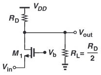

# 예제 12.8 — 부하 RL = RD/2를 구동할 때 귀환 유무에 따른 이득 변화

## 원문
그림 12.11의 공통 게이트 단은 부하 저항 $R_L = R_D/2$를 구동해야 한다. (a) 귀환이 없을 때와 (b) 귀환이 있을 때 이득은 얼마나 변화하는가?

## 조건
- 회로: Fig 12.11 공통 게이트 단 ($M_1$, $R_D$, 귀환 분배기 $R_1$, $R_2$)
- 부하 저항 $R_L = R_D/2$를 구동
- $R_L$은 출력 $V_{out}$과 접지 사이에 연결 (풀이 그림 12.13을 따름, 원문에 없음)
- 예제 12.7에서 이어받는 가정: $\lambda = 0$, $R_1 + R_2 \gg R_D$ (원문에 없음)
- 예제 12.7의 결과: 무부하 개루프 이득 $A_0 \approx g_mR_D$, 무부하 폐루프 이득 $\dfrac{v_{out}}{v_{in}} = \dfrac{g_mR_D}{1 + \dfrac{R_2}{R_1 + R_2}g_mR_D}$ (식 12.33) (원문에 없음)
- (a) 귀환이 없을 때, (b) 귀환이 있을 때 각각

## 구할 것
- (a) 귀환이 없을 때 $R_L$ 연결로 이득이 얼마나 변하는가
- (b) 귀환이 있을 때 $R_L$ 연결로 이득이 얼마나 변하는가

## 상속·참조
- 예제 12.7 (E12.07): $\lambda = 0$, $R_1 + R_2 \gg R_D$. 순방향 시스템은 $M_1$과 $R_D$의 CG 단, $K = R_2/(R_1 + R_2)$. 개루프 $A_0 \approx g_mR_D$ (식 12.31), 폐루프 $\dfrac{v_{out}}{v_{in}} = \dfrac{A_0}{1 + KA_0} = \dfrac{g_mR_D}{1 + \dfrac{R_2}{R_1 + R_2}g_mR_D}$ (식 12.32, 12.33)

## 회로 — Fig 12.11
```spice
RD  VDD   Vout  {R_D}
M1  Vout  n1    Vin  nmos
R1  Vout  n1    {R_1}
R2  n1    0     {R_2}
```
- 단자: VDD = 전원, 값 미지정 (T 전원 기호) / Vin = 입력, M1 소스 (개방 원) / Vout = 출력 (개방 원)
- 표시: 노드 라벨 V_DD (T 기호 오른쪽), V_in (입력 원 왼쪽), V_out (출력 원 오른쪽) / 소자 라벨 R_D (저항 왼쪽), M1 (트랜지스터 왼쪽, 소스 화살표 바로 왼쪽 위), R1, R2 (각 저항 오른쪽) / 부호 없음 / 화살표 없음 / 수치·면적 라벨 없음
- 배치: 왼쪽 세로줄 위→아래 V_DD T 기호, R_D, 드레인 접속점, M1 / M1은 좌우 반전된 NMOS (게이트가 오른쪽, 드레인 위·소스 아래 인출선이 왼쪽, 소스 화살표는 채널에서 왼쪽 바깥을 향함) / 소스에서 세로선이 아래로 내려가 왼쪽으로 꺾여 V_in 원에서 끝남 / 드레인 접속점에서 가로선이 오른쪽으로 가 R1 위 접속점을 지나 V_out 원까지 / 오른쪽 세로줄 위→아래 R1 위 접속점, R1, 게이트 접속점(n1), R2, 접지 / M1 게이트에서 가로선이 오른쪽으로 곧장 n1 접속점 / 접속점 (세 갈래 이상, 3곳): 드레인 = 위 R_D + 아래 M1 드레인 + 오른쪽 가로선 (점), R1 위 = 왼쪽 가로선 + 아래 R1 + 오른쪽 V_out 선 (점), n1 = 위 R1 + 아래 R2 + 왼쪽 게이트 선 (점) / 교차: 없음


> 참고: 그림 12.11은 예제 12.7 상자(교재 654쪽, PDF 8 왼쪽)에 인쇄돼 있음. 그림에는 R_L이 없음

## 답 (검증용)
- (a) 귀환이 없을 때 (Fig 12.13, 본문은 "그림 12.13(a)"로 적었으나 그림에 패널 글자 없음): CG 이득 $g_m(R_D \parallel R_L) = g_mR_D/3$ → 이득이 3배만큼 떨어짐
- (b) 귀환이 있을 때: 개루프 이득이 $g_mR_D/3$으로 떨어진 것을 식 (12.33)에 넣어 $\dfrac{v_{out}}{v_{in}} = \dfrac{g_mR_D/3}{1 + \dfrac{R_2}{R_1 + R_2}g_mR_D/3} = \dfrac{g_mR_D}{3 + \dfrac{R_2}{R_1 + R_2}g_mR_D}$ (식 12.44, 12.45). 예: $g_mR_DR_2/(R_1 + R_2) = 10$이면 식 (12.33)의 무부하 이득과 약 18% 다름 → 귀환은 부하 변동에 따른 이득을 덜 민감하게 함

### 정답 회로 — Fig 12.13
```spice
RD  VDD   Vout  {R_D}
M1  Vout  Vb    Vin  nmos
RL  Vout  0     {R_D/2}
```
- 단자: VDD = 전원, 값 미지정 (T 전원 기호) / Vin = 입력, M1 소스 (개방 원) / Vout = 출력 (개방 원) / Vb = M1 게이트 바이어스, 값 미지정 (점 단자)
- 표시: 노드 라벨 V_DD (T 기호 오른쪽), V_in (입력 원 왼쪽), V_out (출력 원 오른쪽), V_b (게이트 점 단자 오른쪽) / 소자 라벨 R_D (저항 왼쪽), M1 (트랜지스터 왼쪽, 소스 화살표 바로 왼쪽 위), R_L (저항 오른쪽) / 부호 없음 / 화살표 없음 / 수치·면적 라벨 "R_L = R_D/2" (R_L 오른쪽, R_D/2는 분수로 세로로 인쇄)
- 배치: 왼쪽 세로줄 V_DD T 기호, R_D, 드레인 접속점, M1 (Fig 12.11과 같은 좌우 반전 NMOS), 소스에서 아래로 내려가 왼쪽으로 꺾여 V_in 원 / M1 게이트에서 짧은 가로선이 오른쪽으로 V_b 점 단자 (R1, R2 없음) / 드레인 접속점에서 가로선이 오른쪽으로 R_L 위 접속점을 지나 V_out 원까지 / R_L 위 접속점에서 R_L이 아래로, 아래 끝 접지 / 접속점 (세 갈래 이상, 2곳): 드레인 = 위 R_D + 아래 M1 드레인 + 오른쪽 가로선 (점), R_L 위 = 왼쪽 가로선 + 아래 R_L + 오른쪽 V_out 선 (점) / 교차: 없음


