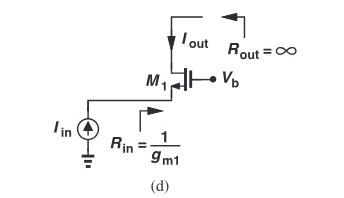
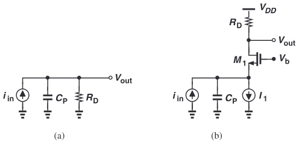

# 예제 12.9 — 전류 이득이 1인 CG 전류 증폭기의 장점

## 원문
전류 이득이 1인 그림 12.19(d)의 토폴로지는 한 조각의 전선보다 조금도 좋아 보이지 않는다. 이 회로의 장점은 무엇인가?

## 조건
- 회로: Fig 12.19(d) 전류 증폭기의 예 (공통 게이트 $M_1$, 입력 전류원 $I_{in}$이 소스를 구동, 게이트는 바이어스 $V_b$)
- 이 토폴로지의 전류 이득 $A_I = 1$ (입력 전류가 그대로 출력으로 흐름)
- 그림에 인쇄된 입출력 임피던스: $R_{in} = 1/g_{m1}$, $R_{out} = \infty$
- 소자 값은 주어지지 않음 (답은 정성적 설명) (원문에 없음)

## 구할 것
- 전류 이득이 1인데도 이 회로(전선 한 조각 대신 CG 단)를 쓰는 장점

## 상속·참조
- 본문 12.3.2절 (교재 661–662쪽): 그림 12.19의 네 회로는 $\lambda = 0$으로 보고 이득을 구함. 그림 12.19(d)의 전류 증폭기는 낮은 입력 임피던스와 높은 출력 임피던스를 가진 공통 게이트 트랜지스터이고, 전류 이득 $A_I$는 입력 전류가 단순히 출력으로 흐르므로 1
- Fig 12.19의 나머지 패널 (a) 전압, (b) 트랜스임피던스, (c) 트랜스컨덕턴스 증폭기는 이 문제가 쓰지 않음 (크롭은 fig12-19-d.png)

## 회로 — Fig 12.19(d)
```spice
* out = 라벨 없는 측정 단자 (I_out, R_out 화살표가 붙은 드레인 쪽 선 끝)
M1   out  Vb  n1  nmos
IIN  0    n1       ; I_in (화살표 위쪽: 접지 → 소스)
```
- 단자: Vb = 게이트 DC 바이어스, 값 미지정 (점 단자) / out = 출력 (드레인에서 올라가 오른쪽으로 꺾인 선 끝, I_out·R_out 측정 단자) (선 끝) / 입력은 단자 없이 전류원 I_in이 소스를 직접 구동
- 표시: 노드 라벨 V_b (점 단자 오른쪽) / 소자 라벨 M1 (트랜지스터 왼쪽, 소스 화살표 옆), I_in (전류원 왼쪽) / 부호 없음 / 화살표 "I_out": 드레인 위 세로 도선, 아래 방향(드레인으로 들어감), 도선 위, 글자는 화살표 오른쪽 / "R_out = ∞": 드레인 쪽 출력 단자를 회로 쪽(왼쪽)으로 들여다봄, 왼쪽 방향, 도선 옆 별도 화살표 (┌ 꺾임을 좌우 반전: 위 가로선 왼쪽 끝에 화살촉, 오른쪽 끝에서 세로선이 아래로), 출력 선 끝 오른쪽 위 / "R_in = 1/g_m1": M1 소스를 오른쪽 위로 들여다봄, 오른쪽 방향, 도선 옆 별도 화살표 (┌ 꺾임), 소스로 가는 가로 도선 아래 / 수치·면적 라벨 없음 ("R_out = ∞", "R_in = 1/g_m1"은 화살표 라벨에 붙은 값)
- 배치: M1은 좌우 반전 NMOS(게이트가 오른쪽, 소스 화살표가 왼쪽 아래로 바깥) / 게이트 → 짧은 가로선 → 오른쪽 V_b 점 단자 / 드레인에서 세로선이 위로 올라가 모서리에서 오른쪽으로 꺾여 선 끝 / I_in 전류원은 왼쪽 아래, 아래 끝 접지, 위 끝에서 세로선이 올라가 오른쪽으로 꺾인 가로선이 M1 소스 높이까지 가서 소스에 닿음 / 접속점: 없음 (세 갈래 이상 선이 만나는 곳 없음) / 교차: 없음



## 답 (검증용)
- 장점은 입력 임피던스에 있음. 입력 전류원이 큰 기생 커패시턴스 $C_p$를 가진다고 하면, 저항 $R_D$에 직접 인가할 때(Fig 12.20(a)) 전류는 −3 dB 대역폭이 겨우 $(R_D C_p)^{-1}$인 고주파에서 $C_p$를 통해 소비됨. CG 단을 쓰면(Fig 12.20(b)) 입력 극점이 아주 높은 주파수 $g_m/C_p$로 옮겨짐

### 정답 회로 — Fig 12.20(a)
```spice
IIN  0     Vout       ; i_in (화살표 위쪽: 접지 → Vout)
CP   Vout  0    {C_P}
RD   Vout  0    {R_D}
```
- 단자: Vout = 출력 (개방 원) / 입력은 단자 없이 전류원 i_in
- 표시: 노드 라벨 V_out (출력 원 오른쪽) / 소자 라벨 i_in (전류원 왼쪽), C_P (커패시터 오른쪽), R_D (저항 오른쪽) / 부호 없음 / 화살표 없음 / 수치·면적 라벨 없음
- 배치: 위쪽 가로 도선 하나에 왼쪽부터 i_in, C_P, R_D가 나란히 매달리고 각각 아래 끝이 접지 / 가로 도선 오른쪽 끝이 V_out 원 / 접속점 (세 갈래 이상, 2곳): C_P 위 (점), R_D 위 (점) / 교차: 없음

### 정답 회로 — Fig 12.20(b)
```spice
RD   VDD   Vout  {R_D}
M1   Vout  Vb    n1   nmos
IIN  0     n1         ; i_in (화살표 위쪽: 접지 → n1)
CP   n1    0     {C_P}
I1   n1    0          ; I_1 (값 없음, 화살표 아래쪽)
```
- 단자: VDD = 전원, 값 미지정 (T 전원 기호) / Vb = 게이트 DC 바이어스, 값 미지정 (점 단자) / Vout = 출력 (개방 원) / 입력은 단자 없이 전류원 i_in
- 표시: 노드 라벨 V_DD (T 기호 오른쪽), V_out (출력 원 오른쪽), V_b (점 단자 오른쪽) / 소자 라벨 R_D (저항 왼쪽), M1 (트랜지스터 왼쪽), i_in (전류원 왼쪽), C_P (커패시터 오른쪽), I_1 (전류원 오른쪽) / 부호 없음 / 화살표 없음 / 수치·면적 라벨 없음
- 배치: 오른쪽 세로줄 위→아래 V_DD T 기호, R_D, Vout 접속점, M1(좌우 반전 NMOS, 게이트 오른쪽 → V_b 점 단자), 소스 접속점, I_1 전류원, 접지 / Vout 접속점에서 가로선이 오른쪽 V_out 원 / 소스 접속점에서 가로 도선이 왼쪽으로 가서 C_P, i_in이 매달림 (각각 아래 접지) / 접속점 (세 갈래 이상, 3곳): Vout = R_D + M1 드레인 + 출력선 (점), C_P 위 (점), M1 소스 = 위 M1 + 아래 I_1 + 왼쪽 가로 도선 (점) / 교차: 없음


