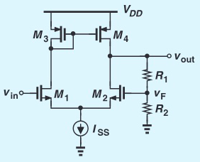

# 예제 12.10 — 차동쌍 + 저항 분배기 회로의 감지·반송 형태

## 원문
그림 12.25에서 신호를 감지하고 반송하는 형태를 결정하라.

## 조건
- 회로: Fig 12.25 능동 부하($M_3$, $M_4$ 전류 거울)를 갖는 차동쌍 $M_1$–$M_2$, 꼬리 전류원 $I_{SS}$, 출력 $v_{out}$에서 $R_1$–$R_2$ 저항 분배기, 분배기 가운데 노드 $v_F$가 $M_2$ 게이트로 이어짐
- 입력 $v_{in}$은 $M_1$ 게이트
- 소자 값은 주어지지 않음 (답은 정성적 설명) (원문에 없음)

## 구할 것
- 회로가 출력 신호를 감지하는 형태와 귀환 신호를 입력에 반송하는 형태

## 상속·참조
- 본문 12.4절 (교재 663–665쪽, 그림 크롭 안 함): 출력 전압은 출력과 병렬로 놓인 귀환 회로망(이상적으로는 무한대 입력 임피던스)으로 감지하고, 예로 그림 12.21(c)의 $R_1$–$R_2$ 저항 분배기가 출력 전압을 감지해 $v_F$를 만듦. 전압 반송은 입력과 직렬로 빼는 방식이고, 예로 그림 12.23(c)의 차동쌍이 전압 뺄셈기로 동작
- 그림 12.2: 12.1절의 비반전 증폭기 (연산 증폭기 + 저항 분배기 귀환)

## 회로 — Fig 12.25
```spice
M3   n1    n1  VDD  pmos
M4   vout  n1  VDD  pmos
M1   n1    vin n2   nmos
M2   vout  vF  n2   nmos
ISS  n2    0   {I_SS}
R1   vout  vF  {R_1}
R2   vF    0   {R_2}
```
- 단자: VDD = 전원, 값 미지정 (가로 레일) / vin = 입력 (개방 원) / vout = 출력 (개방 원)
- 표시: 노드 라벨 V_DD (레일 오른쪽 끝), v_in (입력 원 왼쪽), v_out (출력 원 오른쪽), v_F (분배기 가운데 접속점 오른쪽) / 소자 라벨 M3 (왼쪽), M4 (오른쪽), M1 (오른쪽), M2 (왼쪽), I_SS (전류원 오른쪽), R1, R2 (각 저항 오른쪽) / 부호 없음 / 화살표 없음 / 수치·면적 라벨 없음
- 배치: 맨 위 V_DD 가로 레일에 M3(좌우 반전 PMOS, 게이트 오른쪽), M4(보통 PMOS, 게이트 왼쪽)의 소스가 매달림 / 두 게이트를 잇는 가로선 가운데 접속점에서 세로선이 내려와 왼쪽으로 꺾여 M3 드레인 접속점에 닿음 (다이오드 연결) / 왼쪽 세로줄 M3 – n1 접속점 – M1(보통 NMOS, 게이트 왼쪽 ← v_in 원), 오른쪽 세로줄 M4 – vout 접속점 – M2(좌우 반전 NMOS, 게이트 오른쪽) / M1, M2 소스는 아래 가로선으로 모여 꼬리 접속점, 그 아래 I_SS(화살표 아래쪽)와 접지 / vout 접속점에서 가로선이 오른쪽으로 가서 R1 위 접속점, 다시 오른쪽 v_out 원 / 맨 오른쪽 세로줄 위→아래 R1, v_F 접속점, R2, 접지 / v_F 접속점에서 가로선이 왼쪽으로 M2 게이트 / 접속점 (세 갈래 이상, 6곳): 게이트선 가운데 (점), M3 드레인 n1 (점), M4 드레인 vout (점), R1 위 (점), v_F (점), 꼬리 n2 (점) / 교차: 없음



## 답 (검증용)
- 회로는 그림 12.2의 비반전 증폭기의 실현: 능동 부하를 갖는 차동쌍이 연산 증폭기 역할. 저항 분배기가 출력 전압을 감지하는 귀환 회로망으로 동작해 $v_F = [R_2/(R_1 + R_2)]v_{out}$을 만들고, $M_1$과 $M_2$는 연산 증폭기(순방향 시스템)의 일부이면서 전압 뺄셈기로 동작
- 따라서 그림 12.21(c)(출력 전압 감지)와 그림 12.23(c)(전압 반송·뺄셈)의 토폴로지를 조합한 것
