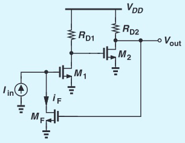

# 예제 12.11 — 트랜지스터 $M_F$ 귀환의 귀환율

## 원문
그림 12.26의 회로에 대하여 귀환율 $K$를 계산하라. $\lambda = 0$이라고 가정하라.

## 조건
- 회로: Fig 12.26 두 단 CS 증폭기 ($M_1$–$R_{D1}$, $M_2$–$R_{D2}$), 입력 전류원 $I_{in}$이 $M_1$ 게이트 노드를 구동, 출력 $V_{out}$이 귀환 트랜지스터 $M_F$의 게이트를 구동하고 $M_F$ 드레인이 입력 노드에 연결 (드레인 전류 $i_F$)
- $\lambda = 0$
- 소자 값은 주어지지 않음 (답은 소신호 파라미터 기호로) (원문에 없음)

## 구할 것
- 귀환율 $K$

## 회로 — Fig 12.26
```spice
RD1  VDD   n1    {R_D1}
RD2  VDD   Vout  {R_D2}
M1   n1    n2    0     nmos
M2   Vout  n1    0     nmos
MF   n2    Vout  0     nmos
IIN  0     n2          ; I_in (화살표 위쪽: 접지 → n2)
```
- 단자: VDD = 전원, 값 미지정 (가로 레일) / Vout = 출력 (개방 원) / 입력은 단자 없이 전류원 I_in
- 표시: 노드 라벨 V_DD (레일 오른쪽 끝), V_out (출력 원 오른쪽) / 소자 라벨 R_D1 (저항 오른쪽), R_D2 (저항 오른쪽), M1 (오른쪽), M2 (오른쪽), M_F (왼쪽), I_in (전류원 왼쪽) / 부호 없음 / 화살표 "i_F": 입력 접속점에서 M_F 드레인으로 내려가는 세로 도선, 아래 방향, 도선 위, 글자는 화살표 오른쪽 / 수치·면적 라벨 없음
- 배치: 맨 위 V_DD 가로 레일에 R_D1(왼쪽), R_D2(오른쪽)가 매달림 / 가운데 세로줄 R_D1 – n1 접속점 – M1(보통 NMOS, 게이트 왼쪽) – 접지 / 오른쪽 세로줄 R_D2 – M2 드레인 접속점 – M2(보통 NMOS, 게이트 왼쪽) – 접지, n1 접속점에서 가로선이 오른쪽 M2 게이트 / M2 드레인 접속점에서 가로선이 오른쪽으로 가서 두 번째 접속점, 다시 오른쪽 V_out 원 / 두 번째 접속점에서 세로선이 맨 아래 M_F 게이트 높이까지 내려가 왼쪽으로 꺾여 M_F 게이트 / I_in 전류원은 맨 왼쪽(아래 접지), 위 끝에서 가로선이 오른쪽 입력 접속점, 다시 오른쪽 M1 게이트 / 입력 접속점에서 세로선(i_F)이 아래로 M_F 드레인 / M_F는 좌우 반전 NMOS(게이트 오른쪽), M1 아래 왼쪽, 소스 아래 접지 / 접속점 (세 갈래 이상, 4곳): n1 (점), M2 드레인 (점), 오른쪽 Vout 갈래 (점), 입력 n2 (점) / 교차: 없음



## 답 (검증용)
- 트랜지스터 $M_F$가 출력 전압을 감지하고 입력에 전류를 반송 → $K = \dfrac{i_F}{v_{out}} = g_{mF}$ (식 12.53), $g_{mF}$는 $M_F$의 트랜스컨덕턴스
