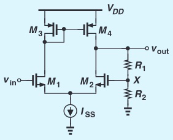

# 예제 12.12 — 차동쌍 + 저항 분배기 귀환의 극성

## 원문
그림 12.28의 회로에서 귀환의 극성을 결정하라.

## 조건
- 회로: Fig 12.28 능동 부하($M_3$, $M_4$ 전류 거울)를 갖는 차동쌍 $M_1$–$M_2$, 꼬리 전류원 $I_{SS}$, 출력 $v_{out}$에서 $R_1$–$R_2$ 저항 분배기, 분배기 가운데 노드 $X$가 $M_2$ 게이트로 이어짐
- 입력 $v_{in}$은 $M_1$ 게이트
- 소자 값은 주어지지 않음 (답은 정성적 판정) (원문에 없음)

## 구할 것
- 귀환의 극성 (부귀환인지 정귀환인지)

## 상속·참조
- 본문 12.5절 (교재 666–667쪽): 극성 결정의 세 단계 — (a) 입력 신호가 증가(감소)한다고 가정, (b) 순방향 증폭기와 귀환 회로망을 통하는 변화를 따라감, (c) 반송된 양이 입력 변화가 만든 원래의 '효과'를 방해하는지 개선하는지 결정. 다른 방법: 입력을 0으로 놓고 루프를 끊은 뒤 테스트 신호 $V_{test}$를 인가해 루프를 따라 반송된 $V_{ret}$를 보고 $V_{ret}/V_{test}$의 극성을 결정

## 회로 — Fig 12.28
```spice
M3   n1    n1  VDD  pmos
M4   vout  n1  VDD  pmos
M1   n1    vin n2   nmos
M2   vout  X   n2   nmos
ISS  n2    0   {I_SS}
R1   vout  X   {R_1}
R2   X     0   {R_2}
```
- 단자: VDD = 전원, 값 미지정 (가로 레일) / vin = 입력 (개방 원) / vout = 출력 (개방 원)
- 표시: 노드 라벨 V_DD (레일 오른쪽 끝), v_in (입력 원 왼쪽), v_out (출력 원 오른쪽), X (분배기 가운데 접속점 오른쪽) / 소자 라벨 M3 (왼쪽), M4 (오른쪽), M1 (오른쪽), M2 (왼쪽), I_SS (전류원 오른쪽), R1, R2 (각 저항 오른쪽) / 부호 없음 / 화살표 없음 / 수치·면적 라벨 없음
- 배치: 맨 위 V_DD 가로 레일에 M3(좌우 반전 PMOS, 게이트 오른쪽), M4(보통 PMOS, 게이트 왼쪽)의 소스가 매달림 / 두 게이트를 잇는 가로선의 M3 게이트 바로 오른쪽 접속점에서 세로선이 내려와 왼쪽으로 꺾여 M3 드레인 접속점에 닿음 (다이오드 연결) / 왼쪽 세로줄 M3 – n1 접속점 – M1(보통 NMOS, 게이트 왼쪽 ← v_in 원), 오른쪽 세로줄 M4 – vout 접속점 – M2(좌우 반전 NMOS, 게이트 오른쪽) / M1, M2 소스는 아래 가로선으로 모여 꼬리 접속점, 그 아래 I_SS(화살표 아래쪽)와 접지 / vout 접속점에서 가로선이 오른쪽으로 가서 R1 위 접속점, 다시 오른쪽 v_out 원 / 맨 오른쪽 세로줄 위→아래 R1, X 접속점, R2, 접지 / X 접속점에서 가로선이 왼쪽으로 M2 게이트 / 접속점 (세 갈래 이상, 6곳): 게이트선 M3 게이트 쪽 (점), M3 드레인 n1 (점), M4 드레인 vout (점), R1 위 (점), X (점), 꼬리 n2 (점) / 교차: 없음



## 답 (검증용)
- 부귀환: $V_{in}$이 증가하면 $I_{D1}$은 증가하고 $I_{D2}$는 감소하려 함 → $V_{out}$과 $V_X$가 증가하려 함. $V_X$의 증가는 $I_{D2}$를 증가시키고 $I_{D1}$을 감소시키려 하여 $V_{in}$에서의 변화의 효과를 방해함
