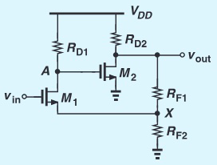

# 예제 12.13 — 두 단 CS 증폭기 + 소스 귀환 분배기의 극성

## 원문
그림 12.29의 회로에서 귀환의 극성을 결정하라.

## 조건
- 회로: Fig 12.29 두 단 CS 증폭기 ($M_1$–$R_{D1}$, 첫 단 드레인 노드 $A$가 $M_2$ 게이트, $M_2$–$R_{D2}$), 출력 $v_{out}$에서 $R_{F1}$–$R_{F2}$ 분배기, 분배기 가운데 노드 $X$가 $M_1$ 소스에 연결
- 입력 $v_{in}$은 $M_1$ 게이트
- 소자 값은 주어지지 않음 (답은 정성적 판정) (원문에 없음)

## 구할 것
- 귀환의 극성

## 상속·참조
- 본문 12.5절 (교재 666–667쪽): 극성 결정의 세 단계 — (a) 입력 신호가 증가(감소)한다고 가정, (b) 순방향 증폭기와 귀환 회로망을 통하는 변화를 따라감, (c) 반송된 양이 입력 변화가 만든 원래의 '효과'를 방해하는지 개선하는지 결정. 다른 방법: 입력을 0으로 놓고 루프를 끊은 뒤 테스트 신호 $V_{test}$를 인가해 루프를 따라 반송된 $V_{ret}$를 보고 $V_{ret}/V_{test}$의 극성을 결정

## 회로 — Fig 12.29
```spice
RD1  VDD   A     {R_D1}
RD2  VDD   vout  {R_D2}
M1   A     vin   X     nmos
M2   vout  A     0     nmos
RF1  vout  X     {R_F1}
RF2  X     0     {R_F2}
```
- 단자: VDD = 전원, 값 미지정 (가로 레일) / vin = 입력 (개방 원) / vout = 출력 (개방 원)
- 표시: 노드 라벨 V_DD (레일 오른쪽 끝), A (접속점 왼쪽), v_in (입력 원 왼쪽), v_out (출력 원 오른쪽), X (접속점 오른쪽) / 소자 라벨 R_D1, R_D2 (각 저항 오른쪽), M1 (오른쪽), M2 (오른쪽), R_F1, R_F2 (각 저항 오른쪽) / 부호 없음 / 화살표 없음 / 수치·면적 라벨 없음
- 배치: 맨 위 V_DD 가로 레일에 R_D1(왼쪽), R_D2(오른쪽)가 매달림 / 왼쪽 세로줄 R_D1 – A 접속점 – M1(보통 NMOS, 게이트 왼쪽 ← v_in 원) / A 접속점에서 가로선이 오른쪽 M2 게이트 / 가운데 세로줄 R_D2 – M2 드레인 접속점 – M2(보통 NMOS, 게이트 왼쪽) – 접지 / M2 드레인 접속점에서 가로선이 오른쪽으로 가서 vout 갈래 접속점, 다시 오른쪽 v_out 원 / 맨 오른쪽 세로줄 위→아래 vout 갈래, R_F1, X 접속점, R_F2, 접지 / M1 소스에서 세로선이 조금 내려가 오른쪽으로 꺾인 가로선이 M2 접지 아래를 지나 X 접속점에 닿음 / 접속점 (세 갈래 이상, 4곳): A (점), M2 드레인 (점), vout 갈래 (점), X (점) / 교차: 없음



## 답 (검증용)
- 부귀환: $V_{in}$이 증가하면 $I_{D1}$이 증가하려 함 → $V_A$는 떨어지고 $V_{out}$은 올라가며 $V_X$도 올라감. $V_X$의 증가는 $I_{D1}$을 감소시키려 하므로 $V_{in}$이 만든 효과를 방해함
