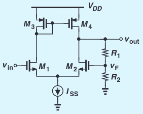

# 예제 12.15 — 능동 부하 차동쌍 + 저항 분배기 전압-전압 귀환의 폐루프 이득

## 원문
$R_1 + R_2$가 매우 크다고 가정할 때 그림 12.32에서 보여 주는 회로의 폐루프 이득을 결정하라.

## 조건
- 회로: Fig 12.32 능동 부하($M_3$, $M_4$ 전류 거울, $M_3$ 다이오드 연결)를 갖는 차동쌍 $M_1$–$M_2$, 꼬리 전류원 $I_{SS}$, 출력 $v_{out}$에서 $R_1$–$R_2$ 저항 분배기, 분배기 가운데 노드 $v_F$가 $M_2$ 게이트로 이어짐
- 입력 $v_{in}$은 $M_1$ 게이트
- 가정: $R_1 + R_2$가 매우 큼
- 소자 값은 주어지지 않음 (답은 소신호 파라미터와 $R_1$, $R_2$의 식으로) (원문에 없음)
- 식 (12.58): $\dfrac{V_{out}}{V_{in}} = \dfrac{A_0}{1 + KA_0}$ (본문 식, 전압-전압 귀환의 폐루프 이득, 원문에 없음)

## 구할 것
- 회로의 폐루프 이득 $v_{out}/v_{in}$ ($v_{out}/v_{in}$ 표기는 원문에 없음)

## 상속·참조
- 본문 12.6.1절 (교재 669–670쪽, 그림 12.31 크롭 안 함): 전압-전압 귀환은 순방향 시스템이 전압 증폭기 $A_0$이고 귀환 회로망이 출력 전압을 감지해 뺄셈기에 전압 $V_F = KV_{out}$을 반송. $V_1 = V_{in} - V_F$, $V_{out} = A_0V_1$ → 식 (12.58)
- 예제 12.10, 12.12 (교재 665, 667쪽): 같은 모양의 회로(그림 12.25, 12.28)에서 저항 분배기가 출력 전압을 감지하고 차동쌍이 전압 뺄셈기로 동작하며 귀환은 부귀환

## 회로 — Fig 12.32
```spice
M3   n1    n1  VDD  pmos
M4   vout  n1  VDD  pmos
M1   n1    vin n2   nmos
M2   vout  vF  n2   nmos
ISS  n2    0   {I_SS}
R1   vout  vF  {R_1}
R2   vF    0   {R_2}
```
- 단자: VDD = 전원, 값 미지정 (가로 레일) / vin = 입력 (개방 원) / vout = 출력 (개방 원)
- 표시: 노드 라벨 V_DD (레일 오른쪽 끝), v_in (입력 원 왼쪽), v_out (출력 원 오른쪽), v_F (분배기 가운데 접속점 오른쪽) / 소자 라벨 M3 (왼쪽), M4 (오른쪽), M1 (오른쪽), M2 (왼쪽), I_SS (전류원 오른쪽), R1, R2 (각 저항 오른쪽) / 부호 없음 / 화살표 없음 / 수치·면적 라벨 없음
- 배치: 맨 위 V_DD 가로 레일에 M3(좌우 반전 PMOS, 게이트 오른쪽), M4(보통 PMOS, 게이트 왼쪽)의 소스가 매달림 / 두 게이트를 잇는 가로선의 M3 게이트 바로 오른쪽 접속점에서 세로선이 내려와 왼쪽으로 꺾여 M3 드레인 접속점에 닿음 (다이오드 연결) / 왼쪽 세로줄 M3 – n1 접속점 – M1(보통 NMOS, 게이트 왼쪽 ← v_in 원), 오른쪽 세로줄 M4 – vout 접속점 – M2(좌우 반전 NMOS, 게이트 오른쪽) / M1, M2 소스는 아래 가로선으로 모여 꼬리 접속점, 그 아래 I_SS(화살표 아래쪽)와 접지 / vout 접속점에서 가로선이 오른쪽으로 가서 R1 위 접속점, 다시 오른쪽 v_out 원 / 맨 오른쪽 세로줄 위→아래 R1, v_F 접속점, R2, 접지 / v_F 접속점에서 가로선이 왼쪽으로 M2 게이트 / 접속점 (세 갈래 이상, 6곳): 게이트선 M3 게이트 쪽 (점), M3 드레인 n1 (점), M4 드레인 vout (점), R1 위 (점), v_F (점), 꼬리 n2 (점) / 교차: 없음



## 답 (검증용)
- 부 전압-전압 귀환: 저항 분배기가 높은 임피던스로 $V_{out}$을 감지해 $M_2$ 게이트에 전압을 반송하고, $M_1$과 $M_2$는 순방향 시스템의 입력단이자 뺄셈기. 개루프 이득 $A_0 = g_{mN}(r_{ON} \parallel r_{OP})$ (식 12.59, 아래첨자 $N$, $P$는 NMOS, PMOS), $K = R_2/(R_1 + R_2)$
- $\dfrac{V_{out}}{V_{in}} = \dfrac{g_{mN}(r_{ON} \parallel r_{OP})}{1 + \dfrac{R_2}{R_1 + R_2}g_{mN}(r_{ON} \parallel r_{OP})}$ (식 12.60). 루프 이득이 1보다 충분히 크면 $\approx 1/K = 1 + R_1/R_2$
