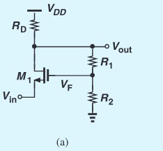
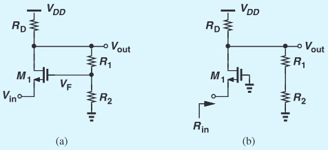

# 예제 12.16 — 저항 분배기 귀환 CG 단의 폐루프 입력 임피던스

## 원문
$R_1 + R_2$가 매우 클 때 그림 12.34(a)에 나와 있는 단의 입력 임피던스를 결정하라.

## 조건
- 회로: Fig 12.34(a) 공통 게이트 단 $M_1$ (NMOS): 소스는 입력 $V_{in}$, 드레인은 $R_D$를 거쳐 $V_{DD}$이고 출력 $V_{out}$, 게이트는 $V_{out}$과 접지 사이 $R_1$–$R_2$ 분배기의 가운데 노드 $V_F$
- 가정: $R_1 + R_2$가 매우 큼
- 소자 값은 주어지지 않음 (답은 $g_m$, $R_D$, $R_1$, $R_2$의 식으로) (원문에 없음)
- 식 (12.63): $\dfrac{V_{in}}{I_{in}} = R_{in}(1 + KA_0)$ (본문 식, 전압-전압 귀환의 폐루프 입력 임피던스, $R_{in}$은 순방향 증폭기의 개루프 입력 저항, 원문에 없음)

## 구할 것
- 단의 (폐루프) 입력 임피던스 (괄호 안은 원문에 없음)

## 상속·참조
- 본문 12.6.1절 (교재 671쪽, 그림 12.33 크롭 안 함): 귀환 회로망은 이상적, 순방향 시스템은 유한한 입력 저항 $R_{in}$을 갖는 전압 증폭기 $A_0$로 둠. $I_{in}R_{in} = V_{in} - V_F = V_{in} - (I_{in}R_{in})A_0K$ (식 12.61, 12.62) → 식 (12.63). 전압 증폭기의 부귀환은 입력 임피던스를 $1 + KA_0$배 증가시킴

## 회로 — Fig 12.34(a)
```spice
RD  VDD   Vout  {R_D}
M1  Vout  VF    Vin  nmos
R1  Vout  VF    {R_1}
R2  VF    0     {R_2}
```
- 단자: VDD = 전원, 값 미지정 (T 전원 기호) / Vin = 입력, M1 소스 (개방 원) / Vout = 출력 (개방 원)
- 표시: 노드 라벨 V_DD (T 기호 오른쪽), V_out (출력 원 오른쪽), V_in (입력 원 왼쪽), V_F (게이트 가로선 아래, 게이트와 R1–R2 접속점 사이) / 소자 라벨 R_D (저항 왼쪽), M1 (트랜지스터 왼쪽, 소스 화살표 왼쪽 위), R1, R2 (각 저항 오른쪽) / 부호 없음 / 화살표 없음 / 수치·면적 라벨 없음
- 배치: 왼쪽 세로줄 위→아래 V_DD T 기호, R_D, 드레인 접속점, M1 / M1은 좌우 반전된 NMOS (게이트가 오른쪽, 드레인·소스 인출선이 왼쪽, 소스 화살표는 채널에서 왼쪽 바깥을 향함) / 소스에서 세로선이 아래로 내려가 왼쪽으로 꺾여 V_in 원에서 끝남 / 드레인 접속점에서 가로선이 오른쪽으로 가 R1 위 접속점을 지나 V_out 원까지 / 오른쪽 세로줄 위→아래 R1 위 접속점, R1, V_F 접속점, R2, 접지 / M1 게이트에서 가로선이 오른쪽으로 곧장 V_F 접속점 / 접속점 (세 갈래 이상, 3곳): 드레인 = 위 R_D + 아래 M1 드레인 + 오른쪽 가로선 (점), R1 위 = 왼쪽 가로선 + 아래 R1 + 오른쪽 V_out 선 (점), V_F = 위 R1 + 아래 R2 + 왼쪽 게이트 선 (점) / 교차: 없음



## 답 (검증용)
- 루프를 열기 위해 $M_1$의 게이트를 귀환 신호에서 끊고 접지에 연결 (Fig 12.34(b)) → 개루프 $R_{in} = 1/g_m$ (식 12.64)
- 폐루프 입력 임피던스 $\dfrac{V_{in}}{I_{in}} = \dfrac{1}{g_m}\left(1 + \dfrac{R_2}{R_1 + R_2}g_mR_D\right)$ (식 12.65)

### 정답 회로 — Fig 12.34(b)
```spice
RD  VDD   Vout  {R_D}
M1  Vout  0     out  nmos   ; 게이트 접지
R1  Vout  n1    {R_1}
R2  n1    0     {R_2}
```
- 단자: VDD = 전원, 값 미지정 (T 전원 기호) / out = 입력 쪽 측정 단자, M1 소스 (개방 원) / Vout = 출력 (개방 원)
- 표시: 노드 라벨 V_DD (T 기호 오른쪽), V_out (출력 원 오른쪽) / 소자 라벨 R_D (저항 왼쪽), M1 (트랜지스터 왼쪽), R1, R2 (각 저항 오른쪽) / 부호 없음 / 화살표 "R_in": 소스 쪽 개방 원을 회로 쪽으로 들여다봄, 오른쪽 방향, 도선 옆 별도 화살표 (┌ 꺾임: 아래 R_in 글자에서 세로선이 올라가 위 끝에서 오른쪽으로 꺾이고 화살촉은 오른쪽 끝, 개방 원 왼쪽 아래) / 수치·면적 라벨 없음
- 배치: (a)와 같은 V_DD–R_D–드레인 접속점–M1 세로줄, M1 좌우 반전 NMOS / M1 게이트에서 짧은 가로선이 오른쪽으로 가 아래로 꺾여 접지 기호 (게이트 접지) / 소스에서 세로선이 내려가 왼쪽으로 꺾여 개방 원에서 끝남 (V_in 라벨 없음) / 드레인 접속점에서 가로선이 오른쪽으로 R1 위 접속점을 지나 V_out 원까지 / 오른쪽 세로줄 위→아래 R1 위 접속점, R1, R2, 접지 (R1–R2 사이 n1은 두 저항만 이어짐, 게이트 선 없음) / 접속점 (세 갈래 이상, 2곳): 드레인 = 위 R_D + 아래 M1 드레인 + 오른쪽 가로선 (점), R1 위 = 왼쪽 가로선 + 아래 R1 + 오른쪽 V_out 선 (점) / 교차: 없음


