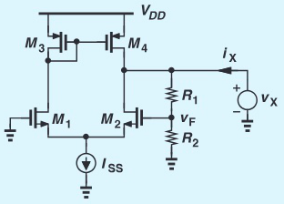

# 예제 12.17 — 능동 부하 차동쌍 + 저항 분배기 전압-전압 귀환의 폐루프 출력 임피던스

## 원문
$R_1 + R_2$가 매우 클 때 그림 12.36 회로의 출력 임피던스를 계산하라.

## 조건
- 회로: Fig 12.36 예제 12.15(Fig 12.32)와 같은 능동 부하 차동쌍 귀환 회로에서 입력 $M_1$ 게이트를 접지하고, 출력 노드에 테스트 전압원 $v_X$를 연결해 흘러 들어가는 전류 $i_X$를 봄 (예제 12.15와의 비교는 원문에 없음)
  - $M_3$(다이오드 연결)–$M_4$ PMOS 전류 거울 능동 부하, 차동쌍 $M_1$–$M_2$, 꼬리 전류원 $I_{SS}$
  - 출력 노드($M_4$ 드레인)와 접지 사이 $R_1$–$R_2$ 분배기, 가운데 노드 $v_F$가 $M_2$ 게이트로
- 가정: $R_1 + R_2$가 매우 큼
- 소자 값은 주어지지 않음 (답은 소신호 파라미터와 $R_1$, $R_2$의 식으로) (원문에 없음)
- 식 (12.67): $\dfrac{V_X}{I_X} = \dfrac{R_{out}}{1 + KA_0}$ (본문 식, 전압-전압 귀환의 폐루프 출력 임피던스, $R_{out}$은 순방향 증폭기의 개루프 출력 저항, 원문에 없음)

## 구할 것
- 회로의 폐루프 출력 임피던스 $v_X/i_X$ ("폐루프"와 $v_X/i_X$ 표기는 원문에 없음)

## 상속·참조
- 본문 12.6.1절 (교재 672쪽, 그림 12.35 크롭 안 함): 순방향 증폭기가 출력 임피던스 $R_{out}$을 가질 때, $A_0$ 입력의 오차 신호 $-V_F = -KV_X$, $A_0$ 출력 전압 $-KA_0V_X$ → $I_X = \dfrac{V_X - (-KA_0V_X)}{R_{out}}$ (식 12.66, 귀환 회로망이 빨아들이는 전류는 무시) → 식 (12.67). 출력 전압을 감지하는 부귀환은 출력 임피던스를 $1 + KA_0$배 낮춤
- 예제 12.15 (E12.15): 같은 회로(Fig 12.32)의 개루프 이득 $A_0 = g_{mN}(r_{ON} \parallel r_{OP})$ (식 12.59), $K = R_2/(R_1 + R_2)$

## 회로 — Fig 12.36
```spice
M3   n1    n1  VDD  pmos
M4   n3    n1  VDD  pmos
M1   n1    0   n2   nmos   ; 게이트 접지
M2   n3    vF  n2   nmos
ISS  n2    0   {I_SS}
R1   n3    vF  {R_1}
R2   vF    0   {R_2}
VX   n3    0   {v_X}
```
- 단자: VDD = 전원, 값 미지정 (가로 레일) / v_X = 테스트 전압원, 출력 노드 n3를 구동 (개방 단자 없음)
- 표시: 노드 라벨 V_DD (레일 오른쪽 끝), v_F (분배기 가운데 접속점 오른쪽) / 소자 라벨 M3 (왼쪽), M4 (오른쪽), M1 (오른쪽), M2 (왼쪽), I_SS (전류원 오른쪽), R1, R2 (각 저항 오른쪽), v_X (전압원 원 오른쪽) / 부호 v_X 원 왼쪽 위 +, 왼쪽 아래 − / 화살표 "i_X": v_X에서 R1 위 접속점으로 가는 가로 도선, 왼쪽 방향(회로 쪽으로), 도선 위, 글자는 화살표 위 / 수치·면적 라벨 없음
- 배치: 맨 위 V_DD 가로 레일에 M3(좌우 반전 PMOS, 게이트 오른쪽), M4(보통 PMOS, 게이트 왼쪽)의 소스가 매달림 / 두 게이트를 잇는 가로선의 M3 게이트 바로 오른쪽 접속점에서 세로선이 내려와 왼쪽으로 꺾여 M3 드레인 접속점에 닿음 (다이오드 연결) / 왼쪽 세로줄 M3 – n1 접속점 – M1(보통 NMOS, 게이트 왼쪽), 오른쪽 세로줄 M4 – n3 접속점 – M2(좌우 반전 NMOS, 게이트 오른쪽) / M1 게이트에서 가로선이 왼쪽으로 가 아래로 꺾여 접지 기호 / M1, M2 소스는 아래 가로선으로 모여 꼬리 접속점, 그 아래 I_SS(화살표 아래쪽)와 접지 / n3 접속점에서 가로선이 오른쪽으로 R1 위 접속점을 지나 오른쪽 끝에서 아래로 꺾여 v_X 위 단자, v_X 아래 접지 / R1 오른쪽 세로줄 위→아래 R1 위 접속점, R1, v_F 접속점, R2, 접지 / v_F 접속점에서 가로선이 왼쪽으로 M2 게이트 / 접속점 (세 갈래 이상, 6곳): 게이트선 M3 게이트 쪽 (점), M3 드레인 n1 (점), M4 드레인 n3 (점), R1 위 (점), v_F (점), 꼬리 n2 (점) / 교차: 없음


> 참고: 문제 문장은 교재 672쪽 아래에 있고, 그림 12.36은 다음 쪽(673쪽, 같은 PDF 17 오른쪽) 위에 인쇄됨

## 답 (검증용)
- 예제 12.15에서 개루프 출력 임피던스 $r_{ON} \parallel r_{OP}$, $KA_0 = \dfrac{R_2}{R_1 + R_2}g_{mN}(r_{ON} \parallel r_{OP})$ → $R_{out,closed} = \dfrac{r_{ON} \parallel r_{OP}}{1 + \dfrac{R_2}{R_1 + R_2}g_{mN}(r_{ON} \parallel r_{OP})}$ (식 12.68)
- 루프 이득이 1보다 훨씬 크면 $R_{out,closed} \approx \left(1 + \dfrac{R_1}{R_2}\right)\dfrac{1}{g_{mN}}$ (식 12.69), $r_{ON}$, $r_{OP}$와 무관
