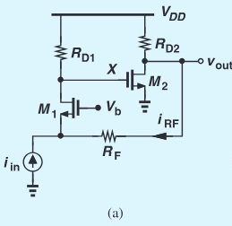
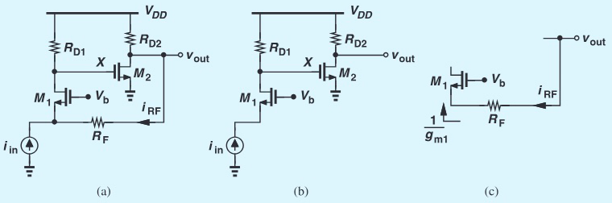

# 예제 12.18 — 2단 트랜스임피던스 증폭기의 귀환 극성, 개루프·폐루프 이득

## 원문
그림 12.38(a)의 회로에서 $\lambda = 0$과 $R_F$가 매우 크다고 가정하고, (a) 귀환이 부귀환임을 증명하라. (b) 개루프 이득을 계산하라. (c) 폐루프 이득을 계산하라.

## 조건
- 회로: Fig 12.38(a) 2단 증폭기
  - 첫째 단: $M_1$ (NMOS) 공통 게이트, 게이트는 바이어스 $V_b$, 드레인 $X$는 $R_{D1}$을 거쳐 $V_{DD}$, 소스는 입력 전류원 $i_{in}$에 연결
  - 둘째 단: $M_2$ (NMOS) 공통 소스, 게이트 $X$, 소스 접지, 드레인은 $R_{D2}$를 거쳐 $V_{DD}$이고 출력 $v_{out}$
  - 귀환: $v_{out}$과 $M_1$ 소스(입력 노드) 사이 $R_F$, $R_F$에 흐르는 전류 $i_{RF}$ ($v_{out}$ 쪽에서 입력 노드 쪽으로)
- 가정: $\lambda = 0$, $R_F$가 매우 큼
- 소자 값은 주어지지 않음 (답은 $g_m$, 저항의 식으로) (원문에 없음)
- 식 (12.72): $\dfrac{V_{out}}{I_{in}} = \dfrac{R_0}{1 + KR_0}$ (본문 식, 전압-전류 귀환의 폐루프 이득, $R_0$은 순방향 트랜스임피던스 증폭기의 개루프 이득, $K = I_F/V_{out}$, 원문에 없음)

## 구할 것
- (a) 귀환이 부귀환임을 증명
- (b) 개루프 이득
- (c) 폐루프 이득

## 상속·참조
- 본문 12.6.2절 (교재 674–675쪽, 그림 12.37 크롭 안 함): 전압-전류 귀환은 순방향 시스템이 트랜스임피던스 증폭기 $R_0$이고, 귀환 회로망이 출력 전압을 감지해 뺄셈기에 전류 $I_F = KV_{out}$을 반송 (귀환율 $K$는 컨덕턴스 차원). $I_e = I_{in} - I_F$, $V_{out} = I_eR_0$ → $V_{out} = (I_{in} - KV_{out})R_0$ (식 12.70, 12.71) → 식 (12.72). 그림 12.37에서 $I_F$는 입력 노드에서 귀환 회로망 $K$ 쪽으로 흘러 나가는 방향으로 그려짐

## 회로 — Fig 12.38(a)
```spice
RD1  VDD   X     {R_D1}
RD2  VDD   vout  {R_D2}
M2   vout  X     0     nmos
M1   X     Vb    n1    nmos
Iin  0     n1    {i_in}
RF   vout  n1    {R_F}
```
- 단자: VDD = 전원, 값 미지정 (가로 레일) / Vb = 이상적 DC 바이어스, 값 미지정 (점 단자) / vout = 출력 (개방 원)
- 표시: 노드 라벨 V_DD (레일 오른쪽 끝), X (X–M2 게이트 가로선 위, M2 게이트 가까이), V_b (점 단자 오른쪽), v_out (출력 원 오른쪽) / 소자 라벨 R_D1 (저항 오른쪽), R_D2 (저항 오른쪽), M2 (트랜지스터 오른쪽), M1 (트랜지스터 왼쪽), i_in (전류원 왼쪽), R_F (저항 아래) / 부호 없음 / 화살표 "i_RF": 아래 가로 도선(R_F 오른쪽 끝과 오른쪽 모서리 사이), 왼쪽 방향(v_out 쪽에서 R_F 쪽으로), 도선 위, 글자는 화살표 위 / 수치·면적 라벨 없음
- 배치: 맨 위 V_DD 가로 레일 / 왼쪽 세로줄 위→아래 R_D1, X 접속점, M1, 입력 접속점(n1) / M1은 좌우 반전된 NMOS (게이트가 오른쪽 → 가로선 → V_b 점 단자, 드레인·소스 인출선이 왼쪽, 소스 화살표는 채널에서 왼쪽 바깥을 향함) / X 접속점에서 가로선이 오른쪽으로 곧장 M2 게이트 / 오른쪽 세로줄 위→아래 R_D2, 드레인 접속점, M2(보통 NMOS, 게이트 왼쪽), 소스 아래 접지 / 드레인 접속점에서 가로선이 오른쪽으로 귀환 접속점을 지나 v_out 원까지 / 귀환 접속점에서 세로선이 아래로 내려가 아래 가로선 높이에서 왼쪽으로 꺾여 R_F를 지나 n1 접속점 / n1 접속점에서 왼쪽으로 가로선이 가서 아래로 꺾여 i_in 전류원(화살표 위쪽) 위 단자, 전류원 아래 접지 / 접속점 (세 갈래 이상, 4곳): X = 위 R_D1 + 아래 M1 드레인 + 오른쪽 M2 게이트 선 (점), M2 드레인 = 위 R_D2 + 아래 M2 + 오른쪽 가로선 (점), 귀환 접속점 = 왼쪽 가로선 + 오른쪽 v_out 선 + 아래 귀환선 (점), n1 = 위 M1 소스 + 왼쪽 i_in 선 + 오른쪽 R_F (점) / 교차: 없음



## 답 (검증용)
- (a) $I_{in}$이 증가하면 $I_{D1}$이 감소하고 $V_X$가 증가 → $V_{out}$이 감소하고 $I_{RF}$가 감소. $I_{in}$과 $R_F$가 입력 노드로 주입하는 전류가 반대 방향으로 변하므로 부귀환
- (b) 귀환 회로망이 없는 순방향 증폭기 (Fig 12.38(b), $R_F$가 매우 큼): $R_0 = R_{D1}(-g_{m2}R_{D2})$ (식 12.73), 둘째 단 이득이 $-g_{m2}R_{D2}$가 되도록 $R_F \gg R_{D2}$를 가정
- (c) Fig 12.38(c)에서 $I_{RF} = \dfrac{V_{out}}{R_F + 1/g_{m1}}$ (식 12.74), $R_F \gg 1/g_{m1}$이면 $I_{RF} \approx V_{out}/R_F$ → $K = -1/R_F$ (음의 부호는 그림 12.37의 전류 방향 기준). 폐루프 이득 $\left.\dfrac{V_{out}}{I_{in}}\right|_{closed} = \dfrac{-g_{m2}R_{D1}R_{D2}}{1 + \dfrac{g_{m2}R_{D1}R_{D2}}{R_F}}$ (식 12.75), $g_{m2}R_{D1}R_{D2} \gg R_F$이면 $-R_F$로 감소

### 정답 회로 — Fig 12.38(b)
```spice
RD1  VDD   X     {R_D1}
RD2  VDD   vout  {R_D2}
M2   vout  X     0     nmos
M1   X     Vb    n1    nmos
Iin  0     n1    {i_in}
```
- 단자: VDD = 전원, 값 미지정 (가로 레일) / Vb = 이상적 DC 바이어스, 값 미지정 (점 단자) / vout = 출력 (개방 원)
- 표시: 노드 라벨 V_DD (레일 오른쪽 끝), X (X–M2 게이트 가로선 위, M2 게이트 가까이), V_b (점 단자 오른쪽), v_out (출력 원 오른쪽) / 소자 라벨 R_D1, R_D2 (각 저항 오른쪽), M2 (트랜지스터 오른쪽), M1 (트랜지스터 왼쪽), i_in (전류원 왼쪽) / 부호 없음 / 화살표 없음 / 수치·면적 라벨 없음
- 배치: (a)에서 R_F와 귀환선을 뺀 모양 / 왼쪽 세로줄 R_D1, X 접속점, M1(좌우 반전 NMOS, 게이트 오른쪽 → V_b), M1 소스에서 세로선이 내려가 왼쪽으로 꺾이고 다시 아래로 꺾여 i_in 전류원(화살표 위쪽), 아래 접지 / 오른쪽 세로줄 R_D2, 드레인 접속점, M2, 접지 / 드레인 접속점에서 가로선이 오른쪽 v_out 원까지 / 접속점 (세 갈래 이상, 2곳): X = 위 R_D1 + 아래 M1 드레인 + 오른쪽 M2 게이트 선 (점), M2 드레인 = 위 R_D2 + 아래 M2 + 오른쪽 v_out 선 (점) / 교차: 없음

### 정답 회로 — Fig 12.38(c)
```spice
M1   n1    Vb    n2    nmos   ; 드레인 n1은 위로 짧게 뻗은 선 끝
RF   n2    vout  {R_F}
```
- 단자: Vb = 이상적 DC 바이어스, 값 미지정 (점 단자) / vout = 출력 (개방 원) / n1 = M1 드레인 (선 끝, 나머지 회로 생략) / vout 접속점 왼쪽으로 짧은 가로선 (선 끝, 나머지 회로 생략)
- 표시: 노드 라벨 V_b (점 단자 오른쪽), v_out (출력 원 오른쪽) / 소자 라벨 M1 (트랜지스터 왼쪽), R_F (저항 아래) / 부호 없음 / 화살표 "i_RF": 아래 가로 도선(R_F 오른쪽 끝과 오른쪽 모서리 사이), 왼쪽 방향(v_out 쪽에서 R_F 쪽으로), 도선 위, 글자는 화살표 위 / 화살표 "1/g_m1": M1 소스 노드를 들여다봄, 위쪽 방향, 도선 옆 별도 화살표 (L자: 세로선 아래 끝에서 짧은 가로선이 오른쪽으로 뻗고 화살촉은 위 끝, M1 소스 모서리 왼쪽 아래), 글자 1/g_m1은 분수 모양으로 화살표 왼쪽 아래 / 수치·면적 라벨 없음
- 배치: 왼쪽에 M1(좌우 반전 NMOS, 게이트 오른쪽 → 가로선 → V_b 점 단자), 드레인 인출선은 위로 짧게 뻗어 끝남 / M1 소스에서 세로선이 내려가 오른쪽으로 꺾여 R_F를 지나 오른쪽 끝에서 위로 올라가 위쪽 접속점 / 위쪽 접속점은 왼쪽 짧은 가로선(선 끝) + 오른쪽 v_out 원 + 아래 귀환선 (점) / 교차: 없음


