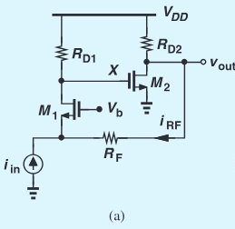

# 예제 12.19 — 트랜스임피던스 증폭기(예제 12.18)의 폐루프 입력 임피던스

## 원문
예제 12.18에서 배운 회로의 폐루프 입력 임피던스를 결정하라.

## 조건
- 예제 12.18의 회로: Fig 12.38(a) ($M_1$ 공통 게이트 첫째 단(게이트 $V_b$, 드레인 $X$ – $R_{D1}$ – $V_{DD}$, 소스 = 입력 노드, 입력 전류원 $i_{in}$), $M_2$ 공통 소스 둘째 단(게이트 $X$, 드레인 $v_{out}$ – $R_{D2}$ – $V_{DD}$), $v_{out}$과 입력 노드 사이 귀환 저항 $R_F$)
- 예제 12.18의 가정을 이어받음: $\lambda = 0$, $R_F$가 매우 큼 (원문에 없음)
- 소자 값은 주어지지 않음 (답은 $g_m$, 저항의 식으로) (원문에 없음)
- 식 (12.78): $\dfrac{V_X}{I_X} = \dfrac{R_{in}}{1 + KR_0}$ (본문 식, 전압-전류 귀환의 폐루프 입력 임피던스, $R_{in}$은 순방향 증폭기의 개루프 입력 임피던스, 원문에 없음)
- 예제 12.18의 결과: $R_0 = R_{D1}(-g_{m2}R_{D2})$, $K = -1/R_F$, 폐루프 이득의 분모 $1 + KR_0 = 1 + \dfrac{g_{m2}R_{D1}R_{D2}}{R_F}$ (식 12.75) (원문에 없음)

## 구할 것
- 회로의 폐루프 입력 임피던스

## 상속·참조
- 예제 12.18 (E12.18): 개루프(순방향) 증폭기는 Fig 12.38(b) ($R_F$를 뗀 회로, $R_F$가 매우 크다는 가정), 개루프 이득 $R_0 = R_{D1}(-g_{m2}R_{D2})$ (식 12.73, $R_F \gg R_{D2}$ 가정), 귀환율 $K = -1/R_F$ ($R_F \gg 1/g_{m1}$ 가정), 폐루프 이득 $\left.\dfrac{V_{out}}{I_{in}}\right|_{closed} = \dfrac{-g_{m2}R_{D1}R_{D2}}{1 + \dfrac{g_{m2}R_{D1}R_{D2}}{R_F}}$ (식 12.75), 분모가 $1 + KR_0$
- 본문 12.6.2절 (교재 676쪽, 그림 12.39 크롭 안 함): 순방향 시스템을 유한한 입력 임피던스 $R_{in}$을 갖는 이상적인 트랜스임피던스 증폭기 $R_0$로 모델링하고 입력 노드에 테스트 전류원 $I_X$를 둠. $I_F = K\dfrac{V_X}{R_{in}}R_0$ (식 12.76), 입력 노드 KCL $I_X - K\dfrac{V_X}{R_{in}}R_0 = \dfrac{V_X}{R_{in}}$ (식 12.77) → 식 (12.78). 전류를 반송하는 귀환 루프는 입력 임피던스를 $1 + KR_0$배 감소시킴

## 회로 — Fig 12.38(a)
```spice
RD1  VDD   X     {R_D1}
RD2  VDD   vout  {R_D2}
M2   vout  X     0     nmos
M1   X     Vb    n1    nmos
Iin  0     n1    {i_in}
RF   vout  n1    {R_F}
```
- 단자: VDD = 전원, 값 미지정 (가로 레일) / Vb = 이상적 DC 바이어스, 값 미지정 (점 단자) / vout = 출력 (개방 원)
- 표시: 노드 라벨 V_DD (레일 오른쪽 끝), X (X–M2 게이트 가로선 위, M2 게이트 가까이), V_b (점 단자 오른쪽), v_out (출력 원 오른쪽) / 소자 라벨 R_D1 (저항 오른쪽), R_D2 (저항 오른쪽), M2 (트랜지스터 오른쪽), M1 (트랜지스터 왼쪽), i_in (전류원 왼쪽), R_F (저항 아래) / 부호 없음 / 화살표 "i_RF": 아래 가로 도선(R_F 오른쪽 끝과 오른쪽 모서리 사이), 왼쪽 방향(v_out 쪽에서 R_F 쪽으로), 도선 위, 글자는 화살표 위 / 수치·면적 라벨 없음
- 배치: 맨 위 V_DD 가로 레일 / 왼쪽 세로줄 위→아래 R_D1, X 접속점, M1, 입력 접속점(n1) / M1은 좌우 반전된 NMOS (게이트가 오른쪽 → 가로선 → V_b 점 단자, 드레인·소스 인출선이 왼쪽, 소스 화살표는 채널에서 왼쪽 바깥을 향함) / X 접속점에서 가로선이 오른쪽으로 곧장 M2 게이트 / 오른쪽 세로줄 위→아래 R_D2, 드레인 접속점, M2(보통 NMOS, 게이트 왼쪽), 소스 아래 접지 / 드레인 접속점에서 가로선이 오른쪽으로 귀환 접속점을 지나 v_out 원까지 / 귀환 접속점에서 세로선이 아래로 내려가 아래 가로선 높이에서 왼쪽으로 꺾여 R_F를 지나 n1 접속점 / n1 접속점에서 왼쪽으로 가로선이 가서 아래로 꺾여 i_in 전류원(화살표 위쪽) 위 단자, 전류원 아래 접지 / 접속점 (세 갈래 이상, 4곳): X = 위 R_D1 + 아래 M1 드레인 + 오른쪽 M2 게이트 선 (점), M2 드레인 = 위 R_D2 + 아래 M2 + 오른쪽 가로선 (점), 귀환 접속점 = 왼쪽 가로선 + 오른쪽 v_out 선 + 아래 귀환선 (점), n1 = 위 M1 소스 + 왼쪽 i_in 선 + 오른쪽 R_F (점) / 교차: 없음


> 참고: 그림 12.38은 예제 12.18의 그림으로 교재 675쪽(PDF 18 오른쪽)에 인쇄됨

## 답 (검증용)
- 개루프 증폭기(Fig 12.38(b))는 $R_F$가 매우 크다는 가정 때문에 입력 임피던스 $R_{in} = 1/g_{m1}$
- 식 (12.75)의 분모가 $1 + KR_0$이므로 $R_{in,closed} = \dfrac{1}{g_{m1}} \cdot \dfrac{1}{1 + \dfrac{g_{m2}R_{D1}R_{D2}}{R_F}}$ (식 12.79)
