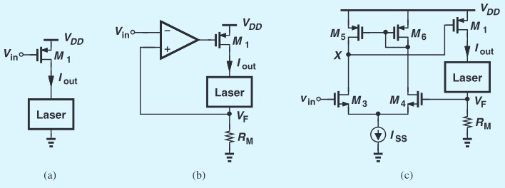
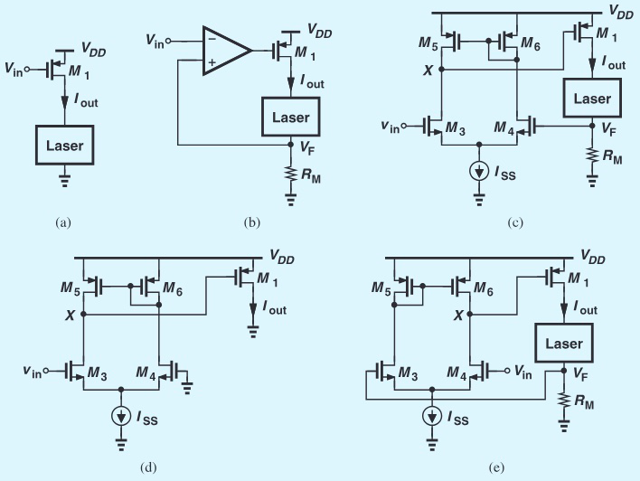

# 예제 12.21 — 레이저 다이오드 전류의 감시: 연산 증폭기 귀환과 트랜지스터 레벨 전류-전압 귀환

## 원문
그림 12.42(a)의 레이저 다이오드에 잘 정의된 전류를 공급하려 한다. 그러나 $M_1$의 트랜스컨덕턴스는 불완전하게 조절된다. 이런 이유로 작은 저항 $R_M$을 직렬로 삽입하고 $R_M$ 양단의 전압을 감지하며 결과를 연산 증폭기의 입력에 반송함으로써 전류를 ‘감시’한다[그림 12.42(b)]. 연산 증폭기가 매우 높은 이득을 가질 때 $I_{out}$을 추정하라. 그림 12.42(c)의 회로에 대해 폐루프 이득을 계산하라.

## 조건
- 회로: Fig 12.42 (a)–(c)
  - (a) PMOS $M_1$ (게이트 = 입력 $V_{in}$, 소스 = $V_{DD}$)이 레이저 다이오드("Laser" 상자, 아래 접지)에 드레인 전류 $I_{out}$을 공급
  - (b) $M_1$ 드레인과 접지 사이에 레이저와 작은 저항 $R_M$을 직렬로 넣음. $R_M$ 양단 전압 $V_F$를 연산 증폭기의 + 입력에 반송, − 입력은 $V_{in}$, 연산 증폭기 출력이 $M_1$ 게이트를 구동
  - (c) (b)의 연산 증폭기를 트랜지스터 레벨로 실현: 차동쌍 $M_3$(게이트 $v_{in}$)–$M_4$(게이트 $V_F$), 꼬리 전류원 $I_{SS}$, PMOS 전류 거울 능동 부하 $M_5$–$M_6$ ($M_6$ 다이오드 연결), $M_3$ 드레인 노드 $X$가 $M_1$ 게이트를 구동, $M_1$ 드레인 – 레이저 – $V_F$ – $R_M$ – 접지
- (b)에서 연산 증폭기의 이득이 매우 높다고 가정
- $M_1$의 트랜스컨덕턴스는 불완전하게 조절됨 (원문의 설명)
- 소자 값은 주어지지 않음 (답은 소신호 파라미터와 $R_M$의 식으로) (원문에 없음)
- 식 (12.85): $\dfrac{I_{out}}{V_{in}} = \dfrac{G_m}{1 + KG_m}$ (본문 식, 전류-전압 귀환의 폐루프 이득, $G_m$은 순방향 트랜스컨덕턴스 증폭기의 개루프 이득, $K = V_F/I_{out}$, 원문에 없음)

## 구할 것
- (b)에서 연산 증폭기의 이득이 매우 높을 때 $I_{out}$ 추정
- (c) 회로의 폐루프 이득 $I_{out}/V_{in}$ (괄호 안은 원문에 없음)

## 상속·참조
- 본문 12.6.3절 (교재 678쪽, 그림 12.41 크롭 안 함): 전류-전압 귀환은 순방향 시스템이 트랜스컨덕턴스 증폭기 $G_m$이고, 귀환 회로망이 출력 전류를 감지해 뺄셈기에 전압 $V_F = KI_{out}$을 반송 (귀환율 $K$는 저항 차원). $I_{out} = G_m(V_{in} - KI_{out})$ (식 12.84) → 식 (12.85). 귀환 회로망은 출력과 입력에 직렬로 나타나고 이상적으로는 입력·출력 임피던스가 0

## 회로 — Fig 12.42(a)
```spice
M1  n1  Vin  VDD  pmos
XL  n1  0    box "Laser"   ; 레이저 다이오드 (상자로 그려짐)
```
- 단자: VDD = 전원, 값 미지정 (T 전원 기호) / Vin = 입력 (개방 원)
- 표시: 노드 라벨 V_DD (T 기호 오른쪽), V_in (입력 원 왼쪽) / 소자 라벨 M1 (트랜지스터 오른쪽), "Laser" (상자 안) / 부호 없음 / 화살표 "I_out": M1 드레인에서 레이저 상자로 가는 세로 도선, 아래 방향, 도선 위, 글자는 화살표 오른쪽 / 수치·면적 라벨 없음
- 배치: 한 세로줄 위→아래 V_DD T 기호, M1(보통 PMOS, 게이트 왼쪽, 소스 위), I_out 화살표, Laser 상자, 접지 / V_in 원에서 가로선이 오른쪽으로 M1 게이트 / 접속점: 없음 / 교차: 없음

## 회로 — Fig 12.42(b)
```spice
XA  VF  Vin  n1  opamp
M1  n2  n1   VDD  pmos
XL  n2  VF   box "Laser"   ; 레이저 다이오드 (상자로 그려짐)
RM  VF  0    {R_M}
```
- 단자: VDD = 전원, 값 미지정 (T 전원 기호) / Vin = 입력 (개방 원)
- 표시: 노드 라벨 V_in (입력 원 왼쪽), V_DD (T 기호 오른쪽), V_F (V_F 접속점 오른쪽) / 소자 라벨 M1 (트랜지스터 오른쪽), "Laser" (상자 안), R_M (저항 오른쪽) / 부호 연산 증폭기 입력 − 위, + 아래 (삼각형 안) / 화살표 "I_out": M1 드레인에서 레이저 상자로 가는 세로 도선, 아래 방향, 도선 위, 글자는 화살표 오른쪽 / 수치·면적 라벨 없음
- 배치: 왼쪽에 오른쪽을 향한 연산 증폭기 삼각형 / V_in 원에서 가로선이 오른쪽으로 − 입력 / 연산 증폭기 출력에서 가로선이 오른쪽으로 M1 게이트 / 오른쪽 세로줄 위→아래 V_DD T 기호, M1(보통 PMOS, 게이트 왼쪽), I_out 화살표, Laser 상자, V_F 접속점, R_M, 접지 / + 입력에서 가로선이 왼쪽으로 가서 아래로 꺾여 V_F 높이에서 오른쪽으로 꺾여 V_F 접속점 / 접속점 (세 갈래 이상, 1곳): V_F = 위 Laser + 아래 R_M + 왼쪽 귀환선 (점) / 교차: 없음

## 회로 — Fig 12.42(c)
```spice
M5   X    n1   VDD  pmos
M6   n1   n1   VDD  pmos
M1   n2   X    VDD  pmos
M3   X    vin  n3   nmos
M4   n1   VF   n3   nmos
ISS  n3   0    {I_SS}
XL   n2   VF   box "Laser"   ; 레이저 다이오드 (상자로 그려짐)
RM   VF   0    {R_M}
```
- 단자: VDD = 전원, 값 미지정 (가로 레일) / vin = 입력 (개방 원)
- 표시: 노드 라벨 V_DD (레일 오른쪽 끝), X (X 접속점 왼쪽), v_in (입력 원 왼쪽), V_F (V_F 접속점 오른쪽) / 소자 라벨 M5 (왼쪽), M6 (오른쪽), M1 (오른쪽), M3 (오른쪽), M4 (왼쪽), I_SS (전류원 오른쪽), "Laser" (상자 안), R_M (저항 오른쪽) / 부호 없음 / 화살표 "I_out": M1 드레인에서 레이저 상자로 가는 세로 도선, 아래 방향, 도선 위, 글자는 화살표 오른쪽 / 수치·면적 라벨 없음
- 배치: 맨 위 V_DD 가로 레일에 M5(좌우 반전 PMOS, 게이트 오른쪽), M6(보통 PMOS, 게이트 왼쪽), 맨 오른쪽 M1(보통 PMOS, 게이트 왼쪽)의 소스가 매달림 / M5–M6 게이트를 잇는 가로선의 M6 게이트 바로 왼쪽 접속점에서 세로선이 내려와 오른쪽으로 꺾여 M6 드레인 접속점에 닿음 (M6 다이오드 연결) / 왼쪽 세로줄 M5 – X 접속점 – M3(보통 NMOS, 게이트 왼쪽 ← v_in 원), 가운데 세로줄 M6 – n1 접속점 – M4(좌우 반전 NMOS, 게이트 오른쪽) / X 접속점에서 가로선이 오른쪽으로 가서 위로 꺾여 M1 게이트 / M3, M4 소스는 아래 가로선으로 모여 꼬리 접속점, 그 아래 I_SS(화살표 아래쪽)와 접지 / 오른쪽 세로줄 위→아래 M1, I_out 화살표, Laser 상자, V_F 접속점, R_M, 접지 / V_F 접속점에서 가로선이 왼쪽으로 M4 게이트 / 접속점 (세 갈래 이상, 5곳): 게이트선 M6 게이트 쪽 (점), M6 드레인 n1 (점), X (점), 꼬리 n3 (점), V_F (점) / 교차: X에서 M1 게이트로 가는 가로선이 M6 드레인–M4 드레인 세로선과 점 없이 교차



## 답 (검증용)
- (b) 연산 증폭기 이득이 매우 높으면 $V_{in}$과 $V_F$의 차이가 매우 작아 $R_M$ 양단 전압이 $V_{in}$과 같게 유지됨 → $I_{out} \approx \dfrac{V_{in}}{R_M}$ (식 12.86)
- (c) 개루프 순방향 증폭기는 Fig 12.42(d) ($M_4$ 게이트 접지, $M_1$ 드레인 접지): $I_{out} = -g_{m1}V_X$, $V_X = -g_{m3}(r_{O3} \parallel r_{O5})V_{in}$ → $G_m = g_{m1}g_{m3}(r_{O3} \parallel r_{O5})$ (식 12.87). 귀환율 $K = V_F/I_{out} = R_M$ → $\left.\dfrac{I_{out}}{V_{in}}\right|_{closed} = \dfrac{g_{m1}g_{m3}(r_{O3} \parallel r_{O5})}{1 + g_{m1}g_{m3}(r_{O3} \parallel r_{O5})R_M}$ (식 12.88), 루프 이득이 1보다 훨씬 크면 $\approx 1/R_M$ (식 12.89)
- 개루프 테스트에서 $M_1$ 드레인을 접지에 단락하는 이유: 드레인이 개방이면 $I_{out} = 0$이고, 그림 12.38 전압 출력 경우와의 쌍대성으로 전류를 공급하는 회로의 출력 포트는 접지로 단락되어야 함. 능동 부하의 다이오드 연결 소자가 오른쪽($M_6$)에 있는 이유: 부귀환을 보장 ($V_{in}$ 증가 → $V_X$ 감소 → $M_1$ 전류와 $R_M$ 전압 강하 증가 → $I_{SS}$의 더 많은 부분이 $M_4$로). 회로는 Fig 12.42(e)처럼 다시 그릴 수 있음

### 정답 회로 — Fig 12.42(d)
```spice
M5   X    n1   VDD  pmos
M6   n1   n1   VDD  pmos
M1   0    X    VDD  pmos   ; 드레인 접지
M3   X    vin  n2   nmos
M4   n1   0    n2   nmos   ; 게이트 접지
ISS  n2   0    {I_SS}
```
- 단자: VDD = 전원, 값 미지정 (가로 레일) / vin = 입력 (개방 원)
- 표시: 노드 라벨 V_DD (레일 오른쪽 끝), X (X 접속점 왼쪽), v_in (입력 원 왼쪽) / 소자 라벨 M5 (왼쪽), M6 (오른쪽), M1 (오른쪽), M3 (오른쪽), M4 (왼쪽), I_SS (전류원 오른쪽) / 부호 없음 / 화살표 "I_out": M1 드레인에서 접지로 가는 세로 도선, 아래 방향, 도선 위, 글자는 화살표 오른쪽 / 수치·면적 라벨 없음
- 배치: (c)와 같은 레일·M5·M6(M6 다이오드 연결)·M3·M4·I_SS 배치 / M4 게이트에서 가로선이 오른쪽으로 가서 아래로 꺾여 접지 기호 / 레이저·R_M 없음, M1 드레인은 I_out 화살표를 지나 바로 접지 기호 / X 접속점에서 가로선이 오른쪽으로 가서 위로 꺾여 M1 게이트 / 접속점 (세 갈래 이상, 4곳): 게이트선 M6 게이트 쪽 (점), M6 드레인 n1 (점), X (점), 꼬리 n2 (점) / 교차: X에서 M1 게이트로 가는 가로선이 M6 드레인–M4 드레인 세로선과 점 없이 교차

### 정답 회로 — Fig 12.42(e)
```spice
M5   n1   n1   VDD  pmos
M6   X    n1   VDD  pmos
M1   n2   X    VDD  pmos
M3   n1   VF   n3   nmos
M4   X    Vin  n3   nmos
ISS  n3   0    {I_SS}
XL   n2   VF   box "Laser"   ; 레이저 다이오드 (상자로 그려짐)
RM   VF   0    {R_M}
```
- 단자: VDD = 전원, 값 미지정 (가로 레일) / Vin = 입력 (개방 원)
- 표시: 노드 라벨 V_DD (레일 오른쪽 끝), X (X 접속점 왼쪽), V_in (입력 원 오른쪽), V_F (V_F 접속점 오른쪽) / 소자 라벨 M5 (왼쪽), M6 (오른쪽), M1 (오른쪽), M3 (오른쪽), M4 (왼쪽), I_SS (전류원 오른쪽), "Laser" (상자 안), R_M (저항 오른쪽) / 부호 없음 / 화살표 "I_out": M1 드레인에서 레이저 상자로 가는 세로 도선, 아래 방향, 도선 위, 글자는 화살표 오른쪽 / 수치·면적 라벨 없음
- 배치: 맨 위 V_DD 가로 레일에 M5(좌우 반전 PMOS, 게이트 오른쪽), M6(보통 PMOS, 게이트 왼쪽), 맨 오른쪽 M1(보통 PMOS)의 소스가 매달림 / M5–M6 게이트를 잇는 가로선의 M5 게이트 바로 오른쪽 접속점에서 세로선이 내려와 왼쪽으로 꺾여 M5 드레인 접속점에 닿음 (M5 다이오드 연결) / 왼쪽 세로줄 M5 – n1 접속점 – M3(보통 NMOS, 게이트 왼쪽), 가운데 세로줄 M6 – X 접속점 – M4(좌우 반전 NMOS, 게이트 오른쪽 → 가로선 → V_in 원) / X 접속점에서 가로선이 오른쪽으로 가서 위로 꺾여 M1 게이트 / M3, M4 소스는 아래 가로선으로 모여 꼬리 접속점, 그 아래 I_SS(화살표 아래쪽)와 접지 / 오른쪽 세로줄 위→아래 M1, I_out 화살표, Laser 상자, V_F 접속점, R_M, 접지 / V_F 접속점에서 가로선이 왼쪽으로 가서 아래로 꺾이고, 꼬리 가로선보다 낮은 높이에서 왼쪽 끝까지 가서 위로 꺾여 M3 게이트 / 접속점 (세 갈래 이상, 5곳): 게이트선 M5 게이트 쪽 (점), M5 드레인 n1 (점), X (점), 꼬리 n3 (점), V_F (점) / 교차: V_F에서 M3 게이트로 가는 아래 귀환선이 꼬리 접속점–I_SS 세로선과 점 없이 교차


