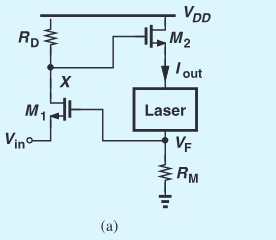
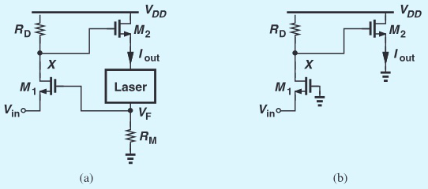

# 예제 12.22 — CG 단과 소스 폴로어로 만든 레이저 전류 조절 회로의 폐루프 이득과 I/O 임피던스

## 원문
레이저 다이오드에 공급되는 전류를 조절하는 또 다른 방법이 그림 12.44(a)에 나타나 있다. 그림 12.42(b)의 회로처럼 매우 작은 저항 $R_M$은 전류를 감시하고 비례하는 전압을 생성하며, 뺄셈 소자 $M_1$에 전압을 되돌려 준다. 회로의 폐루프 이득과 I/O 임피던스를 결정하라.

## 조건
- 회로: Fig 12.44(a), 레이저 다이오드에 공급되는 전류 $I_{out}$을 조절하는 회로
  - $M_1$ (NMOS): 소스는 입력 $V_{in}$, 게이트는 노드 $V_F$, 드레인은 노드 $X$ ($R_D$를 거쳐 $V_{DD}$)
  - $M_2$ (NMOS): 게이트는 $X$, 드레인은 $V_{DD}$, 소스에서 $I_{out}$이 "Laser"로 흘러 들어감
  - $R_M$: "Laser" 아래 노드 $V_F$와 접지 사이
- 매우 작은 저항 $R_M$이 전류를 감시해 비례하는 전압 $V_F$를 만들고, 뺄셈 소자 $M_1$(게이트)에 되돌려 줌
- 그림 12.42(b)의 회로처럼 $R_M$으로 전류를 감시함
  - 참고 회로 (본문 Fig 12.42(b), 예제 12.21): 연산 증폭기 출력이 PMOS $M_1$ (소스 $V_{DD}$) 게이트를 구동, $M_1$ 드레인 전류 $I_{out}$이 "Laser"를 거쳐 노드 $V_F$, $V_F$와 접지 사이에 $R_M$, $V_F$가 연산 증폭기 + 입력으로 되돌아가고 − 입력은 $V_{in}$ (원문에 없음)
- 소자 값은 주어지지 않음 (답은 $g_{m1}$, $g_{m2}$, $R_D$, $R_M$의 식으로) (원문에 없음)

## 구할 것
- 폐루프 이득 ($I_{out}/V_{in}$)
- 폐루프 입력 임피던스와 출력 임피던스

## 상속·참조
- 예제 12.21 (E12.21), 본문 Fig 12.42(b) (교재 679쪽, 이 파일의 그림 목록에는 넣지 않음, 크롭은 fig12-42.png): $M_1$ (PMOS) 소스 $V_{DD}$, 게이트는 연산 증폭기 출력, 드레인에서 $I_{out}$ 화살표가 아래로 "Laser" 상자, 상자 아래 노드 $V_F$ (점), $V_F$–$R_M$–접지. $V_F$에서 선이 왼쪽으로 가서 연산 증폭기 + 입력(아래), − 입력(위)은 $V_{in}$ 개방 원. 예제 12.21 풀이: 연산 증폭기 이득이 매우 높으면 $I_{out} \approx V_{in}/R_M$ (식 12.86)

## 회로 — Fig 12.44(a)
```spice
RD   VDD  X    {R_D}
M1   X    VF   Vin  nmos
M2   VDD  X    n1   nmos
XL   n1   VF   box "Laser"   ; 레이저 다이오드 (상자로 그려짐)
RM   VF   0    {R_M}
```
- 단자: VDD = 전원, 값 미지정 (가로 레일) / Vin = 입력, M1 소스 (개방 원)
- 표시: 노드 라벨 V_DD (레일 오른쪽 끝), X (X 접속점 오른쪽 아래, M1 드레인 선 오른쪽), V_in (입력 원 왼쪽), V_F (V_F 접속점 오른쪽 아래) / 소자 라벨 R_D (저항 왼쪽), M1 (트랜지스터 왼쪽, 소스 화살표 왼쪽 위), M2 (트랜지스터 오른쪽, 소스 화살표 오른쪽), R_M (저항 오른쪽), "Laser" (상자 안) / 부호 없음 / 화살표 "I_out": M2 소스와 Laser 상자 사이 세로 도선, 아래 방향(Laser 쪽으로), 도선 위, 글자는 화살표 오른쪽 / 수치·면적 라벨 없음
- 배치: 맨 위 V_DD 가로 레일 / 왼쪽 세로줄 위→아래 레일, R_D, X 접속점, M1 / M1은 좌우 반전된 NMOS (게이트가 오른쪽, 드레인 위·소스 아래 인출선이 왼쪽, 소스 화살표는 채널에서 왼쪽 바깥을 향함) / M1 소스에서 세로선이 아래로 내려가 왼쪽으로 꺾여 V_in 원에서 끝남 / X 접속점에서 가로선이 오른쪽으로 가다 위로 꺾여 M2 게이트 높이에서 다시 오른쪽으로 꺾여 M2 게이트 / M2는 보통 방향 NMOS (게이트 왼쪽, 드레인 위에서 레일로 올라감, 소스 아래·화살표가 오른쪽 바깥) / 오른쪽 세로줄 위→아래 레일, M2, I_out 화살표, Laser 상자, V_F 접속점, R_M, 접지 / M1 게이트에서 짧은 가로선이 오른쪽으로 가다 아래로 꺾여 V_F 높이에서 오른쪽으로 V_F 접속점 / 접속점 (세 갈래 이상, 2곳): X = 위 R_D + 아래 M1 드레인 + 오른쪽 M2 게이트 선 (점), V_F = 위 Laser + 아래 R_M + 왼쪽 M1 게이트 선 (점) / 교차: 없음



## 답 (검증용)
- $R_M$이 매우 작아 개루프 회로는 Fig 12.44(b) ($M_1$ 게이트 접지, $M_2$ 소스를 접지). 개루프 이득 $G_m = \dfrac{V_X}{V_{in}} \cdot \dfrac{I_{out}}{V_X} = g_{m1}R_D \cdot g_{m2}$ (식 12.93, 12.94), 개루프 입력 임피던스 $1/g_{m1}$, 출력 임피던스 $1/g_{m2}$ (출력 임피던스는 테스트 전압원을 출력선과 직렬로 놓아 측정, 각주 12). 귀환율 $K = R_M$
- 폐루프 이득 $\left.\dfrac{I_{out}}{V_{in}}\right|_{closed} = \dfrac{g_{m1}g_{m2}R_D}{1 + g_{m1}g_{m2}R_DR_M}$ (식 12.95), 루프 이득이 1보다 훨씬 크면 $1/R_M$
- $R_{in,closed} = \dfrac{1}{g_{m1}}(1 + g_{m1}g_{m2}R_DR_M)$ (식 12.96), $R_{out,closed} = \dfrac{1}{g_{m2}}(1 + g_{m1}g_{m2}R_DR_M)$ (레이저에서 본 임피던스, 식 12.97). 입력 임피던스는 $1 + G_mR_M$배 증가

### 정답 회로 — Fig 12.44(b)
```spice
RD   VDD  X    {R_D}
M1   X    0    Vin  nmos   ; 게이트 접지
M2   VDD  X    n1   nmos
* VAC는 그림에 없는 소자: I_out 화살표가 붙은 M2 소스–접지 단락선(그림은 도선 + 접지 기호)을 적기 위한 0 V 전압원. 소신호(교류) 단락만 의미
* 노드 순서 n1 → 0: I(VAC)의 +방향(+ 노드 → 전원 → − 노드)이 그림의 I_out(M2 소스 → 접지)과 같음
VAC  n1   0    0
```
- 단자: VDD = 전원, 값 미지정 (가로 레일) / Vin = 입력, M1 소스 (개방 원) / 출력 쪽은 개방 단자 없이 M2 소스 도선이 접지 기호로 이어짐
- 표시: 노드 라벨 V_DD (레일 오른쪽 끝), X (X 접속점 오른쪽 아래), V_in (입력 원 왼쪽) / 소자 라벨 R_D (저항 왼쪽), M1 (트랜지스터 왼쪽), M2 (트랜지스터 오른쪽) / 부호 없음 / 화살표 "I_out": M2 소스와 접지 기호 사이 세로 도선, 아래 방향(접지 쪽으로), 도선 위, 글자는 화살표 오른쪽 / 수치·면적 라벨 없음
- 배치: (a)와 같은 V_DD 레일–R_D–X 접속점–M1 왼쪽 세로줄, M1 좌우 반전 NMOS, 소스에서 아래로 내려가 왼쪽으로 꺾여 V_in 원 / M1 게이트에서 짧은 가로선이 오른쪽으로 가 아래로 꺾여 접지 기호 / X 접속점에서 가로선이 오른쪽으로 가다 위로 꺾여 M2 게이트 / 오른쪽 세로줄 위→아래 레일, M2, I_out 화살표, 접지 (Laser, R_M, V_F 없음) / 접속점 (세 갈래 이상, 1곳): X = 위 R_D + 아래 M1 드레인 + 오른쪽 M2 게이트 선 (점) / 교차: 없음


