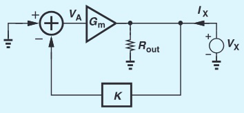

# 예제 12.23 — 전류-전압 귀환의 출력 임피던스 테스트 회로가 잘못된 이유

## 원문
학생이 그림 12.45에 그려진 회로의 도움을 받아 전류-전압 귀환 토폴로지의 출력 임피던스를 계산하려고 한다. 왜 이 토폴로지가 실제 회로의 잘못된 표현인지 설명하라.

## 조건
- 회로: Fig 12.45, 학생이 전류-전압 귀환 토폴로지의 출력 임피던스를 계산하려고 그린 블록도
  - 덧셈기의 + 입력은 접지(입력 0), − 입력은 귀환 블록 $K$의 출력, 덧셈기 출력 $V_A$가 트랜스컨덕턴스 $G_m$ 블록을 구동
  - $G_m$ 출력 노드와 접지 사이에 $R_{out}$, 같은 노드에 귀환 블록 $K$의 입력과 테스트 전압원 $V_X$가 연결되고, $V_X$가 전류 $I_X$를 흘려 줌

## 구할 것
- 이 토폴로지가 실제 (전류-전압 귀환) 회로의 잘못된 표현인 이유 설명

## 회로 — Fig 12.45
```spice
XS    0   n1  VA  sum   ; 0(접지) +, n1 −
XGM   VA  n2  gain "G_m" tri
ROUT  n2  0   {R_out}
VX    n2  0   {V_X}
XK    n2  n1  gain "K"
```
- 단자: 입력 쪽은 덧셈기 + 입력이 접지 기호에 이어짐 (개방 단자 없음) / V_X = 테스트 전압원, 아래 단자 접지
- 표시: 노드 라벨 V_A (덧셈기와 G_m 사이 가로선 위) / 소자 라벨 G_m (삼각형 안), R_out (저항 오른쪽), K (사각 상자 안), V_X (전압원 원 오른쪽), 덧셈기 ⊕ (라벨 없음) / 부호 덧셈기 왼쪽 입력 위쪽에 +, 덧셈기 왼쪽 아래(아래 입력 왼쪽)에 −; V_X 원 왼쪽 위 +, 왼쪽 아래 − / 화살표 "I_X": V_X 위 단자와 오른쪽 접속점 사이 가로 도선, 왼쪽 방향(회로 쪽으로), 도선 위, 글자는 화살표 위; 신호 흐름 (라벨 없음): 접지 → 덧셈기 왼쪽 입력, 오른쪽, 도선 위; 귀환선 → 덧셈기 아래 입력, 위 방향, 도선 위 / 수치·면적 라벨 없음
- 배치: 위 줄 왼쪽→오른쪽 접지 기호(가로선 왼쪽 끝 아래), 덧셈기(⊕ 원), V_A, G_m (오른쪽을 향한 삼각형), 왼쪽 출력 접속점, 오른쪽 접속점, V_X / 왼쪽 출력 접속점에서 R_out이 아래로 내려가 접지 / 오른쪽 접속점에서 세로선이 아래로 내려가 K 높이에서 왼쪽으로 꺾여 K 상자 오른쪽(입력) / K 상자 왼쪽(출력)에서 가로선이 덧셈기 바로 아래까지 가서 위로 꺾여 덧셈기 아래 입력 / V_X 위 단자에서 세로선이 올라가 왼쪽으로 꺾여 오른쪽 접속점, V_X 아래 단자 접지 / 접속점 (세 갈래 이상, 2곳): 왼쪽 출력 = 왼쪽 G_m 출력 + 아래 R_out + 오른쪽 가로선 (점), 오른쪽 = 왼쪽 가로선 + 아래 K 귀환선 + 오른쪽 V_X 선 (점) / 교차: 없음



## 답 (검증용)
- 출력 전류를 감지하려면 귀환 회로망이 순방향 증폭기의 출력 포트와 직렬이어야 하고 테스트 신호원도 마찬가지. 즉 순방향 시스템의 출력 전류는 귀환 회로망의 입력 전류, 그리고 [그림 12.43(b)처럼] $V_X$가 흘려 주는 전류와 같아야 함
- Fig 12.45에서는 $V_X$가 출력과 병렬로 놓여 이 원리를 어김 (귀환 회로망이 이상적이어서 입력 임피던스가 0이면 $V_X$는 무한대의 전류를 공급해야 함, 각주 13)
