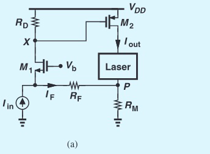
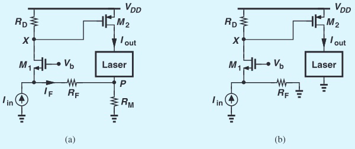

# 예제 12.24 — 레이저 전류를 조절하는 전류-전류 귀환 회로의 극성, 폐루프 이득과 I/O 임피던스

## 원문
그림 12.49(a)의 회로를 고려하자. 여기서 레이저 다이오드에 공급되는 출력 전류는 부귀환에 의해 조절된다. $R_M$이 매우 작고 $R_F$가 매우 클 때 귀환이 부귀환임을 증명하고 폐루프 이득과 I/O 임피던스를 계산하라.

## 조건
- 회로: Fig 12.49(a), 레이저 다이오드에 공급되는 출력 전류 $I_{out}$이 부귀환으로 조절됨
  - 입력 전류원 $I_{in}$이 $M_1$ (NMOS, 게이트는 바이어스 $V_b$) 소스 노드로 전류를 넣음, $M_1$ 드레인은 노드 $X$ ($R_D$를 거쳐 $V_{DD}$)
  - $M_2$ (PMOS, 소스 $V_{DD}$, 게이트 $X$)의 드레인 전류 $I_{out}$이 "Laser"를 거쳐 노드 $P$, $P$와 접지 사이에 $R_M$
  - $R_F$: $M_1$ 소스 노드와 $P$ 사이, 그 전류 $I_F$ ($M_1$ 소스 쪽 → $P$ 쪽 화살표)
- 가정: $R_M$은 매우 작고 $R_F$는 매우 큼
- 소자 값은 주어지지 않음 (답은 $g_{m1}$, $g_{m2}$, $r_{O2}$, $R_D$, $R_M$, $R_F$의 식으로) (원문에 없음)

## 구할 것
- 귀환이 부귀환임을 증명
- 폐루프 이득 ($I_{out}/I_{in}$)
- 폐루프 입력 임피던스와 출력 임피던스

## 상속·참조
- 예제 12.18 (E12.18, 교재 675–676쪽, 본문 Fig 12.38(a)): $\lambda = 0$, $R_F$가 매우 큰 전압-전류 귀환 회로 ($i_{in}$ → $M_1$ (CG, 게이트 $V_b$) 소스, $R_{D1}$, $M_2$ (CS, $R_{D2}$), 출력 $V_{out}$에서 $R_F$로 $M_1$ 소스에 귀환). 풀이 (c): $R_F$에 의해 입력으로 반송되는 전류 $I_{RF} = \dfrac{V_{out}}{R_F + 1/g_{m1}}$ (식 12.74), $R_F \gg 1/g_{m1}$이면 근사적으로 $V_{out}/R_F$, 따라서 $K = -1/R_F$ (음의 부호는 입력 노드에서 $R_F$를 통해 흘러나오는 전류 방향에서 생김). 이 예제 풀이가 이 결과를 "$-V_P/R_F$"로 인용함
- 식 (12.100): 전류-전류 귀환의 폐루프 이득 $\dfrac{I_{out}}{I_{in}} = \dfrac{A_I}{1 + KA_I}$, $K = I_F/I_{out}$

## 회로 — Fig 12.49(a)
```spice
RD   VDD  X    {R_D}
M1   X    Vb   n1   nmos
M2   n2   X    VDD  pmos
XL   n2   P    box "Laser"   ; 레이저 다이오드 (상자로 그려짐)
RF   n1   P    {R_F}
RM   P    0    {R_M}
IIN  0    n1   {I_in}
```
- 단자: VDD = 전원, 값 미지정 (가로 레일) / Vb = M1 게이트 바이어스, 값 미지정 (점 단자)
- 표시: 노드 라벨 V_DD (레일 오른쪽 끝), X (X 접속점 왼쪽), V_b (점 단자 오른쪽), P (P 접속점 오른쪽 아래) / 소자 라벨 R_D (저항 왼쪽), M1 (트랜지스터 왼쪽, 소스 화살표 왼쪽 위), M2 (트랜지스터 오른쪽), R_F (저항 아래), R_M (저항 오른쪽), I_in (전류원 원 왼쪽), "Laser" (상자 안) / 부호 없음 / 화살표 "I_out": M2 드레인과 Laser 상자 사이 세로 도선, 아래 방향(Laser 쪽으로), 도선 위, 글자는 화살표 오른쪽; "I_F": M1 소스 접속점과 R_F 사이 가로 도선, 오른쪽 방향(R_F 쪽으로), 도선 위, 글자는 화살표 아래 / 수치·면적 라벨 없음
- 배치: 맨 위 V_DD 가로 레일 / 왼쪽 세로줄 위→아래 레일, R_D, X 접속점, M1, M1 소스 접속점 / M1은 좌우 반전된 NMOS (게이트가 오른쪽, 소스 화살표는 채널에서 왼쪽 바깥을 향함), 게이트에서 짧은 가로선이 오른쪽 V_b 점 단자 / I_in 전류원은 M1 소스 접속점 왼쪽 아래: 위 단자에서 세로선이 올라가 오른쪽으로 꺾여 소스 접속점, 아래 단자 접지, 원 안 화살표 위 방향 / X 접속점에서 가로선이 오른쪽으로 가다 위로 꺾여 M2 게이트 높이에서 오른쪽으로 꺾여 M2 게이트 / M2는 보통 방향 PMOS (게이트 왼쪽, 소스 위에서 레일로 올라감·화살표가 채널 쪽(왼쪽)을 향함, 드레인 아래) / 오른쪽 세로줄 위→아래 레일, M2, I_out 화살표, Laser 상자, P 접속점, R_M, 접지 / M1 소스 접속점에서 가로선이 오른쪽으로 I_F 화살표, R_F를 지나 P 접속점 / 접속점 (세 갈래 이상, 3곳): X = 위 R_D + 아래 M1 드레인 + 오른쪽 M2 게이트 선 (점), M1 소스 = 위 M1 소스 + 왼쪽 I_in 선 + 오른쪽 R_F 선 (점), P = 위 Laser + 아래 R_M + 왼쪽 R_F 선 (점) / 교차: 없음



## 답 (검증용)
- 부귀환: $I_{in}$이 증가하면 $M_1$ 소스 전압과 드레인 전압이 증가하려 함 → $M_2$의 과구동이 감소하고 $I_{out}$과 $V_P$가 떨어짐 → $I_F$가 증가하여 $M_1$ 소스 전압을 낮춤. 귀환 신호 $I_F$가 $I_{in}$의 효과를 억제하므로 부귀환
- 개루프 (Fig 12.49(b), $V_P \approx 0$): $R_F$가 매우 커서 $I_{in}$의 대부분이 $M_1$과 $R_D$로 흘러 $V_X = I_{in}R_D$. $I_{out} = -g_{m2}V_X = -g_{m2}R_DI_{in}$ (식 12.106, 12.107), $A_I = -g_{m2}R_D$ (식 12.108). 개루프 입력 임피던스 $\approx 1/g_{m1}$, 출력 임피던스 $r_{O2}$
- 귀환율: 예제 12.18처럼 $R_F \gg 1/g_{m1}$이면 $R_F$가 반송하는 전류 $\approx -V_P/R_F$, $V_P = I_{out}R_M$이므로 $K = \dfrac{I_F}{I_{out}} = -\dfrac{R_M}{R_F}$ (식 12.109–12.111)
- 폐루프: $A_{I,closed} = \dfrac{-g_{m2}R_D}{1 + g_{m2}R_D\dfrac{R_M}{R_F}}$ (식 12.112), $R_{in,closed} = \dfrac{1}{g_{m1}} \cdot \dfrac{1}{1 + g_{m2}R_D\dfrac{R_M}{R_F}}$ (식 12.113), $R_{out,closed} = r_{O2}\left(1 + g_{m2}R_D\dfrac{R_M}{R_F}\right)$ (식 12.114). $g_{m2}R_DR_M/R_F \gg 1$이면 폐루프 이득 $\approx -R_F/R_M$

### 정답 회로 — Fig 12.49(b)
```spice
RD   VDD  X    {R_D}
M1   X    Vb   n1   nmos
M2   n2   X    VDD  pmos
XL   n2   0    box "Laser"   ; 레이저 다이오드 (상자로 그려짐)
RF   n1   0    {R_F}
IIN  0    n1   {I_in}
```
- 단자: VDD = 전원, 값 미지정 (가로 레일) / Vb = M1 게이트 바이어스, 값 미지정 (점 단자)
- 표시: 노드 라벨 V_DD (레일 오른쪽 끝), X (X 접속점 왼쪽), V_b (점 단자 오른쪽) / 소자 라벨 R_D (저항 왼쪽), M1 (트랜지스터 왼쪽), M2 (트랜지스터 오른쪽), R_F (저항 아래), I_in (전류원 원 왼쪽), "Laser" (상자 안) / 부호 없음 / 화살표 "I_out": M2 드레인과 Laser 상자 사이 세로 도선, 아래 방향, 도선 위, 글자는 화살표 오른쪽 / 수치·면적 라벨 없음
- 배치: (a)와 같은 레일–R_D–X 접속점–M1 왼쪽 세로줄, M1 좌우 반전 NMOS, V_b 점 단자, I_in 전류원 / M1 소스 접속점에서 가로선이 오른쪽으로 R_F를 지나 오른쪽 끝에서 접지 기호 (P 노드, R_M 없음, I_F 화살표 없음) / 오른쪽 세로줄 위→아래 레일, M2, I_out 화살표, Laser 상자, 접지 / 접속점 (세 갈래 이상, 2곳): X = 위 R_D + 아래 M1 드레인 + 오른쪽 M2 게이트 선 (점), M1 소스 = 위 M1 소스 + 왼쪽 I_in 선 + 오른쪽 R_F 선 (점) / 교차: 없음


