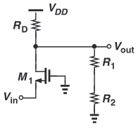

# 예제 12.25 — R1 + R2가 RD에 비해 크지 않은 귀환 CG 단의 해석 방법

## 원문
예제 12.7의 회로에서 $R_1 + R_2$가 $R_D$에 비해 훨씬 크지 않다고 가정하자. 회로를 어떻게 해석하여야 하는가?

## 조건
- 회로: Fig 12.11 (예제 12.7의 회로), 공통 게이트 단 $M_1$ (NMOS, 소스 입력 $V_{in}$, 드레인 출력 $V_{out}$, $R_D$를 거쳐 $V_{DD}$)과 출력–접지 사이 분배기 $R_1$–$R_2$, 분배기 가운데 노드가 $M_1$ 게이트
- 바뀐 점: $R_1 + R_2$가 $R_D$에 비해 훨씬 크지 않음 (예제 12.7의 가정 $R_1 + R_2 \gg R_D$를 쓰지 않음) (괄호 안은 원문에 없음)
- 예제 12.7에서 이어받는 가정: $\lambda = 0$ (원문에 없음)
- 예제 12.7의 결과 ($R_1 + R_2 \gg R_D$일 때): 순방향 시스템은 $M_1$과 $R_D$의 CG 단, 귀환율 $K = R_2/(R_1 + R_2)$, 개루프 $A_0 \approx g_mR_D$, $R_{in,open} = 1/g_m$, $R_{out,open} = R_D$, 폐루프 이득 $\dfrac{v_{out}}{v_{in}} = \dfrac{g_mR_D}{1 + \dfrac{R_2}{R_1 + R_2}g_mR_D}$ (원문에 없음)
- 소자 값은 주어지지 않음 (답은 $g_{m1}$, $R_D$, $R_1$, $R_2$의 식으로) (원문에 없음)

## 구할 것
- 회로를 해석하는 방법 (개루프 회로 구성, 개루프·폐루프 이득과 I/O 임피던스) (괄호 안은 원문에 없음, 원문은 "어떻게 해석하여야 하는가"만 적음)

## 상속·참조
- 예제 12.7 (E12.07, 교재 654–655쪽): 그림 12.11은 그림 12.2 귀환 회로의 트랜지스터 레벨 실현, $\lambda = 0$, $R_1 + R_2 \gg R_D$ 가정. (a) 순방향 시스템(주 증폭기)은 $M_1$과 $R_D$ (CG 단), $R_1$과 $R_2$는 감지 장치와 귀환 회로망으로 $V_{out}R_2/(R_1 + R_2)$를 반송, $M_1$ 자신이 뺄셈기 $i_D = g_m(v_G - v_S)$. (b) $A_0 \approx g_mR_D$ (식 12.31), $\dfrac{v_{out}}{v_{in}} = \dfrac{g_mR_D}{1 + \dfrac{R_2}{R_1 + R_2}g_mR_D}$ (식 12.33). (c) $R_{in,open} = 1/g_m$, $R_{out,open} = R_D$ (식 12.34, 12.35), 폐루프 입력 저항 $\dfrac{1}{g_m}\left(1 + \dfrac{R_2}{R_1 + R_2}g_mR_D\right)$, 폐루프 출력 저항 $\dfrac{R_D}{1 + \dfrac{R_2}{R_1 + R_2}g_mR_D}$

## 회로 — Fig 12.11
```spice
RD  VDD   Vout  {R_D}
M1  Vout  n1    Vin  nmos
R1  Vout  n1    {R_1}
R2  n1    0     {R_2}
```
- 단자: VDD = 전원, 값 미지정 (T 전원 기호) / Vin = 입력, M1 소스 (개방 원) / Vout = 출력 (개방 원)
- 표시: 노드 라벨 V_DD (T 기호 오른쪽), V_in (입력 원 왼쪽), V_out (출력 원 오른쪽) / 소자 라벨 R_D (저항 왼쪽), M1 (트랜지스터 왼쪽, 소스 화살표 바로 왼쪽 위), R1, R2 (각 저항 오른쪽) / 부호 없음 / 화살표 없음 / 수치·면적 라벨 없음
- 배치: 왼쪽 세로줄 위→아래 V_DD T 기호, R_D, 드레인 접속점, M1 / M1은 좌우 반전된 NMOS (게이트가 오른쪽, 드레인 위·소스 아래 인출선이 왼쪽, 소스 화살표는 채널에서 왼쪽 바깥을 향함) / 소스에서 세로선이 아래로 내려가 왼쪽으로 꺾여 V_in 원에서 끝남 / 드레인 접속점에서 가로선이 오른쪽으로 가 R1 위 접속점을 지나 V_out 원까지 / 오른쪽 세로줄 위→아래 R1 위 접속점, R1, 게이트 접속점(n1), R2, 접지 / M1 게이트에서 가로선이 오른쪽으로 곧장 n1 접속점 / 접속점 (세 갈래 이상, 3곳): 드레인 = 위 R_D + 아래 M1 드레인 + 오른쪽 가로선 (점), R1 위 = 왼쪽 가로선 + 아래 R1 + 오른쪽 V_out 선 (점), n1 = 위 R1 + 아래 R2 + 왼쪽 게이트 선 (점) / 교차: 없음


> 참고: 그림 12.11은 예제 12.7에 인쇄됨 (교재 654쪽, PDF 8 왼쪽)

## 답 (검증용)
- 예제 12.7은 $R_1 + R_2$의 효과를 무시하고 개루프 회로를 만들었지만, 여기서는 $R_1 + R_2$가 $R_D$와 병렬로 나타나 개루프 이득을 감소시킴 → 개루프 회로는 Fig 12.51처럼 구성 ($M_1$ 게이트 접지, 출력에 $R_1 + R_2$가 접지까지 직렬로 달림)
- 개루프 $A_O = g_{m1}[R_D \parallel (R_1 + R_2)]$ (식 12.115), $R_{out,open} = R_D \parallel (R_1 + R_2)$ (식 12.116). 다른 순방향·귀환 변수는 예제 12.7과 같음
- $A_{v,closed} = \dfrac{g_{m1}[R_D \parallel (R_1 + R_2)]}{1 + \dfrac{R_2}{R_1 + R_2}g_{m1}[R_D \parallel (R_1 + R_2)]}$ (식 12.117), $R_{in,closed} = \dfrac{1}{g_{m1}}\left\{1 + \dfrac{R_2}{R_1 + R_2}g_{m1}[R_D \parallel (R_1 + R_2)]\right\}$ (식 12.118), $R_{out,closed} = \dfrac{R_D \parallel (R_1 + R_2)}{1 + \dfrac{R_2}{R_1 + R_2}g_{m1}[R_D \parallel (R_1 + R_2)]}$ (식 12.119)

### 정답 회로 — Fig 12.51
```spice
RD  VDD   Vout  {R_D}
M1  Vout  0     Vin  nmos   ; 게이트 접지
R1  Vout  n1    {R_1}
R2  n1    0     {R_2}
```
- 단자: VDD = 전원, 값 미지정 (T 전원 기호) / Vin = 입력, M1 소스 (개방 원) / Vout = 출력 (개방 원)
- 표시: 노드 라벨 V_DD (T 기호 오른쪽), V_in (입력 원 왼쪽), V_out (출력 원 오른쪽) / 소자 라벨 R_D (저항 왼쪽), M1 (트랜지스터 왼쪽), R1, R2 (각 저항 오른쪽) / 부호 없음 / 화살표 없음 / 수치·면적 라벨 없음
- 배치: Fig 12.11과 같은 V_DD–R_D–드레인 접속점–M1 세로줄, M1 좌우 반전 NMOS, 소스에서 아래로 내려가 왼쪽으로 꺾여 V_in 원 / M1 게이트에서 짧은 가로선이 오른쪽으로 가 아래로 꺾여 접지 기호 (게이트 접지) / 드레인 접속점에서 가로선이 오른쪽으로 R1 위 접속점을 지나 V_out 원까지 / 오른쪽 세로줄 R1 위 접속점, R1, R2, 접지 (R1–R2 사이 노드에 다른 선 없음, 점 없음) / 접속점 (세 갈래 이상, 2곳): 드레인 = 위 R_D + 아래 M1 드레인 + 오른쪽 가로선 (점), R1 위 = 왼쪽 가로선 + 아래 R1 + 오른쪽 V_out 선 (점) / 교차: 없음


