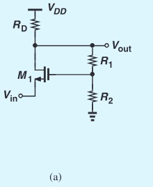
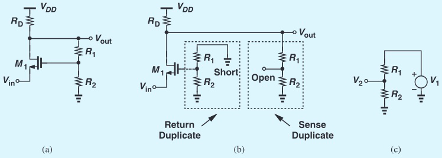

# 예제 12.26 — 일반적인 방법(복제 종지)으로 푸는 귀환 CG 증폭기

## 원문
$R_1 + R_2$가 $R_D$보다 충분히 작지 않을 때 그림 12.55(a)에 그려진 증폭기를 해석하라.

## 조건
- 회로: Fig 12.55(a), 공통 게이트 단 $M_1$ (NMOS, 소스 입력 $V_{in}$, 드레인 출력 $V_{out}$, $R_D$를 거쳐 $V_{DD}$)과 출력–접지 사이 분배기 $R_1$–$R_2$, 분배기 가운데 노드가 $M_1$ 게이트 (예제 12.7·12.25와 같은 회로) (마지막 괄호 안은 원문에 없음)
- 조건: $R_1 + R_2$가 $R_D$보다 충분히 작지 않을 때
- 문맥과 맞지 않음(오식으로 보임): 같은 회로를 다룬 예제 12.25는 "$R_1 + R_2$가 $R_D$에 비해 훨씬 크지 않다", 다음 예제 12.27은 "충분히 크지 않을 때"로 적고, 이 예제 풀이도 결과가 예제 12.25와 일치한다고 함. "충분히 크지 않을 때"의 뜻으로 보임 (원문에 없음)
- 해석 = 12.7.1절의 여섯 단계로 개루프·폐루프 이득과 I/O 임피던스를 구함 (원문에 없음, 원문은 "해석하라"만 적음)
- 12.7.1절의 여섯 단계: 순방향 증폭기 확인, 귀환 회로망 확인, 법칙에 따라 귀환 회로망 끊기, 개루프 변수 계산, 법칙에 따라 귀환율 결정, 폐루프 변수 계산 (본문 정의, 원문에 없음)
- 전압-전압 귀환에서 귀환 회로망을 끊는 법칙 (본문 Fig 12.53(a)): 출력에 연결한 복사물(감지 복제)의 출력 포트는 개방, 입력에 연결한 복사물(반송 복제)의 입력 포트는 단락 (본문 정의, 원문에 없음)
- 전압-전압 귀환의 귀환율 (본문 Fig 12.54(a)): 귀환 회로망 입력 포트에 $V_1$을 인가하고 출력 포트를 개방한 채 출력 전압 $V_2$를 보아 $K = V_2/V_1$ (본문 정의, 원문에 없음)
- 소자 값은 주어지지 않음 (답은 $g_{m1}$, $R_D$, $R_1$, $R_2$의 식으로) (원문에 없음)

## 구할 것
- 증폭기의 해석: 개루프·폐루프 전압 이득, 폐루프 입력·출력 임피던스 (콜론 뒤는 원문에 없음)

## 상속·참조
- 본문 12.7.1절 (교재 688–690쪽) 귀환 회로망을 끊는 법칙: 귀환 회로망의 사본을 순방향 증폭기의 입력과 출력에 '로드'함 (본문 Fig 12.52). 출력 쪽 복사물 = 감지 복제(sense duplicate), 입력 쪽 복사물 = 반송 복제(return duplicate). 종지 법칙 (본문 Fig 12.53): (a) 전압-전압 귀환은 감지 복제 출력 포트 개방, 반송 복제 입력 포트 단락, (b) 전압-전류 귀환은 둘 다 단락. 이 파일의 그림 목록에는 넣지 않음, 크롭 안 함
- 본문 Fig 12.54 (교재 690쪽, 크롭 안 함): 귀환율 계산. (a) 전압-전압: $V_1$ 인가, 출력 포트 개방, $K = V_2/V_1$ / (b) 전압-전류: $K = I_2/V_1$ / (c) 전류-전류: $K = I_2/I_1$ / (d) 전류-전압: $K = V_2/I_1$
- 예제 12.25 (E12.25): 같은 회로에서 $R_1 + R_2$가 $R_D$에 비해 훨씬 크지 않을 때의 직관적 해석. 개루프 $A_O = g_{m1}[R_D \parallel (R_1 + R_2)]$, $R_{out,open} = R_D \parallel (R_1 + R_2)$ (식 12.115, 12.116)

## 회로 — Fig 12.55(a)
```spice
RD  VDD   Vout  {R_D}
M1  Vout  n1    Vin  nmos
R1  Vout  n1    {R_1}
R2  n1    0     {R_2}
```
- 단자: VDD = 전원, 값 미지정 (T 전원 기호) / Vin = 입력, M1 소스 (개방 원) / Vout = 출력 (개방 원)
- 표시: 노드 라벨 V_DD (T 기호 오른쪽), V_in (입력 원 왼쪽), V_out (출력 원 오른쪽) / 소자 라벨 R_D (저항 왼쪽), M1 (트랜지스터 왼쪽, 소스 화살표 바로 왼쪽 위), R1, R2 (각 저항 오른쪽) / 부호 없음 / 화살표 없음 / 수치·면적 라벨 없음
- 배치: 왼쪽 세로줄 위→아래 V_DD T 기호, R_D, 드레인 접속점, M1 / M1은 좌우 반전된 NMOS (게이트가 오른쪽, 소스 화살표는 채널에서 왼쪽 바깥을 향함) / 소스에서 세로선이 아래로 내려가 왼쪽으로 꺾여 V_in 원에서 끝남 / 드레인 접속점에서 가로선이 오른쪽으로 가 R1 위 접속점을 지나 V_out 원까지 / 오른쪽 세로줄 위→아래 R1 위 접속점, R1, 게이트 접속점(n1), R2, 접지 / M1 게이트에서 가로선이 오른쪽으로 곧장 n1 접속점 / 접속점 (세 갈래 이상, 3곳): 드레인 = 위 R_D + 아래 M1 드레인 + 오른쪽 가로선 (점), R1 위 = 왼쪽 가로선 + 아래 R1 + 오른쪽 V_out 선 (점), n1 = 위 R1 + 아래 R2 + 왼쪽 게이트 선 (점) / 교차: 없음



## 답 (검증용)
- 순방향 시스템은 $M_1$과 $R_D$, 귀환 회로망은 $R_1$과 $R_2$. Fig 12.55(b)처럼 그림 12.53(a)에 따라 개루프 회로를 만듦: 귀환 회로망이 두 번 나타나고, 감지 복제의 출력 포트는 개방, 반송 복제의 입력 포트는 단락. 개루프 변수는 예제 12.25에서 계산됨
- 귀환율: 그림 12.54(a)의 법칙, Fig 12.55(c)에서 $K = V_2/V_1 = R_2/(R_1 + R_2)$ (식 12.120, 12.121), $KA_0 = \dfrac{R_2}{R_1 + R_2}g_{m1}[R_D \parallel (R_1 + R_2)]$ (식 12.122)
- $A_{v,closed} = \dfrac{g_{m1}[R_D \parallel (R_1 + R_2)]}{1 + \dfrac{R_2}{R_1 + R_2}g_{m1}[R_D \parallel (R_1 + R_2)]}$ (식 12.123), $R_{in,closed} = \dfrac{1}{g_{m1}}\left\{1 + \dfrac{R_2}{R_1 + R_2}g_{m1}[R_D \parallel (R_1 + R_2)]\right\}$ (식 12.124), $R_{out,closed} = \dfrac{R_D \parallel (R_1 + R_2)}{1 + \dfrac{R_2}{R_1 + R_2}g_{m1}[R_D \parallel (R_1 + R_2)]}$ (식 12.125). 예제 12.25의 결과와 일치

### 정답 회로 — Fig 12.55(b)
```spice
RD   VDD   Vout  {R_D}
M1   Vout  n1    Vin  nmos
R1A  0     n1    {R_1}   ; 인쇄 라벨 R1, 반송 복제 (위 끝이 접지로 단락, "Short")
R2A  n1    0     {R_2}   ; 인쇄 라벨 R2, 반송 복제
R1B  Vout  n2    {R_1}   ; 인쇄 라벨 R1, 감지 복제
R2B  n2    0     {R_2}   ; 인쇄 라벨 R2, 감지 복제, n2는 "Open" 개방 원
```
- 단자: VDD = 전원, 값 미지정 (T 전원 기호) / Vin = 입력, M1 소스 (개방 원) / Vout = 출력 (개방 원) / n2 = 감지 복제의 출력 포트, 개방 ("Open" 글자, 개방 원)
- 표시: 노드 라벨 V_DD (T 기호 오른쪽), V_in (입력 원 왼쪽), V_out (출력 원 오른쪽) / 소자 라벨 R_D (저항 왼쪽), M1 (트랜지스터 왼쪽), R1, R2 (왼쪽 점선 상자 안 각 저항 오른쪽), R1, R2 (오른쪽 점선 상자 안 각 저항 오른쪽), 글자 "Short" (왼쪽 상자 안 접지 기호 아래), "Open" (오른쪽 상자 안 개방 원 아래), "Return Duplicate" (왼쪽 상자 아래 두 줄), "Sense Duplicate" (오른쪽 상자 아래 두 줄) / 부호 없음 / 화살표 "Return Duplicate": 왼쪽 점선 상자 아래 변을 가리킴, 오른쪽 위 방향, 도선 옆 별도 화살표 (직선, 글자는 화살표 왼쪽 아래); "Sense Duplicate": 오른쪽 점선 상자 아래 변을 가리킴, 왼쪽 위 방향, 도선 옆 별도 화살표 (직선, 글자는 화살표 오른쪽 아래) / 수치·면적 라벨 없음
- 배치: 왼쪽 세로줄 V_DD T 기호, R_D, 드레인 접속점, M1 (좌우 반전 NMOS), 소스에서 아래로 내려가 왼쪽으로 꺾여 V_in 원 / 드레인 접속점에서 긴 가로선이 오른쪽으로 두 점선 상자 위를 지나 V_out 접속점, V_out 원 / 왼쪽 점선 상자 (반송 복제): 세로줄 R1, n1 접속점, R2, 접지. R1 위 끝에서 선이 올라가 오른쪽으로 꺾여 다시 아래로 접지 기호 ("Short"). M1 게이트에서 가로선이 오른쪽으로 상자 왼쪽 변을 넘어 n1 접속점 (이 게이트 선은 점선처럼 끊겨 인쇄됨) / 오른쪽 점선 상자 (감지 복제): V_out 접속점에서 세로선이 내려와 상자 위 변을 넘어 R1, n2 접속점, R2, 접지. n2 접속점에서 짧은 가로선이 왼쪽 개방 원 ("Open") / 접속점 (세 갈래 이상, 4곳): 드레인 = 위 R_D + 아래 M1 드레인 + 오른쪽 가로선 (점), V_out = 왼쪽 가로선 + 아래 감지 복제 선 + 오른쪽 V_out 원 (점), n1 = 위 R1 + 아래 R2 + 왼쪽 게이트 선 (점), n2 = 위 R1 + 아래 R2 + 왼쪽 개방 원 선 (점) / 교차: 없음 (선이 점선 상자 변을 지나가는 곳만 있음)

### 정답 회로 — Fig 12.55(c)
```spice
V1  n1  0   {V_1}
R1  n1  V2  {R_1}
R2  V2  0   {R_2}
```
- 단자: V2 = 귀환 회로망 출력 포트, 개방 (개방 원) / V1 = 귀환 회로망 입력에 인가한 전압원, 아래 단자 접지
- 표시: 노드 라벨 V_2 (개방 원 왼쪽) / 소자 라벨 R1, R2 (각 저항 오른쪽), V_1 (전압원 원 오른쪽) / 부호 V_1 원 왼쪽 위 +, 왼쪽 아래 − / 화살표 없음 / 수치·면적 라벨 없음
- 배치: 왼쪽 세로줄 위→아래 R1, V_2 접속점, R2, 접지 / R1 위 끝에서 선이 올라가 오른쪽으로 꺾여 V_1 위 단자로 내려감, V_1 아래 단자 접지 / V_2 접속점에서 가로선이 왼쪽 V_2 원 / 접속점 (세 갈래 이상, 1곳): V_2 = 위 R1 + 아래 R2 + 왼쪽 V_2 원 선 (점) / 교차: 없음


