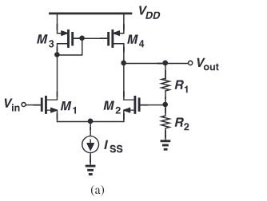
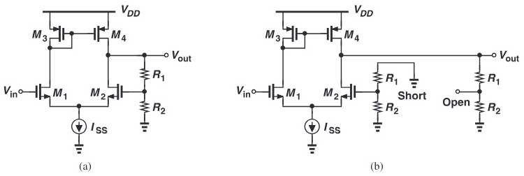

# 예제 12.27 — 분배기 귀환을 건 차동 입력 단일 출력 증폭기의 해석

## 원문
$R_1 + R_2$가 $r_{OP} \parallel r_{ON}$보다 충분히 크지 않을 때 그림 12.56(a)의 회로를 해석하라.

## 조건
- 회로: Fig 12.56(a)
  - NMOS 차동 쌍 $M_1$, $M_2$ (소스 공통, 꼬리 전류원 $I_{SS}$), $M_1$ 게이트는 입력 $V_{in}$
  - PMOS 전류 거울 부하 $M_3$ (다이오드 연결, $M_1$ 드레인 쪽), $M_4$ ($M_2$ 드레인 쪽), $M_4$·$M_2$ 드레인이 출력 $V_{out}$
  - $R_1$–$R_2$: $V_{out}$과 접지 사이 분배기, 가운데 노드가 $M_2$ 게이트
- 조건: $R_1 + R_2$가 $r_{OP} \parallel r_{ON}$보다 충분히 크지 않음
- $r_{ON}$, $r_{OP}$: NMOS($M_1$, $M_2$)와 PMOS($M_3$, $M_4$)의 출력 저항, $g_{mN}$: NMOS 입력 쌍의 트랜스컨덕턴스 (풀이의 기호, 원문에 없음)
- 해석 = 개루프·폐루프 이득과 I/O 임피던스를 구함 (원문에 없음, 원문은 "해석하라"만 적음)
- 전압-전압 귀환에서 귀환 회로망을 끊는 법칙 (본문 Fig 12.53(a)): 감지 복제의 출력 포트는 개방, 반송 복제의 입력 포트는 단락. 귀환율은 입력 포트에 $V_1$을 인가하고 출력 포트를 개방해 $K = V_2/V_1$ (본문 Fig 12.54(a)) (본문 정의, 원문에 없음)
- 소자 값은 주어지지 않음 (원문에 없음)

## 구할 것
- 회로의 해석: 개루프·폐루프 전압 이득, 폐루프 입력·출력 임피던스 (콜론 뒤는 원문에 없음)

## 상속·참조
- 본문 12.7.1절 종지 법칙 (본문 Fig 12.53, 교재 689쪽, 크롭 안 함): 전압-전압 귀환은 감지 복제 출력 포트 개방, 반송 복제 입력 포트 단락. 귀환율 계산 (본문 Fig 12.54(a), 교재 690쪽, 크롭 안 함): $K = V_2/V_1$, 출력 포트 개방
- 예제 12.26 (E12.26): 같은 전압-전압 귀환 형태(출력–접지 분배기 $R_1$–$R_2$, 가운데 노드를 뺄셈 소자로 반송)를 일반적인 방법으로 끊음. 반송 복제는 $R_1$ 위 끝을 접지로 단락, 감지 복제는 $R_1$–$R_2$ 사이를 개방. 귀환율 테스트 회로 (Fig 12.55(c))에서 $K = R_2/(R_1 + R_2)$

## 회로 — Fig 12.56(a)
```spice
M3   n1    n1   VDD  pmos
M4   Vout  n1   VDD  pmos
M1   n1    Vin  n2   nmos
M2   Vout  n3   n2   nmos
ISS  n2    0    {I_SS}
R1   Vout  n3   {R_1}
R2   n3    0    {R_2}
```
- 단자: VDD = 전원, 값 미지정 (가로 레일) / Vin = 입력, M1 게이트 (개방 원) / Vout = 출력 (개방 원)
- 표시: 노드 라벨 V_DD (레일 오른쪽 끝), V_in (입력 원 왼쪽), V_out (출력 원 오른쪽) / 소자 라벨 M3 (트랜지스터 왼쪽), M4 (트랜지스터 오른쪽), M1 (트랜지스터 오른쪽), M2 (트랜지스터 왼쪽), I_SS (전류원 원 오른쪽), R1, R2 (각 저항 오른쪽) / 부호 없음 / 화살표 없음 / 수치·면적 라벨 없음
- 배치: 맨 위 V_DD 가로 레일 / 위 줄 M3 (좌우 반전된 PMOS: 게이트가 오른쪽, 소스 위에서 레일로, 소스 화살표는 채널 쪽(오른쪽)을 향함, 드레인 아래 왼쪽), M4 (보통 방향 PMOS: 게이트 왼쪽, 소스 위에서 레일로, 드레인 아래 오른쪽) / M3·M4 게이트 공통선은 게이트 높이로 가로지르고 M3 게이트 바로 오른쪽에 접속점, 거기서 선이 아래로 내려가 왼쪽으로 꺾여 M3 드레인 접속점 (다이오드 연결) / 아래 줄 M1 (보통 방향 NMOS: 게이트 왼쪽, 소스 화살표 오른쪽 바깥), M2 (좌우 반전된 NMOS: 게이트가 오른쪽, 소스 화살표 왼쪽 바깥) / M3 드레인 접속점–M1 드레인 세로선, M4 드레인 접속점–M2 드레인 세로선 / V_in 원 → 가로선 → M1 게이트 / M1·M2 소스는 아래 가로선으로 이어지고 가운데 꼬리 접속점에서 I_SS가 아래로, I_SS 원 안 화살표 아래 방향, I_SS 아래 접지 / M4 드레인 접속점에서 가로선이 오른쪽으로 R1 위 접속점을 지나 V_out 원 / 오른쪽 세로줄 R1 위 접속점, R1, n3 접속점, R2, 접지 / M2 게이트에서 가로선이 오른쪽으로 곧장 n3 접속점 / 접속점 (세 갈래 이상, 6곳): M3 게이트 오른쪽 = 왼쪽 M3 게이트 + 오른쪽 M4 게이트 선 + 아래 다이오드 연결선 (점), M3 드레인 = 위 M3 드레인 + 아래 M1 드레인 + 오른쪽 다이오드 연결선 (점), M4 드레인 = 위 M4 드레인 + 아래 M2 드레인 + 오른쪽 출력선 (점), 꼬리 = 왼쪽 M1 소스 선 + 오른쪽 M2 소스 선 + 아래 I_SS (점), R1 위 = 왼쪽 출력선 + 아래 R1 + 오른쪽 V_out 원 선 (점), n3 = 위 R1 + 아래 R2 + 왼쪽 M2 게이트 선 (점) / 교차: 없음


> 참고: 그림 12.56은 다음 쪽(교재 692쪽, PDF 27 왼쪽)에 인쇄됨

## 답 (검증용)
- $M_1$–$M_4$는 순방향 증폭기, $R_1$과 $R_2$는 귀환 회로망. 귀환 형태가 같아 루프는 예제 12.26과 비슷하게 끊어짐 (Fig 12.56(b))
- 개루프 $A_0 = g_{mN}[r_{ON} \parallel r_{OP} \parallel (R_1 + R_2)]$ (식 12.126), $R_{in,open} = \infty$ (식 12.127), $R_{out,open} = r_{ON} \parallel r_{OP} \parallel (R_1 + R_2)$ (식 12.128). 귀환율 테스트 회로는 Fig 12.55(c)와 같아 $K = R_2/(R_1 + R_2)$ (식 12.129)
- $\left.\dfrac{V_{out}}{V_{in}}\right|_{closed} = \dfrac{g_{mN}[r_{ON} \parallel r_{OP} \parallel (R_1 + R_2)]}{1 + \dfrac{R_2}{R_1 + R_2}g_{mN}[r_{ON} \parallel r_{OP} \parallel (R_1 + R_2)]}$ (식 12.130), $R_{in,closed} = \infty$ (식 12.131), $R_{out,closed} = \dfrac{r_{ON} \parallel r_{OP} \parallel (R_1 + R_2)}{1 + \dfrac{R_2}{R_1 + R_2}g_{mN}[r_{ON} \parallel r_{OP} \parallel (R_1 + R_2)]}$ (식 12.132)

### 정답 회로 — Fig 12.56(b)
```spice
M3   n1    n1   VDD  pmos
M4   Vout  n1   VDD  pmos
M1   n1    Vin  n2   nmos
M2   Vout  n3   n2   nmos
ISS  n2    0    {I_SS}
R1A  0     n3   {R_1}   ; 인쇄 라벨 R1, 반송 복제 (위 끝이 접지로 단락, "Short")
R2A  n3    0    {R_2}   ; 인쇄 라벨 R2, 반송 복제
R1B  Vout  n4   {R_1}   ; 인쇄 라벨 R1, 감지 복제
R2B  n4    0    {R_2}   ; 인쇄 라벨 R2, 감지 복제, n4는 "Open" 개방 원
```
- 단자: VDD = 전원, 값 미지정 (가로 레일) / Vin = 입력, M1 게이트 (개방 원) / Vout = 출력 (개방 원) / n4 = 감지 복제의 출력 포트, 개방 ("Open" 글자, 개방 원)
- 표시: 노드 라벨 V_DD (레일 오른쪽 끝), V_in (입력 원 왼쪽), V_out (출력 원 오른쪽) / 소자 라벨 M3, M4, M1, M2, I_SS ((a)와 같은 위치), R1, R2 (가운데 반송 복제 각 저항 오른쪽), R1, R2 (오른쪽 감지 복제 각 저항 오른쪽), 글자 "Short" (반송 복제 접지 기호 아래), "Open" (감지 복제 개방 원 아래) / 부호 없음 / 화살표 없음 / 수치·면적 라벨 없음
- 배치: (a)와 같은 M1–M4, I_SS 배치 / M4 드레인 접속점에서 긴 가로선이 오른쪽으로 반송 복제 위를 지나 V_out 접속점, V_out 원 / 가운데 반송 복제: 세로줄 R1, n3 접속점, R2, 접지. R1 위 끝에서 선이 올라가 오른쪽으로 꺾여 아래로 접지 기호 ("Short"). M2 게이트에서 가로선이 오른쪽으로 n3 접속점 / 오른쪽 감지 복제: V_out 접속점에서 세로선이 내려와 R1, n4 접속점, R2, 접지. n4 접속점에서 짧은 가로선이 왼쪽 개방 원 ("Open") / 접속점 (세 갈래 이상, 7곳): M3 게이트 오른쪽, M3 드레인, M4 드레인, 꼬리 ((a)와 같음, 모두 점), V_out = 왼쪽 가로선 + 아래 감지 복제 선 + 오른쪽 V_out 원 (점), n3 = 위 R1 + 아래 R2 + 왼쪽 M2 게이트 선 (점), n4 = 위 R1 + 아래 R2 + 왼쪽 개방 원 선 (점) / 교차: 없음 (점선 상자 없음)


