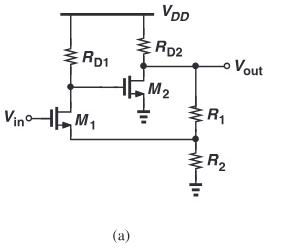
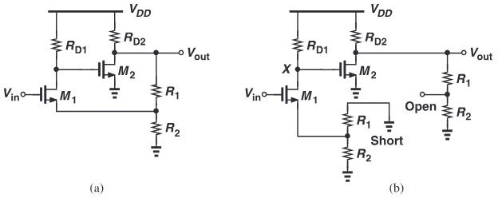

# 예제 12.28 — M1 소스로 귀환하는 2단 CS 증폭기의 해석

## 원문
그림 12.57(a)의 회로를 해석하라.

## 조건
- 회로: Fig 12.57(a), 2단 증폭기
  - 첫째 단: $M_1$ (NMOS, 게이트 입력 $V_{in}$, 드레인은 $R_{D1}$을 거쳐 $V_{DD}$)
  - 둘째 단: $M_2$ (NMOS, 게이트는 $M_1$ 드레인, 소스 접지, 드레인은 $R_{D2}$를 거쳐 $V_{DD}$이고 출력 $V_{out}$)
  - $R_1$–$R_2$: $V_{out}$과 접지 사이 분배기, 가운데 노드가 $M_1$ 소스
- 해석 = 개루프·폐루프 이득과 I/O 임피던스를 구함 (원문에 없음, 원문은 "해석하라"만 적음)
- 전압-전압 귀환에서 귀환 회로망을 끊는 법칙 (본문 Fig 12.53(a)): 감지 복제의 출력 포트는 개방, 반송 복제의 입력 포트는 단락. 귀환율은 입력 포트에 $V_1$을 인가하고 출력 포트를 개방해 $K = V_2/V_1$ (본문 Fig 12.54(a)) (본문 정의, 원문에 없음)
- 소자 값은 주어지지 않음 (원문에 없음)

## 구할 것
- 회로의 해석: 개루프·폐루프 전압 이득, 폐루프 입력·출력 임피던스 (콜론 뒤는 원문에 없음)

## 상속·참조
- 본문 12.7.1절 종지 법칙 (본문 Fig 12.53, 교재 689쪽, 크롭 안 함): 전압-전압 귀환은 감지 복제 출력 포트 개방, 반송 복제 입력 포트 단락. 귀환율 계산 (본문 Fig 12.54(a), 교재 690쪽, 크롭 안 함): $K = V_2/V_1$, 출력 포트 개방
- 예제 12.26, 12.27 (E12.26, E12.27): 출력–접지 분배기 $R_1$–$R_2$의 전압-전압 귀환을 끊는 방법. 반송 복제는 $R_1$ 위 끝을 접지로 단락, 감지 복제는 $R_1$–$R_2$ 사이를 개방, 귀환율 $K = R_2/(R_1 + R_2)$

## 회로 — Fig 12.57(a)
```spice
RD1  VDD   n1    {R_D1}
RD2  VDD   Vout  {R_D2}
M1   n1    Vin   n2   nmos
M2   Vout  n1    0    nmos
R1   Vout  n2    {R_1}
R2   n2    0     {R_2}
```
- 단자: VDD = 전원, 값 미지정 (가로 레일) / Vin = 입력, M1 게이트 (개방 원) / Vout = 출력 (개방 원)
- 표시: 노드 라벨 V_DD (레일 오른쪽 끝), V_in (입력 원 왼쪽), V_out (출력 원 오른쪽) / 소자 라벨 R_D1, R_D2 (각 저항 오른쪽), M1 (트랜지스터 오른쪽), M2 (트랜지스터 오른쪽), R1, R2 (각 저항 오른쪽) / 부호 없음 / 화살표 없음 / 수치·면적 라벨 없음
- 배치: 맨 위 V_DD 가로 레일 / 왼쪽 세로줄 위→아래 레일, R_D1, M1 드레인 접속점(n1), M1 / M1은 보통 방향 NMOS (게이트 왼쪽, 소스 화살표 오른쪽 바깥) / V_in 원 → 가로선 → M1 게이트 / 가운데 세로줄 위→아래 레일, R_D2, M2 드레인 접속점, M2 (보통 방향 NMOS), 소스 아래 접지 / n1 접속점에서 가로선이 오른쪽으로 곧장 M2 게이트 / M2 드레인 접속점에서 가로선이 오른쪽으로 R1 위 접속점을 지나 V_out 원 / 오른쪽 세로줄 위→아래 R1 위 접속점, R1, n2 접속점, R2, 접지 / M1 소스에서 세로선이 아래로 내려가 오른쪽으로 꺾여 M2 아래를 지나 n2 접속점 / 접속점 (세 갈래 이상, 4곳): n1 = 위 R_D1 + 아래 M1 드레인 + 오른쪽 M2 게이트 선 (점), M2 드레인 = 위 R_D2 + 아래 M2 드레인 + 오른쪽 출력선 (점), R1 위 = 왼쪽 출력선 + 아래 R1 + 오른쪽 V_out 원 선 (점), n2 = 위 R1 + 아래 R2 + 왼쪽 M1 소스 선 (점) / 교차: 없음


> 참고: 그림 12.57은 다음 쪽(교재 693쪽, PDF 27 오른쪽)에 인쇄됨

## 답 (검증용)
- 순방향 시스템은 $M_1$, $R_{D1}$, $M_2$, $R_{D2}$, 귀환 회로망은 $R_1$과 $R_2$로 전압을 뺄셈 트랜지스터 $M_1$의 소스에 반송. 앞의 두 예제처럼 개루프 회로를 Fig 12.57(b)처럼 만들고, $M_1$이 $R_1 \parallel R_2$로 축퇴됨에 유의
- $A_0 = (V_X/V_{in})(V_{out}/V_X)$로 쓰면 $A_0 = \dfrac{-R_{D1}}{\dfrac{1}{g_m} + R_1 \parallel R_2} \cdot \{-g_{m2}[R_{D2} \parallel (R_1 + R_2)]\}$ (식 12.133), $R_{in,open} = \infty$ (식 12.134), $R_{out,open} = R_{D2} \parallel (R_1 + R_2)$ (식 12.135)
- 귀환율 $R_2/(R_1 + R_2)$. $\left.\dfrac{V_{out}}{V_{in}}\right|_{closed} = \dfrac{A_0}{1 + \dfrac{R_2}{R_1 + R_2}A_0}$ (식 12.136), $R_{in,closed} = \infty$ (식 12.137), $R_{out,closed} = \dfrac{R_{D2} \parallel (R_1 + R_2)}{1 + \dfrac{R_2}{R_1 + R_2}A_0}$ (식 12.138), $A_0$는 식 (12.133)

### 정답 회로 — Fig 12.57(b)
```spice
RD1  VDD   X     {R_D1}
RD2  VDD   Vout  {R_D2}
M1   X     Vin   n2   nmos
M2   Vout  X     0    nmos
R1A  0     n2    {R_1}   ; 인쇄 라벨 R1, 반송 복제 (위 끝이 접지로 단락, "Short")
R2A  n2    0     {R_2}   ; 인쇄 라벨 R2, 반송 복제
R1B  Vout  n3    {R_1}   ; 인쇄 라벨 R1, 감지 복제
R2B  n3    0     {R_2}   ; 인쇄 라벨 R2, 감지 복제, n3은 "Open" 개방 원
```
- 단자: VDD = 전원, 값 미지정 (가로 레일) / Vin = 입력, M1 게이트 (개방 원) / Vout = 출력 (개방 원) / n3 = 감지 복제의 출력 포트, 개방 ("Open" 글자, 개방 원)
- 표시: 노드 라벨 V_DD (레일 오른쪽 끝), X (X 접속점 왼쪽), V_in (입력 원 왼쪽), V_out (출력 원 오른쪽) / 소자 라벨 R_D1, R_D2, M1, M2 ((a)와 같은 위치), R1, R2 (가운데 아래 반송 복제 각 저항 오른쪽), R1, R2 (오른쪽 감지 복제 각 저항 오른쪽), 글자 "Short" (반송 복제 접지 기호 아래), "Open" (감지 복제 개방 원 아래) / 부호 없음 / 화살표 없음 / 수치·면적 라벨 없음
- 배치: (a)와 같은 레일–R_D1–X–M1, 레일–R_D2–M2–접지 배치 / M2 드레인 접속점에서 긴 가로선이 오른쪽으로 V_out 접속점, V_out 원 / 반송 복제는 M2 아래: 세로줄 R1, n2 접속점, R2, 접지. R1 위 끝에서 선이 올라가 오른쪽으로 꺾여 아래로 접지 기호 ("Short"). M1 소스에서 세로선이 아래로 내려가 오른쪽으로 꺾여 n2 접속점 / 오른쪽 감지 복제: V_out 접속점에서 세로선이 내려와 R1, n3 접속점, R2, 접지. n3 접속점에서 짧은 가로선이 왼쪽 개방 원 ("Open") / 접속점 (세 갈래 이상, 5곳): X = 위 R_D1 + 아래 M1 드레인 + 오른쪽 M2 게이트 선 (점), M2 드레인 = 위 R_D2 + 아래 M2 드레인 + 오른쪽 출력선 (점), V_out = 왼쪽 출력선 + 아래 감지 복제 선 + 오른쪽 V_out 원 (점), n2 = 위 R1 + 아래 R2 + 왼쪽 M1 소스 선 (점), n3 = 위 R1 + 아래 R2 + 왼쪽 개방 원 선 (점) / 교차: 없음


