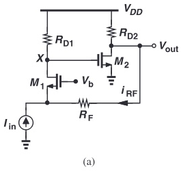
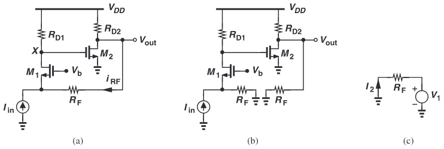

# 예제 12.29 — R_F가 크지 않은 전압-전류 귀환 증폭기 해석

## 원문
$R_F$가 매우 크지 않다고 가정할 때 그림 12.58(a)의 회로를 해석하라.

## 조건
- 회로: Fig 12.58(a) ($M_1$ 공통 게이트, $M_2$ 공통 소스, 출력 $V_{out}$에서 입력 노드로 귀환 저항 $R_F$, 입력은 전류원 $I_{in}$)
- $R_F$가 매우 크지 않음 (귀환 회로망이 순방향 증폭기에 주는 부하를 무시할 수 없음)
- 소자 값은 주어지지 않음 (답은 소신호 파라미터 기호로, $\lambda = 0$으로 봄) (원문에 없음)
- 본문의 해석 순서: 순방향 증폭기와 귀환 회로망을 확인하고, 종지 법칙(Fig 12.53)에 따라 루프를 끊어 개루프 변수를 구한 뒤, Fig 12.54의 법칙으로 귀환율을 구하고 폐루프 변수를 계산 (본문 12.7.1절, 원문에 없음)
- 전압-전류 귀환의 종지 법칙 (본문 Fig 12.53(b)): 감지 복제의 출력 포트와 반송 복제의 입력 포트를 모두 단락 (본문 정의, 원문에 없음)
- 전압-전류 귀환의 귀환율 (본문 Fig 12.54(b)): 귀환 회로망 입력에 전압 $V_1$을 걸고 단락된 출력 포트의 전류 $I_2$를 재어 $K = I_2/V_1$ (본문 정의, 원문에 없음)

## 구할 것
- 회로 해석: 개루프 이득 $R_0 = V_{out}/I_{in}$, 개루프 입력·출력 임피던스, 귀환율 $K$, 폐루프 이득과 폐루프 입력·출력 임피던스 (구할 양의 목록은 원문에 없음, 원문은 "해석하라"만 적음)

## 상속·참조
- 본문 12.7.1절 (교재 688–689쪽): 해석 여섯 단계 = ① 순방향 증폭기 확인 ② 귀환 회로망 확인 ③ 법칙에 따라 귀환 회로망을 끊음 ④ 개루프 변수 계산 ⑤ 법칙에 따라 귀환율 결정 ⑥ 폐루프 변수 계산. 귀환 회로망을 순방향 증폭기의 출력에 복사한 것이 감지 복제, 입력에 복사한 것이 반송 복제
- 본문 Fig 12.53(b) (교재 689쪽, 크롭 안 함): 전압-전류 귀환 블록도. 감지 복제의 출력 포트와 반송 복제의 입력 포트가 모두 접지(단락)
- 본문 Fig 12.54(b) (교재 690쪽, 크롭 안 함): 귀환 회로망 K의 입력에 $V_1$ 전압원(+ 위), 출력 포트를 접지로 단락하고 그 선에 $I_2$ 화살표, $K = I_2/V_1$

## 회로 — Fig 12.58(a)
```spice
RD1  VDD   X     {R_D1}
RD2  VDD   Vout  {R_D2}
M1   X     Vb    n1    nmos
M2   Vout  X     0     nmos
RF   n1    Vout  {R_F}
IIN  0     n1    {I_in}
```
- 단자: VDD = 전원, 값 미지정 (가로 레일) / Vb = M1 게이트 DC 바이어스, 값 미지정 (점 단자) / Vout = 출력 (개방 원)
- 표시: 노드 라벨 VDD (레일 오른쪽 끝 위), X (X 접속점 왼쪽), V_b (점 단자 오른쪽), V_out (출력 원 오른쪽) / 소자 라벨 R_D1 (왼쪽 저항 오른쪽), R_D2 (오른쪽 저항 오른쪽), M1 (M1 왼쪽), M2 (M2 오른쪽), R_F (R_F 저항 아래), I_in (전류원 왼쪽) / 부호 없음 / 화살표 "i_RF": R_F 오른쪽 끝과 오른쪽 아래 모서리 사이 가로 도선, 왼쪽 방향(V_out 쪽에서 R_F 쪽으로), 도선 위, 글자는 화살표 오른쪽 위 / 수치·면적 라벨 없음
- 배치: 맨 위 굵은 가로 레일 VDD, 왼쪽에 R_D1, 오른쪽에 R_D2가 매달림 / 왼쪽 세로줄 위→아래 R_D1, X 접속점, M1, M1 소스 접속점(n1) / M1은 좌우 반전(게이트가 오른쪽, 게이트 선이 오른쪽으로 V_b 점 단자), 드레인 위·소스 아래 / n1에서 가로선이 왼쪽으로 가다 아래로 꺾여 I_in 전류원(원 안 화살표 위쪽), 그 아래 접지 / 오른쪽 세로줄 위→아래 R_D2, M2 드레인 접속점, M2(보통 방향, 게이트 왼쪽), 접지 / X에서 가로선이 오른쪽으로 곧장 M2 게이트 / M2 드레인 접속점에서 가로선이 오른쪽으로 V_out 접속점을 지나 V_out 원 / V_out 접속점에서 세로선이 n1 높이까지 내려가 모서리에서 왼쪽으로 꺾여 R_F를 지나 n1 / 접속점 (세 갈래 이상, 4곳): X = 위 R_D1 + 아래 M1 드레인 + 오른쪽 M2 게이트 선 (점), M2 드레인 = 위 R_D2 + 아래 M2 드레인 + 오른쪽 선 (점), V_out 접속점 = 왼쪽 선 + 오른쪽 출력 원 + 아래 귀환 선 (점), n1 = 위 M1 소스 + 왼쪽 I_in 선 + 오른쪽 R_F (점) / 교차: 없음


> 참고: 문제 문장은 교재 693쪽(PDF 27 오른쪽), 그림 12.58은 다음 쪽 694쪽(PDF 28 왼쪽) 맨 위에 인쇄됨

## 답 (검증용)
- 순방향 증폭기 = $M_1$, $R_{D1}$, $M_2$, $R_{D2}$, 귀환 회로망 = $R_F$. 루프를 Fig 12.58(b)처럼 엶 (감지 복제·반송 복제 모두 $R_F$를 접지에 연결)
- $V_X = I_{in}\dfrac{R_F R_{D1}}{R_F + 1/g_{m1}}$ (식 12.139), $R_0 = \dfrac{V_{out}}{I_{in}} = \dfrac{R_F R_{D1}}{R_F + 1/g_{m1}}\cdot[-g_{m2}(R_{D2} \parallel R_F)]$ (식 12.140)
- $R_{in,open} = \dfrac{1}{g_{m1}} \parallel R_F$, $R_{out,open} = R_{D2} \parallel R_F$ (식 12.141, 12.142)
- 테스트 회로 Fig 12.58(c)로 $K = I_2/V_1 = -1/R_F$ (식 12.143, 12.144). $R_0$와 $K$가 모두 음 → 루프 이득 양, 부귀환
- $\left.\dfrac{V_{out}}{I_{in}}\right|_{closed} = \dfrac{R_0}{1 - R_0/R_F}$, $R_{in,closed} = \dfrac{(1/g_{m1}) \parallel R_F}{1 - R_0/R_F}$, $R_{out,closed} = \dfrac{R_{D2} \parallel R_F}{1 - R_0/R_F}$ (식 12.145–12.147)

### 정답 회로 — Fig 12.58(b)
```spice
RD1  VDD   n2    {R_D1}
RD2  VDD   Vout  {R_D2}
M1   n2    Vb    n1    nmos
M2   Vout  n2    0     nmos
RF1  n1    0     {R_F}   ; 반송 복제, 인쇄 라벨 R_F
RF2  0     Vout  {R_F}   ; 감지 복제, 인쇄 라벨 R_F
IIN  0     n1    {I_in}
```
- 단자: VDD = 전원 (가로 레일) / Vb = M1 게이트 바이어스 (점 단자) / Vout = 출력 (개방 원)
- 표시: 노드 라벨 VDD, V_b, V_out ((a)와 같은 위치, X 라벨은 인쇄되지 않음) / 소자 라벨 R_D1, R_D2, M1, M2, I_in ((a)와 같은 위치), R_F 두 개 (각 저항 아래) / 부호 없음 / 화살표 없음 / 수치·면적 라벨 없음
- 배치: (a)와 같은 VDD 레일, R_D1–M1 왼쪽 세로줄, R_D2–M2 오른쪽 세로줄, 드레인 접속점에서 M2 게이트로 가는 가로선 / n1에서 오른쪽으로 R_F(반송 복제)를 지나 아래로 꺾여 접지 / 그 바로 오른쪽에 접지 기호에서 올라온 선이 오른쪽으로 R_F(감지 복제)를 지나 모서리에서 위로 꺾여 V_out 접속점 / 접속점 (세 갈래 이상, 4곳): M1 드레인 접속점 (점), M2 드레인 접속점 (점), V_out 접속점 (점), n1 = 위 M1 소스 + 왼쪽 I_in 선 + 오른쪽 R_F (점) / 교차: 없음

### 정답 회로 — Fig 12.58(c)
```spice
* VAC는 그림에 없는 소자: I_2 화살표가 붙은 접지 단락선을 적기 위한 0 V 전압원
* 소신호 단락만 의미. 노드 순서 0 → n1이 그림의 I_2 방향(접지 → 위쪽 모서리)과 같음
VAC  0    n1   0
RF   n1   n2   {R_F}
V1   n2   0    {V_1}
```
- 단자: 개방 단자 없음 (왼쪽은 도선이 접지 기호로, V1 아래쪽도 접지 기호로)
- 표시: 노드 라벨 없음 / 소자 라벨 R_F (저항 아래), V_1 (전압원 오른쪽) / 부호 V_1 전압원 왼쪽에 + 위, − 아래 / 화살표 "I_2": 왼쪽 세로 도선(접지 → 위 모서리), 위 방향, 도선 위, 글자는 화살표 왼쪽 / 수치·면적 라벨 없음
- 배치: 왼쪽 접지 기호에서 세로선이 올라가 모서리에서 오른쪽으로 꺾여 R_F, 다시 오른쪽 모서리에서 아래로 꺾여 V_1 전압원의 + 단자, V_1 − 단자 아래 접지 / 접속점: 없음 / 교차: 없음


