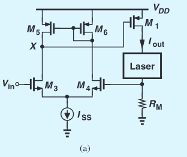
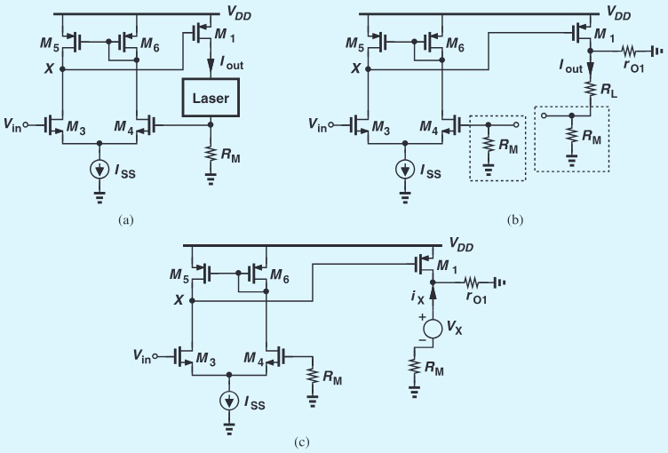

# 예제 12.30 — R_M과 r_O1이 유한한 레이저 구동 전류-전압 귀환 회로 해석

## 원문
$R_M$이 작지 않고, $r_{O1} < \infty$이고 레이저 다이오드가 임피던스 $R_L$을 갖는다고 가정할 때 그림 12.59(a)의 회로를 해석하라.

## 조건
- 회로: Fig 12.59(a) (차동쌍 $M_3$–$M_4$, 전류 거울 부하 $M_5$–$M_6$, 꼬리 전류원 $I_{SS}$, 출력 트랜지스터 $M_1$이 레이저에 $I_{out}$을 공급, 레이저 아래 감지 저항 $R_M$의 전압을 $M_4$ 게이트로 귀환)
- $R_M$이 작지 않음
- $M_1$의 출력 저항 유한: $r_{O1} < \infty$
- 레이저 다이오드는 임피던스 $R_L$로 모델링
- 소자 값은 주어지지 않음 (답은 소신호 파라미터 기호로) (원문에 없음)
- 본문의 해석 순서: 순방향 증폭기와 귀환 회로망을 확인하고, 종지 법칙(Fig 12.53)에 따라 루프를 끊어 개루프 변수를 구한 뒤, Fig 12.54의 법칙으로 귀환율을 구하고 폐루프 변수를 계산 (본문 12.7.1절, 원문에 없음)
- 전류-전압 귀환의 종지 법칙 (본문 Fig 12.53(d)): 감지 복제의 출력 포트와 반송 복제의 입력 포트를 모두 개방 (본문 정의, 원문에 없음)
- 전류-전압 귀환의 귀환율 (본문 Fig 12.54(d)): 귀환 회로망 입력에 전류 $I_1$을 흘리고 개방된 출력 포트의 전압 $V_2$를 재어 $K = V_2/I_1$ (본문 정의, 원문에 없음)

## 구할 것
- 회로 해석: 개루프 이득 $G_m = I_{out}/V_{in}$, 개루프 입력·출력 임피던스, 귀환율 $K$, 폐루프 이득과 폐루프 입력·출력 임피던스 (구할 양의 목록은 원문에 없음, 원문은 "해석하라"만 적음)

## 상속·참조
- 본문 12.7.1절 (교재 688–689쪽): 해석 여섯 단계 = ① 순방향 증폭기 확인 ② 귀환 회로망 확인 ③ 법칙에 따라 귀환 회로망을 끊음 ④ 개루프 변수 계산 ⑤ 법칙에 따라 귀환율 결정 ⑥ 폐루프 변수 계산. 귀환 회로망을 순방향 증폭기의 출력에 복사한 것이 감지 복제, 입력에 복사한 것이 반송 복제
- 본문 Fig 12.53(d) (교재 689쪽, 크롭 안 함): 전류-전압 귀환 블록도. 반송 복제의 입력 포트와 감지 복제의 출력 포트 옆에 각각 "Open"
- 본문 Fig 12.54(d) (교재 690쪽, 크롭 안 함): 귀환 회로망 K의 입력에 전류원 $I_1$, 출력 포트는 개방하고 그 전압 $V_2$(+ 위, − 아래), $K = V_2/I_1$

## 회로 — Fig 12.59(a)
```spice
M5    X    n2   VDD  pmos
M6    n2   n2   VDD  pmos
M3    X    Vin  n1   nmos
M4    n2   n3   n1   nmos
ISS   n1   0    {I_SS}
M1    n4   X    VDD  pmos
XLAS  n4   n3   box "Laser"  ; 레이저 다이오드 (상자로 그려짐)
RM    n3   0    {R_M}
```
- 단자: VDD = 전원, 값 미지정 (가로 레일) / Vin = 입력 (개방 원)
- 표시: 노드 라벨 VDD (레일 오른쪽 끝 위), X (X 접속점 왼쪽), V_in (입력 원 왼쪽) / 소자 라벨 M5 (M5 왼쪽), M6 (M6 오른쪽), M3 (M3 오른쪽), M4 (M4 왼쪽), M1 (M1 오른쪽), I_SS (전류원 오른쪽), R_M (저항 오른쪽), "Laser" (굵은 사각 상자 안 글자) / 부호 없음 / 화살표 "I_out": M1 드레인과 Laser 상자 윗변 사이 세로 도선, 아래 방향, 도선 위, 글자는 화살표 오른쪽 / 수치·면적 라벨 없음
- 배치: 맨 위 굵은 가로 레일 VDD에 M5, M6, M1의 소스가 매달림 / M5는 좌우 반전(게이트 오른쪽), M6은 보통 방향(게이트 왼쪽), 두 게이트가 가로선으로 이어지고 그 가운데 접속점에서 선이 아래로 내려가 오른쪽으로 꺾여 M6 드레인 접속점에 닿음(M6 다이오드 연결) / 왼쪽 세로줄 위→아래 M5, X 접속점, M3(보통 방향, 게이트 왼쪽에서 V_in 원) / 가운데 세로줄 위→아래 M6, M6 드레인 접속점, M4(좌우 반전, 게이트 오른쪽) / M3, M4 소스가 아래에서 가로선으로 이어져 가운데 꼬리 접속점, 그 아래 I_SS(원 안 화살표 아래쪽), 접지 / X에서 가로선이 오른쪽으로 길게 가다 모서리에서 위로 꺾여 M1 게이트(M1은 보통 방향, 게이트 왼쪽) / 오른쪽 세로줄 위→아래 M1, I_out 화살표, Laser 상자, 상자 아래 접속점, R_M, 접지 / 상자 아래 접속점에서 가로선이 왼쪽으로 가 M4 게이트 / 접속점 (세 갈래 이상, 5곳): X = 위 M5 드레인 + 아래 M3 드레인 + 오른쪽 M1 게이트 선 (점), 게이트 선 가운데 = 왼쪽 M5 게이트 + 오른쪽 M6 게이트 + 아래로 내려가는 다이오드 연결선 (점), M6 드레인 = 위 M6 드레인 + 왼쪽 다이오드 연결선 + 아래 M4 드레인 선 (점), 꼬리 = M3 소스 + M4 소스 + 아래 I_SS (점), 상자 아래 = 위 Laser + 아래 R_M + 왼쪽 M4 게이트 선 (점) / 교차: X에서 M1 게이트로 가는 가로선이 M6 드레인에서 M4 드레인으로 내려가는 세로선과 점 없이 교차



## 답 (검증용)
- 순방향 증폭기 = $M_1$, $M_3$–$M_6$, 귀환 회로망 = $R_M$. 루프를 Fig 12.59(b)처럼 엶 (감지 복제의 출력 포트와 반송 복제의 입력 포트를 개방)
- $G_m = I_{out}/V_{in} = (V_X/V_{in})(I_{out}/V_X)$, $V_X/V_{in} = -g_{m3}(r_{O3} \parallel r_{O5})$ (식 12.148), $I_{out} = -\dfrac{r_{O1}}{r_{O1} + R_L + R_M} g_{m1} V_X$ (식 12.149, 음의 부호는 $I_{out}$이 트랜지스터로 흘러 나가기 때문)
- $G_m = \dfrac{g_{m3}(r_{O3} \parallel r_{O5}) g_{m1} r_{O1}}{r_{O1} + R_L + R_M}$ (식 12.150)
- 출력 임피던스: $R_L$ 대신 테스트 전압원 (Fig 12.59(c)), 원문 식 (12.151)–(12.152)는 $R_{in,open} = V_X/I_X = r_{O1} + R_M$으로 인쇄됨
- 문맥과 맞지 않음(오식으로 보임): 본문이 출력 임피던스를 구한다고 하고 식 (12.157)이 $R_{out,closed} = (r_{O1} + R_M)(1 + R_M G_m)$이므로 좌변은 $R_{out,open}$으로 읽힘 (원문에 없음)
- $K = V_2/I_1 = R_M$ (식 12.153, 12.154)
- $\left.\dfrac{I_{out}}{V_{in}}\right|_{closed} = \dfrac{G_m}{1 + R_M G_m}$, $R_{in,closed} = \infty$, $R_{out,closed} = (r_{O1} + R_M)(1 + R_M G_m)$ (식 12.155–12.157)

### 정답 회로 — Fig 12.59(b)
```spice
M5    X    n2   VDD  pmos
M6    n2   n2   VDD  pmos
M3    X    Vin  n1   nmos
M4    n2   n3   n1   nmos
ISS   n1   0    {I_SS}
RM1   n3   0    {R_M}    ; 반송 복제, 인쇄 라벨 R_M, n3은 오른쪽 개방 원
M1    n4   X    VDD  pmos
RO1   n4   0    {r_O1}   ; 오른쪽 끝은 옆으로 누운 접지 기호
RL    n4   n5   {R_L}
RM2   n5   0    {R_M}    ; 감지 복제, 인쇄 라벨 R_M, n5는 왼쪽 개방 원
```
- 단자: VDD = 전원 (가로 레일) / Vin = 입력 (개방 원) / n3 = 반송 복제의 열린 포트, M4 게이트 접속점에서 오른쪽으로 (개방 원) / n5 = 감지 복제의 열린 포트, R_L 아래 접속점에서 왼쪽으로 (개방 원)
- 표시: 노드 라벨 VDD, X, V_in ((a)와 같은 위치) / 소자 라벨 M5, M6, M3, M4, M1, I_SS ((a)와 같은 위치), r_O1 (저항 아래), R_L (저항 오른쪽), R_M 두 개 (각 저항 오른쪽) / 부호 없음 / 화살표 "I_out": M1 드레인 접속점과 R_L 사이 세로 도선, 아래 방향, 도선 위, 글자는 화살표 왼쪽 / 수치·면적 라벨 없음
- 배치: 왼쪽 차동쌍·전류 거울·I_SS 부분은 (a)와 같음 (X에서 M1 게이트로 가는 가로선이 M6–M4 세로선과 점 없이 교차) / M4 게이트 선이 오른쪽으로 접속점, 거기서 아래로 R_M(반송 복제)과 접지, 오른쪽으로 개방 원. 이 부분이 점선 사각형 안 / M1 드레인 아래 접속점에서 오른쪽으로 r_O1을 지나 옆으로 누운 접지 기호, 아래로 I_out 화살표, R_L / R_L 아래가 접속점, 거기서 왼쪽으로 개방 원, 아래로 R_M(감지 복제)과 접지. 이 부분이 또 다른 점선 사각형 안 / 접속점 (세 갈래 이상, 8곳): (a)의 X, 게이트 선 가운데, M6 드레인, 꼬리 (각각 점), M4 게이트 쪽 반송 복제 접속점 (점), M1 드레인 = 위 M1 + 오른쪽 r_O1 + 아래 R_L 쪽 (점), R_L 아래 = 위 R_L + 왼쪽 개방 원 + 아래 R_M (점) / 교차: X–M1 게이트 가로선과 M6–M4 세로선 (점 없음)

### 정답 회로 — Fig 12.59(c)
```spice
M5    X    n2   VDD  pmos
M6    n2   n2   VDD  pmos
M3    X    Vin  n1   nmos
M4    n2   n3   n1   nmos
ISS   n1   0    {I_SS}
RM1   n3   0    {R_M}
M1    n4   X    VDD  pmos
RO1   n4   0    {r_O1}   ; 오른쪽 끝은 옆으로 누운 접지 기호
VX    n4   n5   {V_X}
RM2   n5   0    {R_M}
```
- 단자: VDD = 전원 (가로 레일) / Vin = 입력 (개방 원)
- 표시: 노드 라벨 VDD, X, V_in / 소자 라벨 M5, M6, M3, M4, M1, I_SS, r_O1, R_M 두 개 (M4 게이트 쪽 저항 오른쪽, V_X 아래 저항 오른쪽), V_X (전압원 오른쪽) / 부호 V_X 전압원 왼쪽에 + 위, − 아래 / 화살표 "i_X": V_X + 단자와 M1 드레인 접속점 사이 세로 도선, 위 방향, 도선 위, 글자는 화살표 왼쪽 / 수치·면적 라벨 없음
- 배치: 왼쪽 부분은 (a)와 같고 M4 게이트 선이 오른쪽으로 가 아래로 꺾여 R_M과 접지 (개방 원 없음, 점선 상자 없음) / M1 드레인 접속점에서 오른쪽으로 r_O1과 옆으로 누운 접지, 아래로 i_X 화살표, V_X(+ 위), 그 아래 R_M과 접지 / 접속점 (세 갈래 이상, 5곳): X, 게이트 선 가운데, M6 드레인, 꼬리 (각각 점), M1 드레인 = 위 M1 + 오른쪽 r_O1 + 아래 V_X (점) / 교차: X–M1 게이트 가로선과 M6–M4 세로선 (점 없음)


