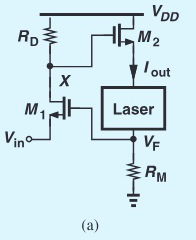
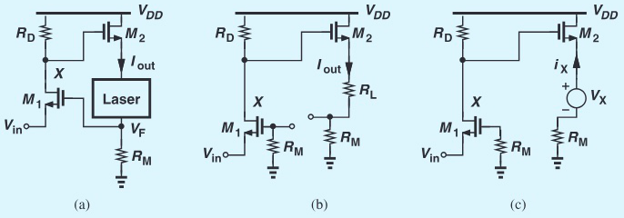

# 예제 12.31 — 공통 게이트 입력과 소스 폴로어로 레이저를 구동하는 귀환 회로 해석

## 원문
$R_M$이 작지 않고, 레이저 다이오드가 임피던스 $R_L$을 갖는다고 가정할 때 그림 12.60(a)의 회로를 해석하라.

## 조건
- 회로: Fig 12.60(a) ($M_1$ 공통 게이트(소스가 입력 $V_{in}$), 드레인 저항 $R_D$, $M_2$ 소스 폴로어가 레이저에 $I_{out}$을 공급, 레이저 아래 감지 저항 $R_M$의 전압 $V_F$를 $M_1$ 게이트로 귀환)
- $R_M$이 작지 않음
- 레이저 다이오드는 임피던스 $R_L$로 모델링
- 소자 값은 주어지지 않음 (답은 소신호 파라미터 기호로, $\lambda = 0$으로 봄) (원문에 없음)
- 본문의 해석 순서: 순방향 증폭기와 귀환 회로망을 확인하고, 종지 법칙(Fig 12.53)에 따라 루프를 끊어 개루프 변수를 구한 뒤, Fig 12.54의 법칙으로 귀환율을 구하고 폐루프 변수를 계산 (본문 12.7.1절, 원문에 없음)
- 전류-전압 귀환의 종지 법칙 (본문 Fig 12.53(d)): 감지 복제의 출력 포트와 반송 복제의 입력 포트를 모두 개방 (본문 정의, 원문에 없음)
- 전류-전압 귀환의 귀환율 (본문 Fig 12.54(d)): 귀환 회로망 입력에 전류 $I_1$을 흘리고 개방된 출력 포트의 전압 $V_2$를 재어 $K = V_2/I_1$ (본문 정의, 원문에 없음)

## 구할 것
- 회로 해석: 개루프 이득 $G_m = I_{out}/V_{in}$, 개루프 입력·출력 임피던스, 귀환율 $K$, 폐루프 이득과 폐루프 입력·출력 임피던스 (구할 양의 목록은 원문에 없음, 원문은 "해석하라"만 적음)

## 상속·참조
- 예제 12.30 (E12.30): 같은 전류-전압 귀환(레이저 전류 $I_{out}$을 $R_M$으로 감지해 전압으로 반송). 귀환율 $K = V_2/I_1 = R_M$ (식 12.154). 풀이는 "예제 12.30과 비슷한 방법으로" 루프를 엶
- 본문 12.7.1절 (교재 688–689쪽): 해석 여섯 단계 = ① 순방향 증폭기 확인 ② 귀환 회로망 확인 ③ 법칙에 따라 귀환 회로망을 끊음 ④ 개루프 변수 계산 ⑤ 법칙에 따라 귀환율 결정 ⑥ 폐루프 변수 계산
- 본문 Fig 12.53(d), Fig 12.54(d) (교재 689–690쪽, 크롭 안 함): 전류-전압 귀환에서 두 복제의 포트를 모두 개방, $K = V_2/I_1$

## 회로 — Fig 12.60(a)
```spice
RD    VDD  X    {R_D}
M1    X    VF   Vin  nmos
M2    VDD  X    n1   nmos
XLAS  n1   VF   box "Laser"  ; 레이저 다이오드 (상자로 그려짐)
RM    VF   0    {R_M}
```
- 단자: VDD = 전원, 값 미지정 (가로 레일) / Vin = 입력, M1 소스 (개방 원)
- 표시: 노드 라벨 VDD (레일 오른쪽 끝 위), X (X 접속점 오른쪽 아래), V_in (입력 원 왼쪽), V_F (상자 아래 접속점 오른쪽) / 소자 라벨 R_D (저항 왼쪽), M1 (M1 왼쪽), M2 (M2 오른쪽), R_M (저항 오른쪽), "Laser" (굵은 사각 상자 안 글자) / 부호 없음 / 화살표 "I_out": M2 소스와 Laser 상자 윗변 사이 세로 도선, 아래 방향, 도선 위, 글자는 화살표 오른쪽 / 수치·면적 라벨 없음
- 배치: 맨 위 굵은 가로 레일 VDD, 왼쪽에 R_D, 오른쪽에 M2 드레인이 매달림 / 왼쪽 세로줄 위→아래 R_D, X 접속점, M1 / M1은 좌우 반전(게이트 오른쪽), 드레인 위, 소스 아래에서 내려가 왼쪽으로 꺾여 V_in 원 / X에서 가로선이 오른쪽으로 가다 위로 꺾여 M2 게이트(M2는 보통 방향, 게이트 왼쪽, 드레인 위·소스 아래) / 오른쪽 세로줄 위→아래 M2, I_out 화살표, Laser 상자, V_F 접속점, R_M, 접지 / M1 게이트 선은 오른쪽으로 짧게 가 아래로 꺾여 V_F 높이에서 다시 오른쪽으로 꺾여 V_F 접속점 (Laser 상자 왼쪽 아래를 지남) / 접속점 (세 갈래 이상, 2곳): X = 위 R_D + 아래 M1 드레인 + 오른쪽 M2 게이트 선 (점), V_F = 위 Laser + 아래 R_M + 왼쪽 M1 게이트 선 (점) / 교차: 없음



## 답 (검증용)
- 순방향 증폭기 = $M_1$, $R_D$, $M_2$ (전압을 감지하고 전류를 부하에 공급), 귀환 회로망 = $R_M$. 루프를 Fig 12.60(b)처럼 엶
- $G_m = I_{out}/V_{in} = (V_X/V_{in})(I_{out}/V_X)$, 공통 게이트 단처럼 $V_X/V_{in} = g_{m1} R_D$
- $M_2$를 소스 폴로어로 보아 $\dfrac{V_A}{V_X} = \dfrac{R_L + R_M}{R_L + R_M + 1/g_{m2}}$ (식 12.158), $I_{out} = \dfrac{V_A}{R_L + R_M} = \dfrac{V_X}{R_L + R_M + 1/g_{m2}}$ (식 12.159, 12.160)
- 원문의 $V_A$는 그림 12.60에 라벨이 인쇄되지 않은 노드 ($M_2$ 소스로 읽힘) (원문에 없음)
- $G_m = \dfrac{g_{m1} R_D}{R_L + R_M + 1/g_{m2}}$ (식 12.161), 개루프 입력 임피던스 $1/g_{m1}$
- 개루프 출력 임피던스: $R_L$ 대신 테스트 전압원 (Fig 12.60(c)) $V_X/I_X = 1/g_{m2} + R_M$ (식 12.162)
- 귀환율은 예제 12.30과 같음 ($K = R_M$)
- $\left.\dfrac{I_{out}}{V_{in}}\right|_{closed} = \dfrac{G_m}{1 + R_M G_m}$, $R_{in,closed} = \dfrac{1}{g_{m1}}(1 + R_M G_m)$, $R_{out,closed} = \left(\dfrac{1}{g_{m2}} + R_M\right)(1 + R_M G_m)$ (식 12.163–12.165)

### 정답 회로 — Fig 12.60(b)
```spice
RD    VDD  X    {R_D}
M1    X    n1   Vin  nmos
RM1   n1   0    {R_M}    ; 반송 복제, 인쇄 라벨 R_M, n1은 오른쪽 개방 원
M2    VDD  X    n2   nmos
RL    n2   n3   {R_L}
RM2   n3   0    {R_M}    ; 감지 복제, 인쇄 라벨 R_M, n3은 왼쪽 개방 원
```
- 단자: VDD = 전원 (가로 레일) / Vin = 입력 (개방 원) / n1 = 반송 복제의 열린 포트, M1 게이트 접속점에서 오른쪽으로 (개방 원) / n3 = 감지 복제의 열린 포트, R_L 아래 접속점에서 왼쪽으로 (개방 원)
- 표시: 노드 라벨 VDD, X (M1 드레인 선 오른쪽, M1 위), V_in / 소자 라벨 R_D, M1, M2, R_L (저항 오른쪽), R_M 두 개 (각 저항 오른쪽) / 부호 없음 / 화살표 "I_out": M2 소스와 R_L 사이 세로 도선, 아래 방향, 도선 위, 글자는 화살표 왼쪽 / 수치·면적 라벨 없음
- 배치: VDD 레일, R_D–X–M1 왼쪽 세로줄, X에서 오른쪽으로 가다 위로 꺾여 M2 게이트 ((a)와 같음) / M1 게이트 선이 오른쪽 접속점, 거기서 아래로 R_M과 접지, 오른쪽으로 개방 원 / M2 소스 아래로 I_out 화살표, R_L, R_L 아래 접속점, 거기서 왼쪽으로 개방 원, 아래로 R_M과 접지 / 접속점 (세 갈래 이상, 3곳): X (점), M1 게이트 쪽 반송 복제 접속점 (점), R_L 아래 접속점 (점) / 교차: 없음

### 정답 회로 — Fig 12.60(c)
```spice
RD    VDD  X    {R_D}
M1    X    n1   Vin  nmos
RM1   n1   0    {R_M}
M2    VDD  X    n2   nmos
VX    n2   n3   {V_X}
RM2   n3   0    {R_M}
```
- 단자: VDD = 전원 (가로 레일) / Vin = 입력 (개방 원)
- 표시: 노드 라벨 VDD, X, V_in / 소자 라벨 R_D, M1, M2, R_M 두 개 (각 저항 오른쪽), V_X (전압원 오른쪽) / 부호 V_X 전압원 왼쪽에 + 위, − 아래 / 화살표 "i_X": M2 소스와 V_X + 단자 사이 세로 도선, 위 방향, 도선 위, 글자는 화살표 왼쪽 / 수치·면적 라벨 없음
- 배치: 왼쪽 부분은 (b)와 같되 M1 게이트 선이 오른쪽으로 가 아래로 꺾여 R_M과 접지 (개방 원 없음) / M2 소스 아래로 i_X 화살표, V_X(+ 위), 그 아래 R_M과 접지 / 접속점 (세 갈래 이상, 1곳): X (점) / 교차: 없음


