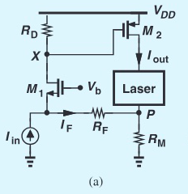
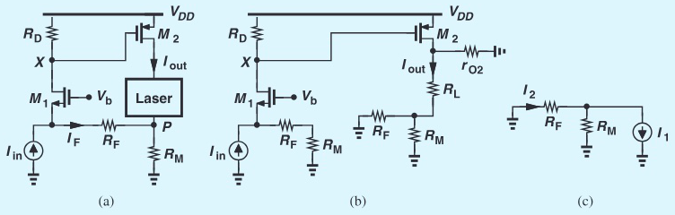

# 예제 12.32 — R_F, R_M, r_O2가 유한한 레이저 구동 전류-전류 귀환 회로 해석

## 원문
$R_F$가 크지 않고, $R_M$이 작지 않으며, 레이저 다이오드가 저항 $R_L$에 의해 모델링될 때 그림 12.61(a)의 회로를 해석하라. 역시 $r_{O2} < \infty$라고 가정하라.

## 조건
- 회로: Fig 12.61(a) ($M_1$ 공통 게이트(입력 전류 $I_{in}$이 소스로), 드레인 저항 $R_D$, PMOS $M_2$가 레이저에 $I_{out}$을 공급, 레이저 아래 노드 $P$에서 $R_M$으로 접지, $P$와 입력 노드 사이 귀환 저항 $R_F$)
- $R_F$가 크지 않음, $R_M$이 작지 않음
- 레이저 다이오드는 저항 $R_L$로 모델링
- $M_2$의 출력 저항 유한: $r_{O2} < \infty$
- 소자 값은 주어지지 않음 (답은 소신호 파라미터 기호로) (원문에 없음)
- 본문의 해석 순서: 순방향 증폭기와 귀환 회로망을 확인하고, 종지 법칙(Fig 12.53)에 따라 루프를 끊어 개루프 변수를 구한 뒤, Fig 12.54의 법칙으로 귀환율을 구하고 폐루프 변수를 계산 (본문 12.7.1절, 원문에 없음)
- 전류-전류 귀환의 종지 법칙 (본문 Fig 12.53(c)): 감지 복제의 출력 포트는 단락, 반송 복제의 입력 포트는 개방 (본문 정의, 원문에 없음)
- 전류-전류 귀환의 귀환율 (본문 Fig 12.54(c)): 귀환 회로망 입력에 전류 $I_1$을 흘리고 단락된 출력 포트의 전류 $I_2$를 재어 $K = I_2/I_1$ (본문 정의, 원문에 없음)

## 구할 것
- 회로 해석: 개루프 전류 이득 $A_{I,open} = I_{out}/I_{in}$, 개루프 입력·출력 임피던스, 귀환율 $K$, 폐루프 이득과 폐루프 입력·출력 임피던스 (구할 양의 목록은 원문에 없음, 원문은 "해석하라"만 적음)

## 상속·참조
- 본문 12.7.1절 (교재 688–689쪽): 해석 여섯 단계 = ① 순방향 증폭기 확인 ② 귀환 회로망 확인 ③ 법칙에 따라 귀환 회로망을 끊음 ④ 개루프 변수 계산 ⑤ 법칙에 따라 귀환율 결정 ⑥ 폐루프 변수 계산. 귀환 회로망을 순방향 증폭기의 출력에 복사한 것이 감지 복제, 입력에 복사한 것이 반송 복제
- 본문 Fig 12.53(c) (교재 689쪽, 크롭 안 함): 전류-전류 귀환 블록도. 반송 복제의 입력 포트 옆에 "Open", 감지 복제의 출력 포트는 접지로 단락
- 본문 Fig 12.54(c) (교재 690쪽, 크롭 안 함): 귀환 회로망 K의 입력에 전류원 $I_1$, 출력 포트를 접지로 단락하고 그 선에 $I_2$ 화살표, $K = I_2/I_1$

## 회로 — Fig 12.61(a)
```spice
RD    VDD  X    {R_D}
M1    X    Vb   n1   nmos
IIN   0    n1   {I_in}
RF    n1   P    {R_F}
M2    n2   X    VDD  pmos
XLAS  n2   P    box "Laser"  ; 레이저 다이오드 (상자로 그려짐)
RM    P    0    {R_M}
```
- 단자: VDD = 전원, 값 미지정 (가로 레일) / Vb = M1 게이트 DC 바이어스, 값 미지정 (점 단자)
- 표시: 노드 라벨 VDD (레일 오른쪽 끝 위), X (X 접속점 왼쪽), V_b (점 단자 오른쪽), P (P 접속점 오른쪽 아래) / 소자 라벨 R_D (저항 왼쪽), M1 (M1 왼쪽), M2 (M2 오른쪽), I_in (전류원 왼쪽), R_F (저항 아래), R_M (저항 오른쪽), "Laser" (굵은 사각 상자 안 글자) / 부호 없음 / 화살표 "I_out": M2 드레인과 Laser 상자 윗변 사이 세로 도선, 아래 방향, 도선 위, 글자는 화살표 오른쪽; "I_F": n1 접속점과 R_F 사이 가로 도선, 오른쪽 방향(입력 노드 → R_F), 도선 위, 글자는 화살표 아래 / 수치·면적 라벨 없음
- 배치: 맨 위 굵은 가로 레일 VDD, 왼쪽에 R_D, 오른쪽에 M2 소스가 매달림 / 왼쪽 세로줄 위→아래 R_D, X 접속점, M1, M1 소스 접속점(n1) / M1은 좌우 반전(게이트 오른쪽, 게이트 선이 오른쪽으로 V_b 점 단자) / n1에서 가로선이 왼쪽으로 가다 아래로 꺾여 I_in 전류원(원 안 화살표 위쪽), 그 아래 접지 / X에서 가로선이 오른쪽으로 가다 위로 꺾여 M2 게이트(M2 PMOS, 보통 방향, 게이트 왼쪽, 소스 위·드레인 아래) / 오른쪽 세로줄 위→아래 M2, I_out 화살표, Laser 상자, P 접속점, R_M, 접지 / n1에서 오른쪽으로 I_F 화살표, R_F를 지나 P 접속점 / 접속점 (세 갈래 이상, 3곳): X = 위 R_D + 아래 M1 드레인 + 오른쪽 M2 게이트 선 (점), n1 = 위 M1 소스 + 왼쪽 I_in 선 + 오른쪽 R_F 선 (점), P = 위 Laser + 아래 R_M + 왼쪽 R_F (점) / 교차: 없음



## 답 (검증용)
- 순방향 시스템 = $M_1$, $R_D$, $M_2$, 귀환 회로망 = $R_M$과 $R_F$. 루프를 Fig 12.61(b)처럼 엶 (귀환 회로망이 전류를 입력에 반송하므로 감지 복제의 출력 포트는 단락)
- $A_{I,open} = (V_X/I_{in})(I_{out}/V_X) = \dfrac{(R_F + R_M) R_D}{R_F + R_M + 1/g_{m1}}\cdot\dfrac{-g_{m2} r_{O2}}{r_{O2} + R_L + R_M \parallel R_F}$ (식 12.166, 두 분수는 $I_{in}$이 $R_F + R_M$과 $M_1$으로 나뉘는 것)
- $R_{in,open} = \dfrac{1}{g_{m1}} \parallel (R_F + R_M)$, $R_{out,open} = r_{O2} + R_F \parallel R_M$ (식 12.167, 12.168, 후자는 Fig 12.59(c)와 비슷한 방법)
- Fig 12.61(c)로 $K = I_2/I_1 = -\dfrac{R_M}{R_M + R_F}$ (식 12.169, 12.170)
- $A_{I,closed} = \dfrac{A_{I,open}}{1 - \frac{R_M}{R_M + R_F} A_{I,open}}$, $R_{in,closed} = \dfrac{\frac{1}{g_{m1}} \parallel (R_F + R_M)}{1 - \frac{R_M}{R_M + R_F} A_{I,open}}$, $R_{out,closed} = (r_{O2} + R_F \parallel R_M)\left(1 - \dfrac{R_M}{R_M + R_F} A_{I,open}\right)$ (식 12.171–12.173)

### 정답 회로 — Fig 12.61(b)
```spice
RD    VDD  X    {R_D}
M1    X    Vb   n1   nmos
IIN   0    n1   {I_in}
RF1   n1   n3   {R_F}    ; 반송 복제, 인쇄 라벨 R_F
RM1   n3   0    {R_M}    ; 반송 복제, 인쇄 라벨 R_M
M2    n2   X    VDD  pmos
RO2   n2   0    {r_O2}   ; 오른쪽 끝은 옆으로 누운 접지 기호
RL    n2   n4   {R_L}
RF2   0    n4   {R_F}    ; 감지 복제, 인쇄 라벨 R_F, 왼쪽 끝은 접지 기호
RM2   n4   0    {R_M}    ; 감지 복제, 인쇄 라벨 R_M
```
- 단자: VDD = 전원 (가로 레일) / Vb = M1 게이트 바이어스 (점 단자)
- 표시: 노드 라벨 VDD, X, V_b ((a)와 같은 위치) / 소자 라벨 R_D, M1, M2, I_in, r_O2 (저항 아래), R_L (저항 오른쪽), R_F 두 개 (각 저항 아래), R_M 두 개 (각 저항 오른쪽) / 부호 없음 / 화살표 "I_out": M2 드레인 접속점과 R_L 사이 세로 도선, 아래 방향, 도선 위, 글자는 화살표 왼쪽 / 수치·면적 라벨 없음
- 배치: VDD 레일, R_D–X–M1 왼쪽 세로줄, n1에서 왼쪽 아래 I_in, X에서 오른쪽으로 가다 위로 꺾여 M2 게이트 ((a)와 같음, (b)는 M2가 더 오른쪽) / n1에서 오른쪽으로 R_F를 지나 모서리에서 아래로 꺾여 R_M과 접지 (반송 복제, 점 없음) / M2 드레인 아래 접속점에서 오른쪽으로 r_O2와 옆으로 누운 접지, 아래로 I_out 화살표와 R_L / R_L 아래에서 선이 왼쪽으로 꺾여 접속점(n4), 거기서 아래로 R_M과 접지, 왼쪽으로 R_F를 지나 접지 기호 (감지 복제) / 접속점 (세 갈래 이상, 4곳): X (점), n1 = 위 M1 소스 + 왼쪽 I_in 선 + 오른쪽 R_F (점), M2 드레인 = 위 M2 + 오른쪽 r_O2 + 아래 R_L (점), n4 = 오른쪽 R_L 쪽 선 + 왼쪽 R_F + 아래 R_M (점) / 교차: 없음

### 정답 회로 — Fig 12.61(c)
```spice
* VAC는 그림에 없는 소자: I_2 화살표가 붙은 접지 단락선을 적기 위한 0 V 전압원
* 소신호 단락만 의미. 노드 순서 0 → n1이 그림의 I_2 방향(접지 쪽 → R_F 쪽)과 같음
VAC   0    n1   0
RF    n1   n2   {R_F}
RM    n2   0    {R_M}
I1    n2   0    {I_1}
```
- 단자: 개방 단자 없음 (왼쪽은 도선이 접지 기호로)
- 표시: 노드 라벨 없음 / 소자 라벨 R_F (저항 아래), R_M (저항 오른쪽), I_1 (전류원 오른쪽) / 부호 없음 / 화살표 "I_2": 왼쪽 접지에서 올라온 선과 R_F 사이 가로 도선, 오른쪽 방향, 도선 위, 글자는 화살표 위 / 수치·면적 라벨 없음
- 배치: 왼쪽 접지 기호에서 세로선이 조금 올라가 오른쪽으로 꺾여 I_2 화살표, R_F, 접속점(n2) / n2에서 아래로 R_M과 접지, 오른쪽으로 가다 아래로 꺾여 I_1 전류원(원 안 화살표 아래쪽)과 접지 / 접속점 (세 갈래 이상, 1곳): n2 = 왼쪽 R_F + 아래 R_M + 오른쪽 I_1 선 (점) / 교차: 없음


