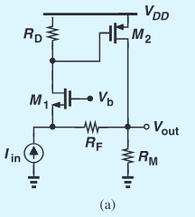
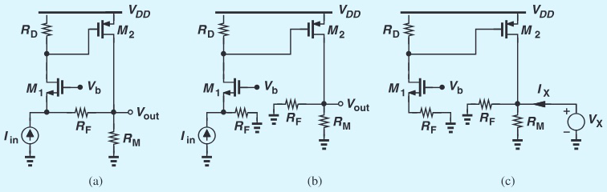

# 예제 12.33 — 출력이 V_out인 그림 12.61(a)형 증폭기 해석과 두 회로의 차이

## 원문
그림 12.62(a)는 그림 12.61(a)와 비슷한 회로를 묘사하지만 여기서 관심 있는 출력은 $V_{out}$이다. 증폭기를 해석하고 두 회로 사이의 차이를 공부하라.

## 조건
- 회로: Fig 12.62(a) ($M_1$ 공통 게이트(입력 전류 $I_{in}$이 소스로), 드레인 저항 $R_D$, PMOS $M_2$의 드레인이 출력 $V_{out}$, $V_{out}$에서 $R_M$으로 접지, $V_{out}$과 입력 노드 사이 귀환 저항 $R_F$)
- 관심 있는 출력은 전압 $V_{out}$ (그림 12.61(a)에서는 레이저 전류 $I_{out}$)
- 그림 12.61(a)와의 차이: 레이저(상자)가 없고 $M_2$ 드레인이 바로 $R_M$, $R_F$가 만나는 노드 (원문에 없음)
- 참고 회로 (본문 Fig 12.61(a), 예제 12.32): $V_{DD}$–$R_D$–$X$, $M_1$: D = $X$, G = $V_b$, S = 입력 노드, 입력 노드에 $I_{in}$(접지 → 노드), PMOS $M_2$: G = $X$, S = $V_{DD}$, D → 레이저 상자 → 노드 $P$, $P$–$R_M$–접지, 입력 노드–$R_F$–$P$ (원문에 없음)
- 예제 12.32의 결과 (그림 12.61(a), 전류-전류 귀환): $R_{in,open} = \dfrac{1}{g_{m1}} \parallel (R_F + R_M)$, $R_{out,open} = r_{O2} + R_F \parallel R_M$, $K = -\dfrac{R_M}{R_M + R_F}$, $R_{out,closed} = (r_{O2} + R_F \parallel R_M)\left(1 - \dfrac{R_M}{R_M + R_F} A_{I,open}\right)$ (원문에 없음)
- 소자 값은 주어지지 않음 (답은 소신호 파라미터 기호로) (원문에 없음)
- 전압-전류 귀환의 종지 법칙 (본문 Fig 12.53(b)): 감지 복제의 출력 포트와 반송 복제의 입력 포트를 모두 단락 (본문 정의, 원문에 없음)
- 전압-전류 귀환의 귀환율 (본문 Fig 12.54(b)): 귀환 회로망 입력에 전압 $V_1$을 걸고 단락된 출력 포트의 전류 $I_2$를 재어 $K = I_2/V_1$ (본문 정의, 원문에 없음)

## 구할 것
- 증폭기 해석: 개루프 이득 $R_O = V_{out}/I_{in}$, 개루프 입력·출력 임피던스, 귀환율 $K$, 폐루프 변수 (구할 양의 목록은 원문에 없음, 원문은 "해석하라"만 적음)
- 그림 12.61(a)의 회로(예제 12.32)와 이 회로의 차이

## 상속·참조
- 예제 12.32 (E12.32): Fig 12.61(a)를 전류-전류 귀환으로 해석. 순방향 시스템 $M_1$, $R_D$, $M_2$, 귀환 회로망 $R_M$과 $R_F$. 루프를 열 때 반송 복제가 $R_F + R_M$(입력 포트 개방), 감지 복제의 출력 포트 단락
  - $A_{I,open} = \dfrac{(R_F + R_M) R_D}{R_F + R_M + 1/g_{m1}}\cdot\dfrac{-g_{m2} r_{O2}}{r_{O2} + R_L + R_M \parallel R_F}$ (식 12.166)
  - $R_{in,open} = \dfrac{1}{g_{m1}} \parallel (R_F + R_M)$, $R_{out,open} = r_{O2} + R_F \parallel R_M$ (식 12.167, 12.168)
  - $K = -\dfrac{R_M}{R_M + R_F}$ (식 12.170), $R_{out,closed} = (r_{O2} + R_F \parallel R_M)\left(1 - \dfrac{R_M}{R_M + R_F} A_{I,open}\right)$ (식 12.173)
- 본문 Fig 12.53(b), Fig 12.54(b) (교재 689–690쪽, 크롭 안 함): 전압-전류 귀환에서 두 복제의 포트를 모두 단락, $K = I_2/V_1$
- 본문 Fig 12.58(a) (예제 12.29, 이 파일의 그림 목록에는 넣지 않음, 크롭은 fig12-58-a.png): NMOS 공통 게이트 $M_1$ + NMOS 공통 소스 $M_2$ + 귀환 저항 $R_F$의 전압-전류 귀환 회로. 풀이는 이 회로가 공통 소스 단이 PMOS인 것만 빼면 그 구조와 닮았다고 씀

## 회로 — Fig 12.62(a)
```spice
RD    VDD   n2    {R_D}
M1    n2    Vb    n1    nmos
IIN   0     n1    {I_in}
RF    n1    Vout  {R_F}
M2    Vout  n2    VDD   pmos
RM    Vout  0     {R_M}
```
- 단자: VDD = 전원, 값 미지정 (가로 레일) / Vb = M1 게이트 DC 바이어스, 값 미지정 (점 단자) / Vout = 출력 (개방 원)
- 표시: 노드 라벨 VDD (레일 오른쪽 끝 위), V_b (점 단자 오른쪽), V_out (출력 원 오른쪽) / 소자 라벨 R_D (저항 왼쪽), M1 (M1 왼쪽), M2 (M2 오른쪽), I_in (전류원 왼쪽), R_F (저항 아래), R_M (저항 오른쪽) / 부호 없음 / 화살표 없음 / 수치·면적 라벨 없음
- 배치: 맨 위 굵은 가로 레일 VDD, 왼쪽에 R_D, 오른쪽에 M2 소스가 매달림 / 왼쪽 세로줄 위→아래 R_D, 드레인 접속점(n2, 라벨 없음), M1, M1 소스 접속점(n1) / M1은 좌우 반전(게이트 오른쪽, 게이트 선이 오른쪽으로 V_b 점 단자) / n1에서 가로선이 왼쪽으로 가다 아래로 꺾여 I_in 전류원(원 안 화살표 위쪽), 그 아래 접지 / n2에서 가로선이 오른쪽으로 가다 위로 꺾여 M2 게이트(M2 PMOS, 보통 방향, 게이트 왼쪽, 소스 위·드레인 아래) / M2 드레인에서 세로선이 n1 높이까지 내려와 V_out 접속점 / n1에서 오른쪽으로 R_F를 지나 V_out 접속점, 거기서 오른쪽으로 V_out 원, 아래로 R_M과 접지 / 접속점 (세 갈래 이상, 3곳): n2 = 위 R_D + 아래 M1 드레인 + 오른쪽 M2 게이트 선 (점), n1 = 위 M1 소스 + 왼쪽 I_in 선 + 오른쪽 R_F (점), V_out 접속점 = 위 M2 드레인 + 왼쪽 R_F + 오른쪽 출력 원 + 아래 R_M, 네 갈래 (점) / 교차: 없음



## 답 (검증용)
- 전압-전류 귀환. 앞의 경우와 달리 $R_M$은 귀환 회로망보다는 순방향 증폭기에 포함됨 ($M_2$는 $R_M$ 없이 출력에서 전압을 생성할 수 없음). 공통 소스 단이 PMOS인 것만 빼면 Fig 12.58(a)의 구조와 닮음
- Fig 12.53(b)의 법칙으로 루프를 열면 Fig 12.62(b). 반송 복제가 $R_F$ (Fig 12.61(b)의 $R_F + R_M$과 다름)
- $R_O = \dfrac{V_{out}}{I_{in}} = \dfrac{R_F R_D}{R_F + 1/g_{m1}}\,[-g_{m2}(R_F \parallel R_M)]$ (식 12.174, 12.175), $R_{in,open} = \dfrac{1}{g_{m1}} \parallel R_F$ (식 12.176)
- Fig 12.62(c)로 $R_{out,open} = V_X/I_X = R_F \parallel R_M$ (식 12.177, 12.178). $r_{O2} < \infty$이면 식 (12.175)와 (12.178) 모두에서 $R_F \parallel R_M$에 병렬로 나타남
- $K = I_2/V_1 = -1/R_F$ (식 12.179, 12.180, Fig 12.54(b)의 법칙, 예제 12.32의 귀환율과 다름)
- $\left.\dfrac{V_{out}}{I_{in}}\right|_{closed} = \dfrac{R_O}{1 - R_O/R_F}$, $R_{in,closed} = \dfrac{(1/g_{m1}) \parallel R_F}{1 - R_O/R_F}$, $R_{out,closed} = \dfrac{R_F \parallel R_M}{1 - R_O/R_F}$ (식 12.181–12.183)
- 차이: 예제 12.32와 달리 이 경우 회로 토폴로지가 변하지 않더라도 출력 임피던스는 $1 - R_O/R_F$배만큼 감소. 원문은 그 까닭을 "두 경우에 출력 임피던스가 매우 어렵게 측정되기 때문"이라고 적음
- 위 원문 문장의 "어렵게"는 문맥상 두 경우에 출력 임피던스를 재는 곳(방법)이 다르다는 뜻으로 읽힘 (원문에 없음)

### 정답 회로 — Fig 12.62(b)
```spice
RD    VDD   n2    {R_D}
M1    n2    Vb    n1    nmos
IIN   0     n1    {I_in}
RF1   n1    0     {R_F}   ; 반송 복제, 인쇄 라벨 R_F
M2    Vout  n2    VDD   pmos
RF2   0     Vout  {R_F}   ; 감지 복제, 인쇄 라벨 R_F, 왼쪽 끝은 접지 기호
RM    Vout  0     {R_M}
```
- 단자: VDD = 전원 (가로 레일) / Vb = M1 게이트 바이어스 (점 단자) / Vout = 출력 (개방 원)
- 표시: 노드 라벨 VDD, V_b, V_out / 소자 라벨 R_D, M1, M2, I_in, R_M ((a)와 같은 위치), R_F 두 개 (각 저항 아래) / 부호 없음 / 화살표 없음 / 수치·면적 라벨 없음
- 배치: VDD 레일, R_D–n2–M1 왼쪽 세로줄, n2에서 M2 게이트로 가는 선 ((a)와 같음) / n1에서 오른쪽으로 R_F를 지나 아래로 꺾여 접지 (반송 복제) / M2 드레인 세로선이 V_out 접속점으로 내려옴, V_out 접속점에서 왼쪽으로 R_F를 지나 접지 기호(감지 복제), 오른쪽으로 V_out 원, 아래로 R_M과 접지 / 접속점 (세 갈래 이상, 3곳): n2 (점), n1 (점), V_out 접속점 = 위 M2 드레인 + 왼쪽 R_F + 오른쪽 출력 원 + 아래 R_M (점) / 교차: 없음

### 정답 회로 — Fig 12.62(c)
```spice
RD    VDD   n2    {R_D}
M1    n2    Vb    n1    nmos
RF1   n1    0     {R_F}   ; 반송 복제, 인쇄 라벨 R_F
M2    n3    n2    VDD   pmos
RF2   0     n3    {R_F}   ; 감지 복제, 인쇄 라벨 R_F, 왼쪽 끝은 접지 기호
RM    n3    0     {R_M}
VX    n3    0     {V_X}
```
- 단자: VDD = 전원 (가로 레일) / Vb = M1 게이트 바이어스 (점 단자)
- 표시: 노드 라벨 VDD, V_b / 소자 라벨 R_D, M1, M2, R_M, R_F 두 개 (각 저항 아래), V_X (전압원 오른쪽) / 부호 V_X 전압원 왼쪽에 + 위, − 아래 / 화살표 "I_X": V_X + 단자에서 올라와 왼쪽으로 출력 접속점에 이르는 가로 도선, 왼쪽 방향(V_X 쪽 → 출력 접속점), 도선 위, 글자는 화살표 위 / 수치·면적 라벨 없음
- 배치: (b)와 같되 I_in이 없음 (M1 소스에서 선이 내려가 오른쪽으로 꺾여 R_F를 지나 아래로 꺾여 접지, n1에 점 없음) / 출력 접속점(n3)에서 오른쪽으로 I_X 화살표, 모서리에서 아래로 꺾여 V_X(+ 위), V_X − 아래 접지 / 접속점 (세 갈래 이상, 2곳): n2 (점), n3 = 위 M2 드레인 + 왼쪽 R_F + 오른쪽 V_X 선 + 아래 R_M (점) / 교차: 없음


