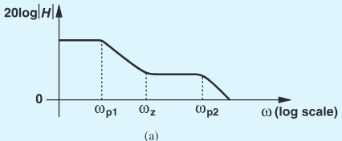
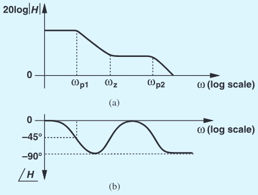

# 예제 12.34 — 크기 특성(극점 2개, 영점 1개)에서 위상 응답 그리기

## 원문
그림 12.63(a)는 증폭기의 크기 특성을 보여 준다. 보데의 규칙을 이용하여 위상 응답을 도시하라.

## 조건
- 증폭기의 크기 특성: Fig 12.63(a) (가로축 $\omega$ 로그 눈금, 세로축 $20\log|H|$)
  - 낮은 주파수에서 평탄, $\omega_{p1}$부터 감소, $\omega_z$부터 다시 평탄, $\omega_{p2}$부터 다시 감소해 0을 지남
  - 즉 극점 $\omega_{p1}$, 영점 $\omega_z$, 극점 $\omega_{p2}$, 순서는 $\omega_{p1} < \omega_z < \omega_{p2}$ (원문에 없음)
- 일반적으로 크기 그림으로부터 위상 프로파일을 만드는 것은 불가능할 것이다 (원문의 각주 15)
- 보데의 규칙 (본문 12.8.1절): 크기의 기울기는 주파수가 극점(영점)을 지나면 20 dB/dec씩 감소(증가). 위상은 극점(영점) 주파수의 1/10부터 감소(증가)하기 시작해 극점(영점) 주파수에서 −45°(+45°), 10배에서 거의 −90°(+90°)만큼 바뀜 (본문 규칙, 원문에 없음)
- 극점과 영점은 좌반면에 있다고 가정 (본문 각주 14, 원문에 없음)

## 구할 것
- 보데의 규칙을 이용한 위상 응답 $\angle H$ 도시

## 상속·참조
- 본문 12.8.1절 (교재 701–702쪽): 11장의 보데의 규칙 복습. 위상이 극점·영점 주파수의 1/10에서 변하기 시작하므로, 멀리 있다고 보이는 영점과 극점이라도 크기와 달리 위상에는 심각하게 영향을 줄 수 있음
- Fig 12.63(a) (문제 그림, 크롭함): 그래프 (회로 아님)
  - 세로축 화살표 위쪽 "20log|H|", 가로축 화살표 오른쪽 "ω (log scale)", 세로축 왼쪽 "0" 눈금이 가로축 높이
  - 굵은 꺾은선: 높은 수평선 → "ω_p1"에서 꺾여 내려가는 직선 → "ω_z"에서 꺾여 중간 높이 수평선 → "ω_p2"에서 꺾여 내려가 가로축(0)에 닿고 끝남
  - 세 꺾임점에서 가로축까지 세로 점선, 아래에 "ω_p1", "ω_z", "ω_p2" 라벨
  - 두 내려가는 구간의 기울기는 비슷하게 그려짐

## 회로 — 없음 (특성 그래프 문제, 그림 12.63(a)는 크기 특성 그래프로 상속·참조에 적음)

## 답 (검증용)
- 위상은 $0.1\omega_{p1}$에서 하강하기 시작해 $\omega_{p1}$에서 $-45^\circ$, $10\omega_{p1}$에서 $-90^\circ$. $0.1\omega_z$에서 상승하기 시작해 $\omega_z$에서 $-45^\circ$, $10\omega_z$에서 근사적으로 $0^\circ$. 마지막으로 $0.1\omega_{p2}$에서 하강하기 시작해 $\omega_{p2}$에서 $-45^\circ$, $10\omega_{p2}$에서 $-90^\circ$
- 극점과 영점은 $10\omega_{p1} < 0.1\omega_z$, $10\omega_z < 0.1\omega_{p2}$가 되도록 충분히 떨어져 있다고 가정 (아니면 더 정확한 계산 필요)
- Fig 12.63(b): 세로축이 아래로 향하는 화살표, 아래 끝 라벨 "∠H", 눈금 "0" (가로축 높이), "−45°", "−90°". 가로축 화살표 오른쪽 "ω (log scale)". 굵은 곡선이 0에서 출발해 내려가며 −45° 수평 점선과 만나는 곳에 가로축에서 내려온 세로 점선(ω_p1 위치), −90°까지 내려가 둥근 골을 만든 뒤 다시 0°까지 올라가 둥근 봉우리, 다시 내려가 −90°에서 평탄하게 오른쪽으로 이어짐. −90° 수평 점선이 세로축에서 오른쪽 끝까지

