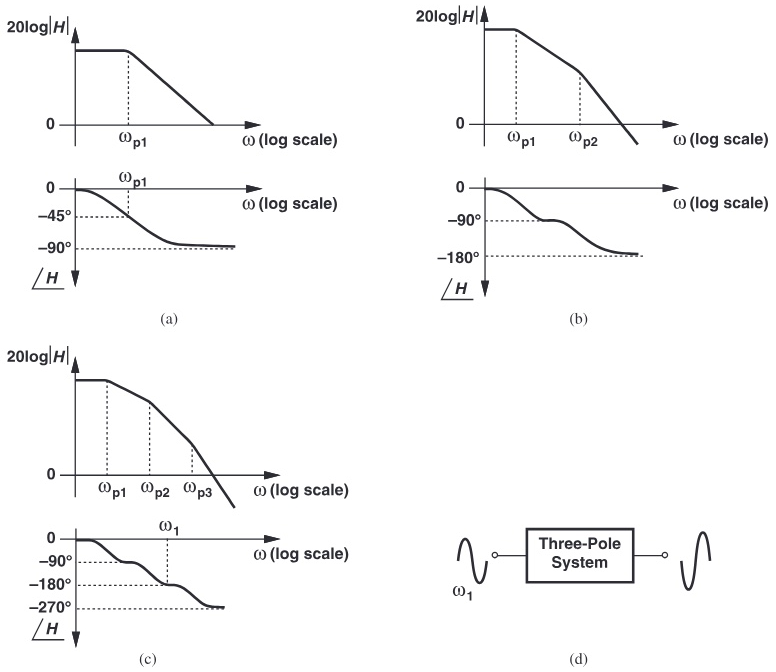

# 예제 12.35 — 극점이 1개, 2개, 3개인 증폭기의 크기·위상 응답

## 원문
(a) 단일 극점, (b) 2개의 극점, (c) 3개의 극점을 갖는 증폭기의 크기와 위상 응답을 만들어라.

## 조건
- (a) 단일 극점 ($\omega_{p1}$), (b) 2개의 극점 ($\omega_{p1}$, $\omega_{p2}$), (c) 3개의 극점 ($\omega_{p1}$, $\omega_{p2}$, $\omega_{p3}$)을 갖는 증폭기 (극점 이름은 원문에 없음)
- 영점은 없고 극점은 좌반면에 있으며 서로 충분히 떨어져 있다고 봄 (원문에 없음)
- 보데의 규칙 (본문 12.8.1절): 크기의 기울기는 주파수가 극점을 지날 때마다 20 dB/dec씩 감소. 위상은 극점 주파수의 1/10부터 감소하기 시작해 극점 주파수에서 −45°, 10배에서 거의 −90°만큼 바뀜 (본문 규칙, 원문에 없음)

## 구할 것
- (a), (b), (c) 각각의 크기 응답 $20\log|H|$와 위상 응답 $\angle H$ (가로축 $\omega$ 로그 눈금)

## 회로 — 없음 (그림 없는 글 문제, 그림 12.64는 풀이 그림)

## 답 (검증용)
- 그림 12.64(a)–(c)가 세 경우의 응답. 입력과 출력 사이의 위상 시프트는 단일 극점, 2개의 극점, 3개의 극점 시스템에서 각각 점근적으로 $-90^\circ$, $-180^\circ$, $-270^\circ$에 도달
- 중요한 관찰: 3개의 극점 시스템은 유한한 주파수 $\omega_1$에서 입력 정현파의 부호를 바꾸는 $-180^\circ$의 위상 시프트를 가짐 (Fig 12.64(d)). 예를 들어 1 GHz 정현파는 0.5 ns만큼 편이(지연)됨
- Fig 12.64(a): 위 크기 그래프(세로축 "20log|H|", 가로축 "ω (log scale)", 눈금 "0")는 수평선이 "ω_p1"(세로 점선)에서 꺾여 직선으로 내려가 가로축(0)에 닿고 끝남. 아래 위상 그래프(세로축 아래로 화살표 "∠H", 눈금 "0", "−45°", "−90°", 위쪽에 "ω_p1" 라벨과 세로 점선)는 0에서 내려가 ω_p1에서 −45°, −90°로 평탄해짐
- Fig 12.64(b): 크기는 "ω_p1"에서 한 번, "ω_p2"에서 더 가파르게 한 번 꺾여 0 아래까지 내려감. 위상은 눈금 "0", "−90°", "−180°", −90° 근처에서 잠깐 평탄한 계단을 지나 −180°로 평탄해짐
- Fig 12.64(c): 크기는 "ω_p1", "ω_p2", "ω_p3"에서 차례로 꺾이며 점점 가팔라져 0 아래까지 내려감. 위상은 눈금 "0", "−90°", "−180°", "−270°", 계단 두 개(−90°, −180° 근처)를 지나 −270°로 평탄해짐. "ω_1" 라벨의 세로 점선이 위상 곡선이 −180°가 되는 곳을 가리킴
- Fig 12.64(d): 왼쪽 정현파(라벨 "ω_1", 위로 볼록 → 아래로 볼록)가 개방 원을 지나 "Three-Pole System" 상자로 들어가고, 상자 오른쪽 개방 원 뒤에 부호가 뒤집힌 정현파(아래로 볼록 → 위로 볼록)

