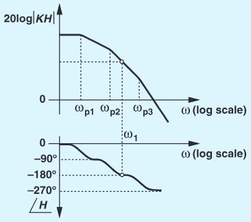

# 예제 12.37 — 보데 그림이 주어진 3극점 귀환 시스템의 발진 여부

## 원문
3개의 극점을 갖는 귀환 시스템이 그림 12.67에 그려진 주파수 응답을 나타낸다. 이 시스템은 발진하는가?

## 조건
- 극점이 3개($\omega_{p1}$, $\omega_{p2}$, $\omega_{p3}$)인 귀환 시스템의 주파수 응답: Fig 12.67 (루프 전송 크기 $20\log|KH|$와 위상)
- 위상이 $-180^\circ$가 되는 주파수 $\omega_1$에서 크기 곡선은 0 dB보다 위에 있음 (그림에서 읽음, 원문에 없음)
- 식 (12.185), (12.186): 발진 조건(바르크하우젠 조건) $|KH(j\omega_1)| = 1$ (인쇄는 닫는 괄호 빠짐), $\angle KH(j\omega_1) = -180^\circ$ (본문 식, 원문에 없음)

## 구할 것
- 이 시스템이 발진하는가?

## 상속·참조
- 식 (12.185): $|KH(j\omega_1)| = 1$ (인쇄는 닫는 괄호 빠짐), 식 (12.186): $\angle KH(j\omega_1) = -180^\circ$
- 본문 그림 12.66 (교재 705쪽, 크롭 안 함): 발진 시스템의 시간에 따른 전개. $\omega_1$의 정현파 성분이 입력에서 감지되고(a), $H(s)$와 $K$를 거쳐 $180^\circ$ 위상 시프트를 갖고 뺄셈기로 반송되며(b), 뺄셈기가 노드 $B$에서 신호를 키움(c). $|KH(j\omega_1)| = 1$이면 루프를 돌 때마다 신호가 계속 커지고, $|KH(j\omega_1)| < 1$이면 출력은 무한대로 커질 수 없음
- Fig 12.67 (문제 상자 안, 크롭함): 보데 그림 (회로 그림 아님)
  - 위: 세로축 화살표 위쪽, 라벨 "20log|KH|". 가로축 화살표 "ω (log scale)", 세로축 왼쪽에 "0". 곡선은 평탄하다가 "ω_p1"에서 꺾여 완만히 내려가고, "ω_p2"에서 더 가파르게, "ω_p3"에서 더욱 가파르게 꺾여 0 축을 지나 아래로 내려감. 세 극점 위치마다 곡선에서 가로축까지 수직 점선, 라벨 ω_p1, ω_p2, ω_p3는 가로축 아래
  - 극점 $\omega_{p2}$와 $\omega_{p3}$ 사이의 크기 곡선 위에 빈 원 하나, 그 점에서 세로축까지 가로 점선(0보다 위 높이)과 아래 위상 그림까지 내려가는 수직 점선. 라벨 "ω_1"은 위 그림 가로축 아래, 수직 점선 오른쪽
  - 아래: 가로축 화살표 "ω (log scale)", 왼쪽 "0". 세로축 화살표 아래쪽, 라벨 "∠H". 눈금 "−90°", "−180°", "−270°"에서 오른쪽으로 가로 점선. 곡선은 0에서 내려가 $-90^\circ$ 근처에서 잠시 평탄해진 뒤 내려가 $\omega_1$에서 $-180^\circ$(빈 원)를 지나고, 다시 평탄해졌다가 내려가 $-270^\circ$에 붙음
  - 위 세로 라벨은 $|KH|$, 아래 세로 라벨은 $\angle H$로 인쇄됨 ($K$는 위상이 없으므로 $\angle KH = \angle H$)

## 회로 — 없음 (특성 그래프 문제, 그림 12.67은 회로가 아닌 보데 그림으로 상속·참조에 적음)

## 답 (검증용)
- 그렇다(발진한다). $\omega_1$에서 루프 이득은 1보다 큼
- 그림 12.66의 해석에 따라 한계 없는 신호의 증가가 계속 (실제로는 매우 빨리) 일어남. 루프를 돌 때마다 $\omega_1$의 정현파는 $|KH| > 1$인 이득을 겪고 뺄셈기에 반대 위상으로 반송됨
