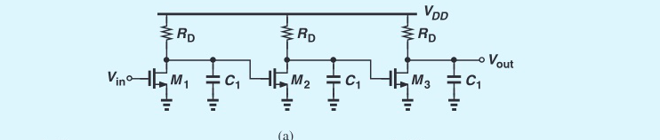
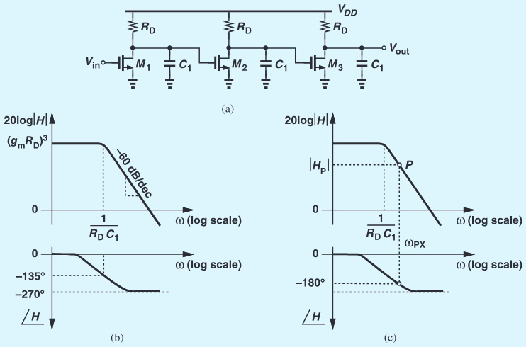

# 예제 12.38 — 같은 CS 단 3개로 된 증폭기의 K = 1 귀환 안정 조건

## 원문
그림 12.69(a)의 3단 증폭기에 $K = 1$인 부귀환을 걸려고 한다. 다른 커패시턴스를 무시하고 단이 모두 같다고 가정할 때 회로의 주파수 응답을 그리고 안정성 조건을 결정하라. $\lambda = 0$이라고 가정하라.

## 조건
- 회로: Fig 12.69(a) 3단 증폭기 (CS 단 $M_1$, $M_2$, $M_3$ 종속 연결, 각 단 드레인 저항 $R_D$, 각 드레인 노드에서 접지로 $C_1$)
- 귀환율 $K = 1$인 부귀환을 걸 예정
- $C_1$ 외의 다른 커패시턴스는 무시
- 세 단은 모두 같음 (같은 $g_m$, $R_D$, $C_1$) (괄호 안은 원문에 없음)
- $\lambda = 0$
- 식 (12.187): 안정하려면 $\omega_{GX} < \omega_{PX}$ ($\omega_{GX}$: 루프 이득이 1로 떨어지는 이득 교차 주파수, $\omega_{PX}$: 위상이 $-180^\circ$에 도달하는 위상 교차 주파수) (본문 식, 원문에 없음)

## 구할 것
- 회로의 주파수 응답(보데 그림) 그리기
- 안정성 조건 결정

## 상속·참조
- 식 (12.187) (교재 707쪽): $\omega_{GX} < \omega_{PX}$. 바르크하우젠 조건이 같은 주파수에서 충족되지 않도록 위상 시프트가 $-180^\circ$에 도달하기 전에 루프 이득이 1로 떨어져야 함

## 회로 — Fig 12.69(a)
```spice
RD1  VDD   n1    {R_D}   ; 인쇄 라벨 R_D (첫째 단)
M1   n1    Vin   0       nmos
C1a  n1    0     {C_1}   ; 인쇄 라벨 C_1 (첫째 단)
RD2  VDD   n2    {R_D}   ; 인쇄 라벨 R_D (둘째 단)
M2   n2    n1    0       nmos
C1b  n2    0     {C_1}   ; 인쇄 라벨 C_1 (둘째 단)
RD3  VDD   Vout  {R_D}   ; 인쇄 라벨 R_D (셋째 단)
M3   Vout  n2    0       nmos
C1c  Vout  0     {C_1}   ; 인쇄 라벨 C_1 (셋째 단)
```
- 단자: VDD = 전원, 값 미지정 (가로 레일) / Vin = 입력 (개방 원) / Vout = 출력 (개방 원)
- 표시: 노드 라벨 V_DD (레일 오른쪽 끝), V_in (입력 원 왼쪽), V_out (출력 원 오른쪽) / 소자 라벨 R_D 세 개 (각 저항 오른쪽), M1, M2, M3 (각 트랜지스터 오른쪽, 소스 옆), C_1 세 개 (각 커패시터 오른쪽) / 부호 없음 / 화살표 없음 / 수치·면적 라벨 없음
- 배치: 맨 위 가로 레일 VDD가 첫째 단 R_D에서 셋째 단 R_D 바로 오른쪽까지 이어지고 라벨은 오른쪽 끝 / 세 단이 왼쪽→오른쪽으로 같은 모양 반복: 레일에서 R_D가 아래로, 그 아래 드레인 노드, 바로 아래 NMOS(게이트 왼쪽, 소스 아래·화살표 바깥), 소스 아래 접지 / 각 드레인 노드에서 가로선이 오른쪽으로 C_1 위 접속점까지 가고 C_1은 아래로 접지 / 첫째·둘째 단은 그 가로선이 C_1 접속점을 지나 더 오른쪽으로 가서 아래로 꺾여 게이트 높이에서 다음 단 게이트로 들어감 / 셋째 단은 C_1 접속점을 지나 Vout 개방 원에서 끝남 / V_in 원에서 가로선이 M1 게이트로 / 접속점 (세 갈래 이상, 6곳): 각 단 드레인 = 위 R_D + 아래 드레인 + 오른쪽 가로선 (점), 각 단 C_1 위 = 왼쪽 가로선 + 아래 C_1 + 오른쪽 가로선 (점) / 교차: 없음


> 참고: 문제 문장은 707쪽(PDF 34 오른쪽) 아래에서 시작하고, 그림 12.69는 다음 쪽 708쪽(PDF 35 왼쪽) 위에 있음

## 답 (검증용)
- 저주파 이득 $(g_m R_D)^3$, 세 중복 극점 $\omega_p = (R_D C_1)^{-1}$. $|H|$는 $\omega_p$에서 60 dB/dec로 떨어지기 시작하고, 위상은 $0.1\omega_p$에서 변하기 시작해 $\omega_p$에서 $-135^\circ$, $10\omega_p$에서 $-270^\circ$에 접근 (Fig 12.69(b))
- $H(s) = \dfrac{(g_m R_D)^3}{(1 + s/\omega_p)^3}$ (식 12.188, 각 단 이득의 음 부호는 생략), $\angle H(j\omega) = -3\tan^{-1}(\omega/\omega_p)$ (식 12.189) → $\omega_{PX} = \sqrt{3}\,\omega_p$ (식 12.190)
- $|KH| (= |H|)$가 $\omega_{PX}$에서 1보다 작아야 함 (Fig 12.69(c), $|H_P| < 1$): $\dfrac{(g_m R_D)^3}{\left[\sqrt{1 + (\omega_{PX}/\omega_p)^2}\right]^3} < 1$ (식 12.191) → $g_m R_D < 2$ (식 12.192). 각 단의 저주파 이득이 2를 넘으면 $K = 1$ 귀환 루프는 불안정
- Fig 12.69(b): 위 세로축 "20log|H|", 평탄 레벨 라벨 "(g_m R_D)^3", 가로축 "ω (log scale)". 곡선은 평탄하다가 "1/(R_D C_1)"(수직 점선)에서 꺾여 기울기 "−60 dB/dec"(직선 옆 비스듬한 글자, 작은 점선 직각삼각형 표시)로 내려가 0을 지남. 아래 세로축 "∠H"(아래 방향), 눈금 "−135°", "−270°"에 가로 점선. 위상 곡선은 0에서 내려가 1/(R_D C_1)의 수직 점선에서 −135° 높이를 지나 −270°에서 평탄
- Fig 12.69(c): 위 "20log|H|", 같은 크기 곡선. 곡선 위 빈 원 "P"와 그 높이에서 세로축까지 가로 점선, 세로축 라벨 "|H_P|". 1/(R_D C_1)에 수직 점선. P에서 아래로 수직 점선이 내려가 "ω_PX" 라벨(위 가로축 아래)을 지나 위상 곡선의 "−180°" 빈 원에 닿음. 아래 세로축 "∠H", 눈금 −180°와 그 아래 점근선(−270°, 라벨 없음)에 가로 점선


