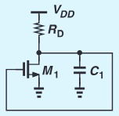

# 예제 12.39 — 단일 이득 귀환 루프에 놓인 CS 단이 발진하지 않는 이유

## 원문
공통 소스 단이 그림 12.70에 나와 있는 단일 이득 귀환 루프에 놓여 있다. 이 회로가 왜 발진하지 않는지 설명하라.

## 조건
- 회로: Fig 12.70 공통 소스 단 ($M_1$, 드레인 저항 $R_D$, 드레인 노드에서 접지로 $C_1$)
- 출력(드레인)이 게이트로 그대로 이어진 단일 이득 귀환 루프 ($K = 1$) (괄호 안은 원문에 없음)
- 소자 값은 주어지지 않음 (답은 설명으로) (원문에 없음)
- 식 (12.187): 안정하려면 $\omega_{GX} < \omega_{PX}$, 즉 위상 시프트가 $-180^\circ$에 도달하기 전에 루프 이득이 1로 떨어져야 함 (본문 식, 원문에 없음)

## 구할 것
- 이 회로가 왜 발진하지 않는지 설명

## 상속·참조
- 식 (12.187) (교재 707쪽): $\omega_{GX} < \omega_{PX}$ ($\omega_{GX}$: 이득 교차 주파수, $\omega_{PX}$: 위상 교차 주파수)

## 회로 — Fig 12.70
```spice
RD  VDD  n1  {R_D}
M1  n1   n1  0  nmos   ; 게이트는 아래로 도는 귀환선으로 드레인 노드에 연결
C1  n1   0   {C_1}
```
- 단자: VDD = 전원, 값 미지정 (T 전원 기호)
- 표시: 노드 라벨 V_DD (T 기호 오른쪽) / 소자 라벨 R_D (저항 오른쪽), M1 (트랜지스터 오른쪽, 소스 옆), C_1 (커패시터 오른쪽) / 부호 없음 / 화살표 없음 / 수치·면적 라벨 없음
- 배치: 한 세로줄 위→아래 VDD T 기호, R_D, 드레인 노드, M1(NMOS, 게이트 왼쪽, 소스 아래·화살표 바깥), 접지 / 드레인 노드에서 가로선이 오른쪽으로 C_1 위 접속점을 지나 오른쪽 끝에서 아래로 꺾임 → 접지 기호들보다 아래 높이로 왼쪽으로 가로질러 → 왼쪽 끝에서 위로 올라가 게이트 높이에서 오른쪽으로 꺾여 M1 게이트로 들어감 (회로를 감싸는 사각 루프) / C_1 아래 접지 / 접속점 (세 갈래 이상, 2곳): 드레인 = 위 R_D + 아래 드레인 + 오른쪽 가로선 (점), C_1 위 = 왼쪽 가로선 + 아래 C_1 + 오른쪽 귀환선 (점) / 교차: 없음



## 답 (검증용)
- 회로가 오직 1개의 극점만 포함하므로 어떤 주파수에서도 위상 시프트가 $180^\circ$에 도달할 수 없음 → 이 회로는 안정 (발진하지 않음)
