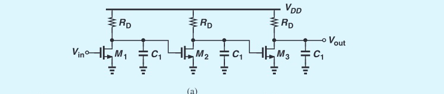
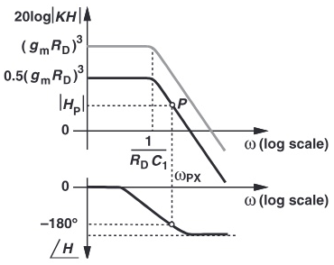

# 예제 12.40 — K = 1/2일 때 3단 증폭기의 귀환 안정 조건 (예제 12.38 반복)

## 원문
$K$의 목표값이 1/2일 때, 즉 귀환이 약해질 때 예제 12.38을 반복하라.

## 조건
- 예제 12.38과 같은 회로: Fig 12.69(a) 3단 증폭기 (같은 CS 단 $M_1$–$M_3$, 각 단 $R_D$, $C_1$), $C_1$ 외의 커패시턴스 무시, 세 단 동일, $\lambda = 0$
- 바뀐 점: 귀환율 목표값 $K = 1/2$ (귀환이 약해짐)
- 예제 12.38의 결과 ($K = 1$): $H(s) = \dfrac{(g_m R_D)^3}{(1 + s/\omega_p)^3}$, $\omega_p = (R_D C_1)^{-1}$ (각 단 이득의 음 부호 생략), $\angle H(j\omega) = -3\tan^{-1}(\omega/\omega_p)$, $\omega_{PX} = \sqrt{3}\,\omega_p$, 안정 조건 $g_m R_D < 2$ (원문에 없음)

## 구할 것
- $K = 1/2$일 때 주파수 응답 그리기와 안정성 조건 결정 (예제 12.38 반복)

## 상속·참조
- 예제 12.38 (E12.38): "그림 12.69(a)의 3단 증폭기에 $K = 1$인 부귀환을 걸려고 한다. 다른 커패시턴스를 무시하고 단이 모두 같다고 가정할 때 회로의 주파수 응답을 그리고 안정성 조건을 결정하라. $\lambda = 0$이라고 가정하라."
- 예제 12.38의 풀이: 저주파 이득 $(g_m R_D)^3$, 세 중복 극점 $\omega_p = (R_D C_1)^{-1}$. 식 (12.188) $H(s) = \dfrac{(g_m R_D)^3}{(1 + s/\omega_p)^3}$, 식 (12.189) $\angle H(j\omega) = -3\tan^{-1}\dfrac{\omega}{\omega_p}$, 식 (12.190) $\omega_{PX} = \sqrt{3}\,\omega_p$, 식 (12.191) $\dfrac{(g_m R_D)^3}{\left[\sqrt{1 + (\omega_{PX}/\omega_p)^2}\right]^3} < 1$, 식 (12.192) $g_m R_D < 2$. 각 단 이득의 음 부호는 생략 (각주 19)

## 회로 — Fig 12.69(a)
```spice
RD1  VDD   n1    {R_D}   ; 인쇄 라벨 R_D (첫째 단)
M1   n1    Vin   0       nmos
C1a  n1    0     {C_1}   ; 인쇄 라벨 C_1 (첫째 단)
RD2  VDD   n2    {R_D}   ; 인쇄 라벨 R_D (둘째 단)
M2   n2    n1    0       nmos
C1b  n2    0     {C_1}   ; 인쇄 라벨 C_1 (둘째 단)
RD3  VDD   Vout  {R_D}   ; 인쇄 라벨 R_D (셋째 단)
M3   Vout  n2    0       nmos
C1c  Vout  0     {C_1}   ; 인쇄 라벨 C_1 (셋째 단)
```
- 단자: VDD = 전원, 값 미지정 (가로 레일) / Vin = 입력 (개방 원) / Vout = 출력 (개방 원)
- 표시: 노드 라벨 V_DD (레일 오른쪽 끝), V_in (입력 원 왼쪽), V_out (출력 원 오른쪽) / 소자 라벨 R_D 세 개 (각 저항 오른쪽), M1, M2, M3 (각 트랜지스터 오른쪽, 소스 옆), C_1 세 개 (각 커패시터 오른쪽) / 부호 없음 / 화살표 없음 / 수치·면적 라벨 없음
- 배치: 맨 위 가로 레일 VDD가 첫째 단 R_D에서 셋째 단 R_D 바로 오른쪽까지 이어지고 라벨은 오른쪽 끝 / 세 단이 왼쪽→오른쪽으로 같은 모양 반복: 레일에서 R_D가 아래로, 그 아래 드레인 노드, 바로 아래 NMOS(게이트 왼쪽, 소스 아래·화살표 바깥), 소스 아래 접지 / 각 드레인 노드에서 가로선이 오른쪽으로 C_1 위 접속점까지 가고 C_1은 아래로 접지 / 첫째·둘째 단은 그 가로선이 C_1 접속점을 지나 더 오른쪽으로 가서 아래로 꺾여 게이트 높이에서 다음 단 게이트로 들어감 / 셋째 단은 C_1 접속점을 지나 Vout 개방 원에서 끝남 / V_in 원에서 가로선이 M1 게이트로 / 접속점 (세 갈래 이상, 6곳): 각 단 드레인 = 위 R_D + 아래 드레인 + 오른쪽 가로선 (점), 각 단 C_1 위 = 왼쪽 가로선 + 아래 C_1 + 오른쪽 가로선 (점) / 교차: 없음


> 참고: 예제 12.40은 그림이 없고 예제 12.38의 그림 12.69(a) 회로를 그대로 씀

## 답 (검증용)
- $|KH| = 0.5|H|$, $\angle KH = \angle H$ (Fig 12.71). $|KH|$ 그림은 대수 눈금에서 6 dB만큼 밑으로 이동. 위상 교차 주파수에서 $|KH|$의 점 $P$를 정하고 $0.5|H_P| < 1$이 필요
  - 원문은 "$0.5|HP| < 1$"로 인쇄됨. 문맥과 맞지 않음(오식으로 보임), 뜻은 $0.5|H_P| < 1$ (원문에 없음)
  - 원문 풀이는 "그림 12.71(a)"를 가리키지만 그림 12.71에는 패널 글자가 없음 (원문에 없음)
- 식 (12.189), (12.190)이 그대로 성립 → $\dfrac{0.5(g_m R_D)^3}{\left[\sqrt{1 + (\omega_{PX}/\omega_p)^2}\right]^3} < 1$ (식 12.193), 즉 $(g_m R_D)^3 < \dfrac{2^3}{0.5}$ (식 12.194). 약한 귀환은 개루프 이득을 크게 함
- Fig 12.71: 위 세로축 "20log|KH|", 가로축 "ω (log scale)". 회색 곡선은 레벨 "(g_m R_D)^3"에서 평탄하다가 꺾여 내려가고, 검은 곡선은 그보다 낮은 레벨 "0.5(g_m R_D)^3"에서 평탄하다가 같은 주파수 "1/(R_D C_1)"(수직 점선)에서 꺾여 회색과 나란히 내려감. 검은 곡선 위 빈 원 "P"에서 세로축까지 가로 점선, 라벨 "|H_P|". P에서 아래로 수직 점선이 "ω_PX"를 지나 위상 곡선의 "−180°" 빈 원에 닿음. 아래 세로축 "∠H", 위상 곡선은 0에서 내려가 −180°를 지나 아래 점근선(라벨 없음, 가로 점선)에서 평탄


