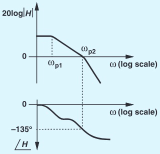

# 예제 12.41 — 두 번째 극점에서 크기가 1이 되는 증폭기의 위상 마진

## 원문
그림 12.73은 여러 개의 극점을 갖는 시스템의 주파수 응답을 그린 것이다. 두 번째 극점 주파수에서 크기가 1로 떨어졌다. $K = 1$인 이 증폭기를 사용한 귀환 시스템의 위상 마진을 결정하라.

## 조건
- 여러 개의 극점을 갖는 시스템의 주파수 응답: Fig 12.73 (크기 $20\log|H|$와 위상 $\angle H$)
- 두 번째 극점 주파수 $\omega_{p2}$에서 크기가 1(0 dB)로 떨어짐
- 귀환율 $K = 1$
- 식 (12.195): 위상 마진 $\text{PM} = \angle H(\omega_{GX}) + 180^\circ$ ($\omega_{GX}$: 루프 이득이 1이 되는 이득 교차 주파수) (본문 식, 원문에 없음)

## 구할 것
- $K = 1$인 이 증폭기를 사용한 귀환 시스템의 위상 마진

## 상속·참조
- 식 (12.195) (교재 711쪽): $\text{Phase Margin} = \angle H(\omega_{GX}) + 180^\circ$. $K$에는 위상 편이가 없으므로 $\angle KH = \angle H$로 가정
- Fig 12.73 (문제 상자 안, 크롭함): 보데 그림 (회로 그림 아님)
  - 위: 세로축 화살표 위쪽, 라벨 "20log|H|". 가로축 화살표 "ω (log scale)", 세로축 왼쪽에 "0". 곡선은 0보다 위에서 평탄하다가 "ω_p1"(수직 점선, 라벨은 가로축 아래)에서 꺾여 완만히 내려가 정확히 0 축 위의 "ω_p2"(라벨은 축 위, 교차점 위쪽)에서 가로축과 만나고, 거기서 더 가파르게 꺾여 0 아래로 내려감
  - $\omega_{p2}$ 교차점에서 수직 점선이 아래 위상 그림까지 내려감
  - 아래: 가로축 화살표 "ω (log scale)", 왼쪽 "0". 세로축 화살표 아래쪽, 라벨 "∠H". 눈금 "−135°" 하나에서 가로 점선이 오른쪽으로 뻗어 $\omega_{p2}$ 수직 점선과 위상 곡선이 만나는 곳까지. 위상 곡선은 0에서 내려가 잠시 평탄(라벨 없음, 약 −90°)해진 뒤 다시 내려가 $\omega_{p2}$에서 −135°를 지나고 더 아래(라벨 없음)에서 평탄

## 회로 — 없음 (특성 그래프 문제, 그림 12.73은 회로가 아닌 보데 그림으로 상속·참조에 적음)

## 답 (검증용)
- 그림은 두 번째 극점 주파수(멀리 떨어진 극점)에서 위상이 $-135^\circ$에 도달함을 보여 줌 → 위상 마진 $= 45^\circ$
