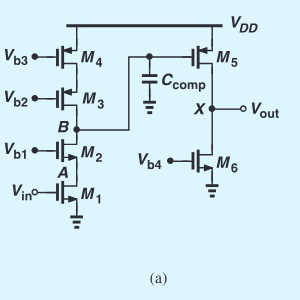
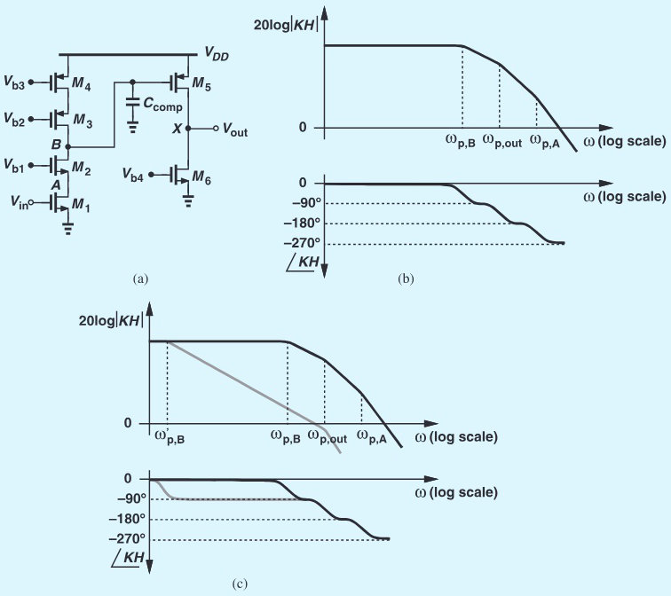

# 예제 12.42 — 캐스코드 단과 CS 단으로 된 증폭기의 주파수 응답과 보상

## 원문
그림 12.75(a)의 증폭기가 캐스코드 단과 CS 단을 사용한다. 노드 $B$에서의 극점이 우성이라고 가정하여 주파수 응답을 그리고, 회로가 어떻게 '보상'되었는지 설명하라.

## 조건
- 회로: Fig 12.75(a) 증폭기. 첫째 단은 캐스코드 단 ($M_1$ 입력, $M_2$ 캐스코드, $M_3$–$M_4$ PMOS 캐스코드 부하), 둘째 단은 CS 단 ($M_5$ PMOS 입력, $M_6$ NMOS 전류원 부하), 노드 $B$와 접지 사이에 $C_{comp}$ (괄호 안은 원문에 없음)
- 노드 $B$에서의 극점이 우성(dominant)
- 소자 값은 주어지지 않음 (답은 극점 식과 보데 그림 모양으로) (원문에 없음)

## 구할 것
- 주파수 응답(보데 그림) 그리기
- 회로가 어떻게 '보상'되었는지 설명

## 상속·참조
- 본문 그림 12.74 (교재 713쪽, 크롭 안 함): 주파수 보상의 개념. (a) $\omega_{PX}$를 바꾸지 않고 $|KH|$를 더 낮은 주파수에서 1로 떨어뜨리면($\omega_{GX} \to \omega'_{GX}$) 위상 마진이 증가. (b) 첫 번째 극점이 $\omega_{p1}$에서 $\omega'_{p1}$으로 이동하고 다른 극점은 그대로이면 $\omega_{GX}$가 감소하고, $\angle KH$의 저주파 구간만 바뀌며 $\omega_{GX}$ 근처는 바뀌지 않음

## 회로 — Fig 12.75(a)
```spice
M4     n1  Vb3  VDD  pmos
M3     B   Vb2  n1   pmos
M2     B   Vb1  A    nmos
M1     A   Vin  0    nmos
M5     X   B    VDD  pmos   ; 게이트는 노드 B에서 오른쪽으로 꺾여 올라온 선
Ccomp  B   0    {C_comp}    ; M5 게이트 선의 접속점에서 접지로
M6     X   Vb4  0    nmos
* X 노드에서 오른쪽 가로선 끝 개방 원 = V_out
```
- 단자: VDD = 전원, 값 미지정 (가로 레일) / Vb1, Vb2, Vb3, Vb4 = 이상적 DC 바이어스, 값 미지정 (점 단자) / Vin = 입력 (개방 원) / X = 출력 V_out (개방 원)
- 표시: 노드 라벨 V_DD (레일 오른쪽 끝), V_b3, V_b2, V_b1 (왼쪽 세로줄 각 점 단자 왼쪽), V_in (입력 원 왼쪽), V_b4 (M6 점 단자 왼쪽), B (M3–M2 사이 접속점 왼쪽), A (M2–M1 사이 노드 왼쪽), X (M5–M6 사이 접속점 왼쪽), V_out (출력 원 오른쪽) / 소자 라벨 M1, M2, M3, M4 (각 트랜지스터 오른쪽), M5, M6 (각 트랜지스터 오른쪽), C_comp (커패시터 오른쪽) / 부호 없음 / 화살표 없음 / 수치·면적 라벨 없음
- 배치: 맨 위 가로 레일 VDD가 왼쪽 세로줄에서 오른쪽 세로줄까지, 라벨은 오른쪽 끝 / 왼쪽 세로줄 위→아래 M4(PMOS, 소스 위가 레일), M3(PMOS), 노드 B, M2(NMOS), 노드 A, M1(NMOS), 접지. 네 트랜지스터 모두 게이트 왼쪽 / 오른쪽 세로줄 위→아래 M5(PMOS, 소스 위가 레일, 게이트 왼쪽), 노드 X, M6(NMOS, 게이트 왼쪽), 접지 / 노드 B에서 가로선이 오른쪽으로 두 세로줄 사이까지 가서 위로 꺾여 M5 게이트 높이에서 다시 오른쪽으로 꺾여 C_comp 위 접속점을 지나 M5 게이트로 들어감 / C_comp는 그 접속점에서 아래로 접지 / X에서 가로선이 오른쪽으로 V_out 원 / 접속점 (세 갈래 이상, 3곳): B = 위 M3 드레인 + 아래 M2 드레인 + 오른쪽 가로선 (점), C_comp 위 = 왼쪽 선 + 아래 C_comp + 오른쪽 M5 게이트 선 (점), X = 위 M5 드레인 + 아래 M6 드레인 + 오른쪽 V_out 선 (점) / 교차: 없음


> 참고: 문제 문장은 713쪽(PDF 37 오른쪽)에서 시작해 714쪽(PDF 38 왼쪽) 맨 위 "이라고 가정하여 …"에서 끝남. 그림 12.75는 713쪽 문제 상자 안

## 답 (검증용)
- 캐스코드 단은 노드 $A$의 극점과 원점에 훨씬 가까운 노드 $B$의 극점을 가짐: $\omega_{p,A} \approx \dfrac{g_{m2}}{C_A}$ (식 12.196), $\omega_{p,B} \approx \dfrac{1}{[(g_{m2} r_{O2} r_{O1}) \| (g_{m3} r_{O3} r_{O4})] C_B}$ (식 12.197). 세 번째 극점은 출력 노드: $\omega_{p,out} = \dfrac{1}{(r_{O5} \| r_{O6}) C_{out}}$ (식 12.198). $C_A$, $C_B$, $C_{out}$은 각 노드에서 접지로 본 전체 커패시턴스. $\omega_{p,B} < \omega_{p,out} < \omega_{p,A}$로 가정 → 주파수 응답은 Fig 12.75(b)
- 보상: 노드 $B$에 커패시턴스($C_{comp}$)를 더해 $\omega_{p,B}$를 낮춤. $C_{comp}$가 충분히 크면 이득 교차가 위상 교차보다 훨씬 밑에서 일어나 적당한 위상 마진을 줌 (Fig 12.75(c)). 우성 극점의 크기가 감소하므로 주파수 보상은 불가피하게 속도를 감소시킴
- Fig 12.75(b): 위 세로축 "20log|KH|", 가로축 "ω (log scale)", 왼쪽 "0". 곡선은 평탄하다가 "ω_p,B", "ω_p,out", "ω_p,A"(각각 수직 점선, 라벨은 가로축 아래)에서 차례로 더 가파르게 꺾여 ω_p,A 바로 뒤에서 0을 지나 내려감. 아래 세로축 "∠KH"(아래 방향), 눈금 "−90°", "−180°", "−270°"에 가로 점선. 위상 곡선은 0에서 계단 모양으로 −90°, −180° 근처에서 잠시 평탄해지며 내려가 −270°에서 평탄
- Fig 12.75(c): 같은 축. 검은 곡선은 (b)와 같은 원래 응답. 회색 곡선(보상 후)은 평탄 레벨에서 "ω'_p,B"(세로축 가까이, 수직 점선)에서 꺾여 일정한 기울기로 곧게 내려가 ω_p,out 근처에서 0을 지나고 그 뒤 더 가파르게 꺾임. 위 그림 수직 점선은 ω'_p,B, ω_p,B, ω_p,out, ω_p,A. 아래 위상에서 회색 곡선은 ω'_p,B 근처에서 바로 −90°로 내려가 평탄하게 이어지다 검은 곡선과 합쳐짐. 검은 위상 곡선은 (b)처럼 −90°, −180°, −270° 계단


