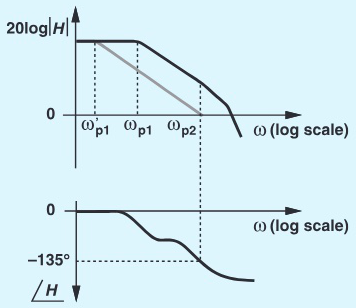

# 예제 12.43 — K = 1에서 위상 마진 45°가 되도록 증폭기 보상

## 원문
여러 개의 극점을 갖는 증폭기가 그림 12.77에 그려진 주파수 응답을 나타낸다. 극점이 멀리 떨어져 있다고 가정하고 $K = 1$일 때 $45^\circ$의 위상 마진을 갖도록 증폭기를 보상하라.

## 조건
- 여러 개의 극점을 갖는 증폭기의 주파수 응답: Fig 12.77 (크기 $20\log|H|$와 위상 $\angle H$, 원래 응답은 검은 곡선)
- 극점들은 멀리 떨어져 있다고 가정
- 귀환율 $K = 1$, 목표 위상 마진 $45^\circ$
- 식 (12.195): 위상 마진 $\text{PM} = \angle H(\omega_{GX}) + 180^\circ$ (본문 식, 원문에 없음)
- 보상 절차 (본문 그림 12.76): $\angle H = -180^\circ + \text{PM}$이 되는 주파수 $\omega_{PM}$을 찾고, 크기 응답의 $\omega_{PM}$(0 dB)에서 수직축 방향으로 20 dB/dec 기울기의 선을 그려 원래 크기 응답과 만나는 점을 우성 극점의 새 위치 $\omega'_{p1}$으로 함 (본문 절차, 원문에 없음)

## 구할 것
- $K = 1$일 때 $45^\circ$의 위상 마진을 갖도록 하는 보상 (우성 극점의 새 위치)

## 상속·참조
- 식 (12.195) (교재 711쪽): $\text{Phase Margin} = \angle H(\omega_{GX}) + 180^\circ$
- 본문 그림 12.76 (교재 714쪽, 크롭 안 함): 주파수 보상을 위한 체계적인 방법. 위상 그림에서 "−180° + PM" 높이의 가로 점선 화살표가 위상 곡선과 만나는 주파수 $\omega_{PM}$을 정하고, 그 주파수에서 위로 향한 화살표로 크기 그림의 0 dB 축 위 $\omega_{PM}$(빈 원)을 가리킴. $\omega_{PM}$에서 왼쪽 위로 "−20 dB/dec" 회색 선을 그어 원래 크기 응답의 평탄 레벨과 만나는 곳이 $\omega'_{p1}$ (원래 우성 극점은 $\omega_{p1}$). 보상된 증폭기는 $\omega_{PM}$에서 이득 교차
- Fig 12.77 (문제 상자 안, 크롭함): 보데 그림 (회로 그림 아님)
  - 위: 세로축 화살표 위쪽, 라벨 "20log|H|". 가로축 화살표 "ω (log scale)", 왼쪽 "0". 검은 곡선은 평탄하다가 "ω_p1"(수직 점선)에서 꺾여 내려가고, "ω_p2"(수직 점선이 곡선의 꺾인 점에 닿음)에서 조금 더 가파르게 꺾이며, 그보다 오른쪽(0 dB 바로 위, 라벨 없음)에서 한 번 더 급하게 꺾여 0을 지나 내려감
  - 회색 직선이 평탄 레벨의 "ω'_p1"(수직 점선, ω_p1보다 왼쪽)에서 시작해 곧게 내려가 0 축 위의 ω_p2 지점에서 끝남. 라벨 ω'_p1, ω_p1, ω_p2는 모두 가로축 아래
  - ω_p2의 수직 점선은 위 그림 검은 곡선의 꺾인 점에서 시작해 회색 직선의 끝점(0 축)을 지나 아래 위상 그림까지 내려감
  - 아래: 가로축 화살표 "ω (log scale)", 왼쪽 "0". 세로축 화살표 아래쪽, 라벨 "∠H". 눈금 "−135°" 하나에서 가로 점선이 ω_p2 수직 점선까지. 위상 곡선은 0에서 내려가 중간에서 잠시 평탄해진 뒤 다시 내려가 ω_p2에서 −135°를 지나고 더 아래에서 평탄

> 참고: 문제 그림 안에 보상 결과(회색 선과 ω'_p1)가 함께 인쇄돼 있어 그림에서 답이 보임. 패널이 나뉘어 있지 않아 따로 자르지 않음

## 회로 — 없음 (특성 그래프 문제, 그림 12.77은 회로가 아닌 보데 그림으로 상속·참조에 적음)

## 답 (검증용)
- $\omega = \omega_{p2}$에서 위상이 $-135^\circ$에 도달하므로 이 예제에서 $\omega_{PM} = \omega_{p2}$
- $\omega_{p2}$(0 dB)로부터 수직축 방향으로 $-20$ dB/dec 기울기를 갖는 선을 그림 → 우성 극점은 $\omega'_{p1}$으로 이동해야 함 (Fig 12.77의 회색 선)
- 이 위상 마진($45^\circ$)은 일반적으로 부적당하므로 실제에서는 $\omega_{PM} < \omega_{p2}$
