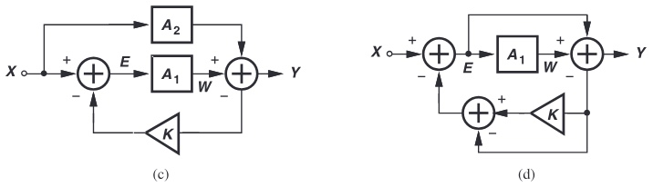

# 장말문제 12.3 — 블록도 귀환 시스템의 전달 함수 E/X

## 원문
For the systems depicted in Fig. 12.79, compute the transfer function $E/X$.

## 조건
- 회로: Fig 12.79 블록도 귀환 시스템. 인쇄된 패널은 (c), (d) 두 개뿐
- 블록 $A_1$, $A_2$, $K$는 주파수와 상관없는 이득으로 봄 (원문에 없음)
- Fig 12.79 (c), (d)의 오른쪽 덧셈기 왼쪽 아래에 "−"가 인쇄돼 있으나 그 자리로 들어가는 화살표가 없음. 아래로 나가는 선은 화살촉 없이 $K$의 입력으로 감 (원문에 없음)

## 구할 것
- Fig 12.79의 각 시스템에 대해 전달 함수 $E/X$

## 회로 — Fig 12.79(c)
```spice
XS1  X   n1  E   sum          ; X +, n1(K 출력) −
XA1  E   W   gain "A1"
XA2  X   n2  gain "A2"
XS2  W   n2  Y   sum          ; W +, n2(A2 출력, 부호 인쇄 없음)
XK   Y   n1  gain "K" tri     ; 입력은 오른쪽 덧셈기 아래로 나가는 선(Y)
```
- 단자: X = 입력 (개방 원) / Y = 출력 (선 끝, 라벨 앞 화살촉)
- 표시: 노드 라벨 X (개방 원 왼쪽), E (왼쪽 덧셈기와 A1 사이 선 위), W (A1과 오른쪽 덧셈기 사이 선 아래), Y (오른쪽 끝 화살표 오른쪽) / 소자 라벨 A1, A2 (각 사각 상자 안), K (삼각형 안), 덧셈기 두 개 (⊕, 라벨 없음) / 부호 왼쪽 덧셈기: "+" 왼쪽 위(X 입력), "−" 왼쪽 아래(아래쪽 입력) · 오른쪽 덧셈기: "+" 왼쪽 위(W 입력), "−" 왼쪽 아래(이 자리로 들어가는 화살표 없음), 위쪽 A2 입력에는 부호 없음 / 화살표 신호선 화살촉 (모두 라벨 없음, 도선 위): X 분기점 → 왼쪽 덧셈기, X 분기점 위로 올라간 선 → A2 왼쪽, 왼쪽 덧셈기 → A1 (E), A1 → 오른쪽 덧셈기 (W), A2 출력 → 오른쪽 덧셈기 위쪽(아래 방향), 오른쪽 덧셈기 → Y, K 출력 → 왼쪽 덧셈기 아래쪽(위 방향) / 수치·면적 라벨 없음
- 배치: 가운데 가로줄 왼쪽→오른쪽 X 원, 분기점, 왼쪽 덧셈기, A1 상자, 오른쪽 덧셈기, Y / A2 상자는 A1 바로 위 / X 분기점에서 선이 위로 올라가 A2 높이에서 오른쪽으로 꺾여 A2 왼쪽 / A2 오른쪽에서 선이 오른쪽으로 가 오른쪽 덧셈기 x에서 아래로 꺾여 덧셈기 위쪽으로 들어감 / 오른쪽 덧셈기 아래쪽에서 선이 아래로 내려가 맨 아래 높이에서 왼쪽으로 꺾여 왼쪽을 향한 K 삼각형의 오른쪽(입력)으로 들어감 / K 왼쪽(출력)에서 선이 왼쪽으로 가 왼쪽 덧셈기 x에서 위로 꺾여 덧셈기 아래쪽으로 들어감 / 접속점 (세 갈래 이상, 1곳): X 분기점 = 왼쪽 X 원 + 오른쪽 덧셈기 쪽 + 위 A2 쪽 (점) / 교차: 없음

## 회로 — Fig 12.79(d)
```spice
XS1  X   n1  E   sum          ; X +, n1(아래 덧셈기 출력) −
XA1  E   W   gain "A1"
XS2  W   E   Y   sum          ; W +, E(위쪽 입력, 부호 인쇄 없음)
XK   Y   n2  gain "K" tri
XS3  n2  Y   n1  sum          ; n2(K 출력) +, Y(아래쪽 입력) −
```
- 단자: X = 입력 (개방 원) / Y = 출력 (선 끝, 라벨 앞 화살촉)
- 표시: 노드 라벨 X (개방 원 왼쪽), E (왼쪽 덧셈기 오른쪽 분기점 아래), W (A1과 오른쪽 덧셈기 사이 선 아래), Y (오른쪽 끝 화살표 오른쪽) / 소자 라벨 A1 (사각 상자 안), K (삼각형 안), 덧셈기 세 개 (⊕, 라벨 없음) / 부호 왼쪽 덧셈기: "+" 왼쪽 위(X 입력), "−" 왼쪽 아래(아래쪽 입력) · 오른쪽 덧셈기: "+" 왼쪽 위(W 입력), "−" 왼쪽 아래(이 자리로 들어가는 화살표 없음), 위쪽 E 입력에는 부호 없음 · 아래 덧셈기: "+" 오른쪽 위(K 입력), "−" 오른쪽 아래(아래쪽 입력) / 화살표 신호선 화살촉 (모두 라벨 없음, 도선 위): X → 왼쪽 덧셈기, E 분기점 → A1, A1 → 오른쪽 덧셈기 (W), E에서 위로 돌아온 선 → 오른쪽 덧셈기 위쪽(아래 방향), 오른쪽 덧셈기 → Y, K 출력 → 아래 덧셈기 오른쪽(왼쪽 방향), 맨 아래 선 → 아래 덧셈기 아래쪽(위 방향), 아래 덧셈기 출력 → 왼쪽 덧셈기 아래쪽(위 방향) / 수치·면적 라벨 없음
- 배치: 위 가로줄 왼쪽→오른쪽 X 원, 왼쪽 덧셈기, E 분기점, A1 상자, 오른쪽 덧셈기, Y / E 분기점에서 선이 위로 올라가 오른쪽으로 가 오른쪽 덧셈기 x에서 아래로 꺾여 덧셈기 위쪽으로 들어감 / 아래 줄: 왼쪽을 향한 K 삼각형이 A1 아래쪽 오른쪽, 아래 덧셈기가 그 왼쪽(A1 왼쪽 아래) / 오른쪽 덧셈기 아래쪽에서 선이 아래로 내려가 K 높이의 분기점에서 왼쪽으로 K 오른쪽(입력)으로 들어가고, 분기점에서 계속 내려가 맨 아래 높이에서 왼쪽으로 꺾여 아래 덧셈기 x에서 위로 꺾여 아래 덧셈기 아래쪽으로 들어감 / K 왼쪽(출력) → 가로선 → 아래 덧셈기 오른쪽 / 아래 덧셈기 왼쪽에서 선이 왼쪽으로 가 왼쪽 덧셈기 x에서 위로 꺾여 왼쪽 덧셈기 아래쪽으로 들어감 / 접속점 (세 갈래 이상, 2곳): E 분기점 = 왼쪽 덧셈기 출력 + 오른쪽 A1 + 위로 가는 선 (점), K 높이 분기점 = 위 오른쪽 덧셈기에서 내려온 선 + 왼쪽 K + 아래로 가는 선 (점) / 교차: 없음


> 참고: 원본에는 그림 12.79의 (c), (d) 패널만 인쇄돼 있고 (a), (b)는 PDF에 없음 (718쪽 왼쪽 단, 문제 12.3 바로 아래)
