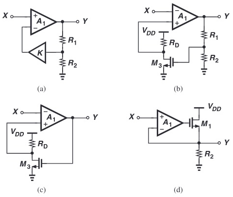

# 장말문제 12.4 — 연산증폭기 귀환 회로 네 개의 루프 이득

## 원문
Calculate the loop gain of the circuits illustrated in Fig. 12.80. Assume the op amp exhibits an open-loop gain of $A_1$, but is otherwise ideal. Also, $\lambda = 0$.

## 조건
- 회로: Fig 12.80 (a)–(d)
- 연산증폭기의 개루프 이득은 $A_1$이고, 그 밖에는 이상적
- $\lambda = 0$
- 소자 값은 주어지지 않음. 답은 $A_1$, $K$, $R_1$, $R_2$, $R_D$, $g_m$ 등 기호로 나타냄 (원문에 없음)

## 구할 것
- (a)–(d) 각 회로의 루프 이득

## 회로 — Fig 12.80(a)
```spice
XA1  X   n2  Y   opamp        ; 삼각형 안 라벨 A1
R1   Y   n1  {R_1}
R2   n1  0   {R_2}
XK   n1  n2  gain "K" tri
```
- 단자: X = 입력 (개방 원) / Y = 출력 (개방 원)
- 표시: 노드 라벨 X (개방 원 왼쪽), Y (개방 원 오른쪽) / 소자 라벨 A1 (연산증폭기 삼각형 안), K (작은 삼각형 안), R_1, R_2 (각 세로 저항 오른쪽) / 부호 연산증폭기 입력 "+" 위, "−" 아래 / 화살표 없음 / 수치·면적 라벨 없음
- 배치: 왼쪽 위 연산증폭기(오른쪽을 향함), X 원 → 가로선 → + 입력 / 출력 → 접속점 → 오른쪽 Y 원 / 출력 접속점에서 세로로 R_1, n1 접속점, R_2, 접지 / n1 접속점에서 가로선이 왼쪽으로 가 왼쪽을 향한 K 삼각형의 오른쪽(입력)으로 들어감 / K 왼쪽(출력)에서 선이 왼쪽으로 가 모서리에서 위로 꺾이고 − 입력 높이에서 오른쪽으로 꺾여 − 입력 / K는 연산증폭기 바로 아래, R_1과 R_2 사이 높이 / 접속점 (세 갈래 이상, 2곳): Y 출력 = 연산증폭기 출력 + 오른쪽 Y 원 + 아래 R_1 (점), n1 = 위 R_1 + 아래 R_2 + 왼쪽 K (점) / 교차: 없음

## 회로 — Fig 12.80(b)
```spice
XA1  n2  X   Y   opamp        ; 삼각형 안 라벨 A1, − 입력 = X
R1   Y   n1  {R_1}
R2   n1  0   {R_2}
RD   VDD n2  {R_D}
M3   n2  n1  0   nmos         ; 좌우 반전, 게이트 오른쪽
```
- 단자: X = 입력 (개방 원) / Y = 출력 (개방 원) / VDD = 전원, 값 미지정 (T 전원 기호)
- 표시: 노드 라벨 X (개방 원 왼쪽), Y (개방 원 오른쪽), V_DD (T 기호 왼쪽) / 소자 라벨 A1 (연산증폭기 삼각형 안), R_1, R_2 (각 세로 저항 오른쪽), R_D (세로 저항 오른쪽), M_3 (트랜지스터 왼쪽) / 부호 연산증폭기 입력 "−" 위, "+" 아래 / 화살표 없음 / 수치·면적 라벨 없음
- 배치: 위쪽 연산증폭기(오른쪽을 향함), X 원 → 가로선 → − 입력(위) / 출력 → 접속점 → 오른쪽 Y 원 / 출력 접속점에서 세로로 R_1, n1 접속점, R_2, 접지 (오른쪽 세로줄) / 왼쪽 아래 세로줄 위→아래 V_DD T 기호, R_D, n2 접속점, M_3, 접지 / M_3 nmos, 좌우 반전(게이트 오른쪽, 드레인 위, 소스 왼쪽 아래·화살표 바깥), 소스 아래 접지 / + 입력(아래)에서 선이 왼쪽으로 가 왼쪽 모서리에서 아래로 꺾이고 n2 높이에서 오른쪽으로 꺾여 n2 접속점 / M_3 게이트에서 선이 오른쪽으로 가 모서리에서 위로 꺾이고 n1 높이에서 오른쪽으로 꺾여 n1 접속점 / 접속점 (세 갈래 이상, 3곳): Y 출력 = 연산증폭기 출력 + 오른쪽 Y 원 + 아래 R_1 (점), n1 = 위 R_1 + 아래 R_2 + 왼쪽 M_3 게이트 선 (점), n2 = 위 R_D + 아래 M_3 드레인 + 왼쪽 + 입력 선 (점) / 교차: 없음

## 회로 — Fig 12.80(c)
```spice
XA1  n1  X   Y   opamp        ; 삼각형 안 라벨 A1, − 입력 = X
RD   VDD n1  {R_D}
M3   n1  Y   0   nmos         ; 좌우 반전, 게이트 오른쪽
```
- 단자: X = 입력 (개방 원) / Y = 출력 (개방 원) / VDD = 전원, 값 미지정 (T 전원 기호)
- 표시: 노드 라벨 X (개방 원 왼쪽), Y (개방 원 오른쪽), V_DD (T 기호 왼쪽) / 소자 라벨 A1 (연산증폭기 삼각형 안), R_D (세로 저항 오른쪽), M_3 (트랜지스터 왼쪽) / 부호 연산증폭기 입력 "−" 위, "+" 아래 / 화살표 없음 / 수치·면적 라벨 없음
- 배치: 위쪽 연산증폭기(오른쪽을 향함), X 원 → 가로선 → − 입력(위) / 출력 → 접속점 → 오른쪽 Y 원 / 왼쪽 아래 세로줄 위→아래 V_DD T 기호, R_D, n1 접속점, M_3, 접지 / M_3 nmos, 좌우 반전(게이트 오른쪽, 드레인 위, 소스 왼쪽 아래·화살표 바깥), 소스 아래 접지 / + 입력(아래)에서 선이 왼쪽으로 가 왼쪽 모서리에서 아래로 꺾이고 n1 높이에서 오른쪽으로 꺾여 n1 접속점 / Y 출력 접속점에서 선이 오른쪽 세로로 M_3 게이트 높이까지 내려가 왼쪽으로 꺾여 M_3 게이트 / 접속점 (세 갈래 이상, 2곳): Y 출력 = 연산증폭기 출력 + 오른쪽 Y 원 + 아래 M_3 게이트로 가는 선 (점), n1 = 위 R_D + 아래 M_3 드레인 + 왼쪽 + 입력 선 (점) / 교차: 없음

## 회로 — Fig 12.80(d)
```spice
XA1  X   Y   n1  opamp        ; 삼각형 안 라벨 A1
M1   VDD n1  Y   nmos
R2   Y   0   {R_2}
```
- 단자: X = 입력 (개방 원) / Y = 출력 (개방 원) / VDD = 전원, 값 미지정 (T 전원 기호)
- 표시: 노드 라벨 X (개방 원 왼쪽), Y (개방 원 오른쪽), V_DD (T 기호 오른쪽) / 소자 라벨 A1 (연산증폭기 삼각형 안), M_1 (트랜지스터 오른쪽), R_2 (세로 저항 오른쪽) / 부호 연산증폭기 입력 "+" 위, "−" 아래 / 화살표 없음 / 수치·면적 라벨 없음
- 배치: 왼쪽 연산증폭기(오른쪽을 향함), X 원 → 가로선 → + 입력 / 출력 → 가로선 → M_1 게이트 / 오른쪽 세로줄 위→아래 V_DD T 기호, M_1, Y 접속점, R_2, 접지 / M_1 nmos 보통 방향(게이트 왼쪽, 드레인 위, 소스 아래·화살표 바깥) / Y 접속점에서 오른쪽으로 Y 원, 왼쪽으로 가로선이 연산증폭기 왼쪽 아래까지 가서 위로 꺾이고 − 입력 높이에서 오른쪽으로 꺾여 − 입력 / 접속점 (세 갈래 이상, 1곳): Y = 위 M_1 소스 + 아래 R_2 + 오른쪽 Y 원 + 왼쪽 귀환선 (점) / 교차: 없음


