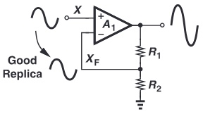

# 장말문제 12.6 — 비반전 증폭기의 출력 파형과 귀환 파형 진폭

## 원문
In the circuit of Fig. 12.3, the input is a sinusoid with a peak amplitude of 2 mV. If $A_1 = 500$ and $R_1/R_2 = 7$, determine the amplitude of the output waveform and the feedback waveform.

## 조건
- 회로: Fig 12.3 (연산증폭기 $A_1$과 저항 분배기 $R_1$, $R_2$로 된 비반전 증폭기)
- 입력 $X$: 피크 진폭 $2\ \text{mV}$인 사인파
- $A_1 = 500$
- $R_1/R_2 = 7$
- 귀환율 (본문 예제 12.1): $K = \dfrac{R_2}{R_1 + R_2}$ (본문 정의, 원문에 없음)
- 식 (12.3): $\dfrac{Y}{X} = \dfrac{A_1}{1 + \dfrac{R_2}{R_1 + R_2} A_1}$ (본문 식, 원문에 없음)
- 귀환 파형은 $R_1$, $R_2$ 접속점의 신호 $X_F$로 봄 (원문에 없음)

## 구할 것
- 출력 파형의 진폭
- 귀환 파형의 진폭

## 상속·참조
- 본문 예제 12.1 (교재 644쪽): 그림 12.2 비반전 증폭기에서 $R_1$, $R_2$가 출력 전압을 감지하고 귀환율 $K = R_2/(R_1 + R_2)$를 제공. 식 (12.3) $\dfrac{Y}{X} = \dfrac{A_1}{1 + \frac{R_2}{R_1 + R_2} A_1}$
- 식 (12.4) (교재 645쪽): 오차 $E = X - X_F = \dfrac{X}{1 + KA_1}$

## 회로 — Fig 12.3
```spice
XA1  X   XF  out  opamp       ; 삼각형 안 라벨 A1
R1   out XF  {R_1}
R2   XF  0   {R_2}
```
- 단자: X = 입력 (개방 원) / out = 출력, 라벨 없음 (개방 원)
- 표시: 노드 라벨 X (입력 선 위), X_F (귀환 선 안쪽, R_1·R_2 접속점 왼쪽 위) / 소자 라벨 A1 (연산증폭기 삼각형 안), R_1, R_2 (각 세로 저항 오른쪽) / 부호 연산증폭기 입력 "+" 위, "−" 아래 / 화살표 "Good Replica": 입력 쪽 사인파에서 X_F 쪽 작은 사인파를 가리킴, 아래 방향, 곡선 / 수치·면적 라벨 없음
- 배치: 연산증폭기(오른쪽을 향함), X 원 → 가로선 → + 입력 / 출력 → 접속점 → 오른쪽 개방 원 / 출력 접속점에서 세로로 R_1, X_F 접속점, R_2, 접지 / X_F 접속점에서 가로선이 왼쪽으로 가 연산증폭기 왼쪽에서 위로 꺾이고 − 입력 높이에서 오른쪽으로 꺾여 − 입력 / 파형 그림: X 원 왼쪽에 작은 사인파, 그 아래 귀환 선 왼쪽에 비슷한 크기의 사인파와 왼쪽 "Good Replica" 글자, 출력 원 오른쪽에 진폭이 큰 사인파 / 접속점 (세 갈래 이상, 2곳): 출력 = 연산증폭기 출력 + 오른쪽 개방 원 + 아래 R_1 (점), X_F = 위 R_1 + 아래 R_2 + 왼쪽 귀환 선 (점) / 교차: 없음


> 참고: 본문 그림 12.3 (교재 645쪽, PDF 3 오른쪽). 사인파 세 개와 "Good Replica" 글자·화살표는 회로 소자가 아닌 설명 그림
