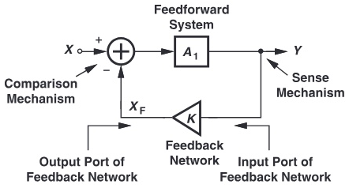

# 장말문제 12.7 — 개루프 이득 20% 변화에 폐루프 이득 변화 1% 미만인 최소 루프 이득

## 원문
Suppose the open-loop gain $A_1$ in Fig. 12.1 changes by 20%. Determine the minimum loop gain necessary to ensure the closed-loop gain changes by less than 1%.

## 조건
- 회로: Fig 12.1 일반적인 귀환 시스템 (순방향 시스템 $A_1$, 귀환 회로망 $K$)
- 개루프 이득 $A_1$이 20% 변함
- 식 (12.2): $\dfrac{Y}{X} = \dfrac{A_1}{1 + KA_1}$, 루프 이득은 $KA_1$ (본문 식, 원문에 없음)
- $K$는 변하지 않는다고 봄 (원문에 없음)

## 구할 것
- 폐루프 이득의 변화가 1% 미만이 되도록 하는 최소 루프 이득

## 상속·참조
- 식 (12.2) (교재 644쪽): $\dfrac{Y}{X} = \dfrac{A_1}{1 + KA_1}$ (폐루프 이득)
- 12.1.1절 (교재 645쪽): 순방향 이득과 귀환율의 곱 $KA_1$을 루프 이득이라 부름

## 회로 — Fig 12.1
```spice
XS1  X   XF  n1  sum          ; X +, XF −
XA1  n1  Y   gain "A1"
XK   Y   XF  gain "K" tri
```
- 단자: X = 입력 (개방 원) / Y = 출력 (선 끝, 라벨 앞 화살촉)
- 표시: 노드 라벨 X (개방 원 왼쪽), X_F (K 왼쪽 귀환선 바로 위), Y (오른쪽 끝 화살표 오른쪽) / 소자 라벨 A1 (사각 상자 안), K (삼각형 안), 덧셈기 (⊕, 라벨 없음), 설명 글자 "Feedforward System" (A1 위), "Comparison Mechanism" (덧셈기 왼쪽 아래), "Sense Mechanism" (출력 분기점 오른쪽 아래), "Feedback Network" (K 아래), "Output Port of Feedback Network" (K 왼쪽 아래), "Input Port of Feedback Network" (K 오른쪽 아래) / 부호 덧셈기 "+" 왼쪽 위(X 입력), "−" 왼쪽 아래(아래쪽 X_F 입력) / 화살표 신호선 화살촉 (라벨 없음, 도선 위): X → 덧셈기, 덧셈기 → A1, 분기점 → Y, X_F → 덧셈기 아래쪽(위 방향); "Comparison Mechanism": 덧셈기를 가리킴, 오른쪽 위 방향, 도선 옆 별도 화살표 (직선); "Sense Mechanism": 출력 분기점을 가리킴, 왼쪽 위 방향, 도선 옆 별도 화살표 (직선); "Output Port of Feedback Network": K 왼쪽 귀환선 아래에서 오른쪽(K 출력 쪽)을 가리킴, 오른쪽 방향, 도선 옆 별도 화살표 (┌ 꺾임: 글자에서 세로선이 올라가 귀환선 바로 아래 높이에서 오른쪽으로 꺾임, 화살촉은 오른쪽 끝); "Input Port of Feedback Network": K 오른쪽 귀환선 아래에서 왼쪽(K 입력 쪽)을 가리킴, 왼쪽 방향, 도선 옆 별도 화살표 (┌ 꺾임을 좌우 반전: 글자에서 세로선이 올라가 귀환선 바로 아래 높이에서 왼쪽으로 꺾임, 화살촉은 왼쪽 끝) / 수치·면적 라벨 없음
- 배치: 위 가로줄 왼쪽→오른쪽 X 원, 덧셈기, A1 상자, 출력 분기점, Y / 출력 분기점에서 선이 아래로 내려가 K 높이에서 왼쪽으로 꺾여 왼쪽을 향한 K 삼각형의 오른쪽(입력)으로 들어감 / K 왼쪽(출력)에서 선이 왼쪽으로 가 덧셈기 x에서 위로 꺾여 덧셈기 아래쪽으로 들어감 / 접속점 (세 갈래 이상, 1곳): 출력 분기점 = 왼쪽 A1 + 오른쪽 Y + 아래 귀환선 (점) / 교차: 없음


> 참고: 본문 그림 12.1 (교재 643쪽, PDF 2 오른쪽). 설명 글자와 그 화살표는 각 부분의 이름표
