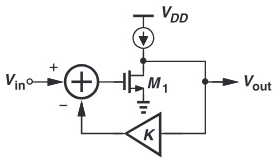

# 장말문제 12.8 — 공통 소스 단 순방향 회로망의 이득 변동 ±5% 보장 최소 루프 이득

## 원문
Consider the feedback system shown in Fig. 12.81, where the common-source stage serves as the feedforward network. Assume $\mu_n C_{ox}$ may vary by $\pm 10\%$ and $\lambda$ by $\pm 20\%$. What is the minimum loop gain necessary to guarantee that the closed-loop gain varies by less than $\pm 5\%$?

## 조건
- 회로: Fig 12.81 귀환 시스템. 공통 소스 단($M_1$, 전류원 부하)이 순방향 회로망, $K$가 귀환 회로망
- $\mu_n C_{ox}$는 $\pm 10\%$, $\lambda$는 $\pm 20\%$까지 변할 수 있음
- 식 (12.2): $\dfrac{Y}{X} = \dfrac{A_1}{1 + KA_1}$, 루프 이득은 $KA_1$ (본문 식, 원문에 없음)
- 전류원은 이상적 전류원이고 바이어스 전류는 변하지 않는다고 봄 (원문에 없음)

## 구할 것
- 폐루프 이득의 변동을 $\pm 5\%$ 미만으로 보장하는 최소 루프 이득

## 상속·참조
- 식 (12.2) (교재 644쪽): 폐루프 이득 $\dfrac{Y}{X} = \dfrac{A_1}{1 + KA_1}$, 루프 이득 $KA_1$ (12.1.1절)

## 회로 — Fig 12.81
```spice
XS1  Vin  n2   n1   sum         ; Vin +, n2(K 출력) −
M1   Vout n1   0    nmos
I1   VDD  Vout                  ; 라벨·값 없음
XK   Vout n2   gain "K" tri
```
- 단자: Vin = 입력 (개방 원) / Vout = 출력 (선 끝, 라벨 앞 화살촉) / VDD = 전원, 값 미지정 (T 전원 기호)
- 표시: 노드 라벨 V_in (개방 원 왼쪽), V_out (오른쪽 화살표 오른쪽), V_DD (T 기호 오른쪽) / 소자 라벨 M_1 (트랜지스터 오른쪽), K (삼각형 안), 덧셈기 (⊕, 라벨 없음), I1 (라벨 없음) / 부호 덧셈기 "+" 왼쪽 위(V_in 입력), "−" 왼쪽 아래(아래쪽 입력) / 화살표 신호선 화살촉 (라벨 없음, 도선 위): V_in → 덧셈기, 오른쪽 세로선의 분기점 → V_out, K 출력 → 덧셈기 아래쪽(위 방향) / 수치·면적 라벨 없음
- 배치: 왼쪽→오른쪽 V_in 원, 덧셈기, M_1, 오른쪽 세로선 / 덧셈기 출력 → 가로선 → M_1 게이트 / M_1 nmos 보통 방향(게이트 왼쪽, 드레인 위, 소스 아래·화살표 바깥), 소스 아래 접지 / M_1 위로 전류원(화살표 아래 방향), 그 위 V_DD T 기호 / 드레인 접속점에서 가로선이 오른쪽으로 가 모서리에서 아래로 꺾여 오른쪽 세로선, 게이트 높이에서 V_out 분기점(오른쪽으로 화살표), 계속 내려가 맨 아래 높이에서 왼쪽으로 꺾여 왼쪽을 향한 K 삼각형의 오른쪽(입력) / K 왼쪽(출력)에서 선이 왼쪽으로 가 덧셈기 x에서 위로 꺾여 덧셈기 아래쪽 / K는 M_1 오른쪽 아래, 맨 아래 / 접속점 (세 갈래 이상, 2곳): 드레인 = 위 전류원 + 아래 M_1 드레인 + 오른쪽 가로선 (점), V_out 분기점 = 위 세로선 + 아래 세로선 + 오른쪽 V_out 화살표 (점) / 교차: 없음


