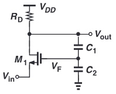

# 장말문제 12.11 — 용량성 분배 귀환 공통 게이트 단에 예제 12.7 반복

## 원문
Repeat Example 12-7 for the circuit depicted in Fig. 12.83. Assume the impedance of $C_1$ and $C_2$ at the frequency of interest is much higher than $R_D$.

## 조건
- 회로: Fig 12.83 공통 게이트 단 ($M_1$, $R_D$). 출력 $V_{out}$을 $C_1$, $C_2$ 용량성 분배기로 나눈 $V_F$를 $M_1$ 게이트로 되돌림
- 관심 주파수에서 $C_1$, $C_2$의 임피던스는 $R_D$보다 훨씬 큼
- 예제 12.7에서 이어받는 가정: $\lambda = 0$ (원문에 없음)
- 식 (12.32): 폐루프 전압 이득 $\dfrac{v_{out}}{v_{in}} = \dfrac{A_0}{1 + KA_0}$, $A_0$는 개루프 이득, $K$는 귀환율 (본문 식, 원문에 없음)

## 구할 것
- (a) Fig 12.83 귀환 시스템의 네 가지 성분 (원문에 없음, 원문은 "Repeat Example 12-7"만 적음)
- (b) 개루프와 폐루프 전압 이득 (원문에 없음, 원문은 "Repeat Example 12-7"만 적음)
- (c) 개루프와 폐루프 I/O 임피던스 (원문에 없음, 원문은 "Repeat Example 12-7"만 적음)

## 상속·참조
- 원문 표기 "Example 12-7"은 예제 12.7
- 예제 12.7 (E12.07, 교재 654–656쪽): 그림 12.11은 그림 12.2 귀환 회로의 트랜지스터 레벨 구현. $\lambda = 0$, $R_1 + R_2 \gg R_D$로 가정. (a) 귀환 시스템의 네 가지 성분을 밝혀라. (b) 개루프와 폐루프 전압 이득을 결정하라. (c) 개루프와 폐루프 I/O 임피던스를 결정하라
- 본문 Fig 12.11 (교재 654쪽, 이 파일의 그림 목록에는 넣지 않음, 크롭은 fig12-11.png): 공통 게이트 단에 저항 분배 귀환
  - `RD: VDD — Vout`, `M1: D = Vout, G = n1, S = Vin`, `R1: Vout — n1`, `R2: n1 — 0`
  - Fig 12.83은 이 회로의 $R_1$, $R_2$를 $C_1$, $C_2$로 바꾼 꼴 ($R_1$ 자리에 $C_1$, $R_2$ 자리에 $C_2$)
- 예제 12.7 풀이의 틀: 순방향 시스템은 $M_1$과 $R_D$ (공통 게이트 단), 분배기가 감지 장치와 귀환 회로망, $M_1$ 자신이 $i_D = g_m(v_G - v_S)$로 뺄셈기. 개루프 이득 $A_0 \approx g_m R_D$, 폐루프 이득 $\dfrac{A_0}{1 + KA_0}$ (식 12.31–12.33)

## 회로 — Fig 12.83
```spice
RD   VDD   Vout  {R_D}
M1   Vout  VF    Vin   nmos     ; 좌우 반전, 게이트 오른쪽
C1   Vout  VF    {C_1}
C2   VF    0     {C_2}
```
- 단자: Vin = 입력 (개방 원) / Vout = 출력 (개방 원) / VDD = 전원, 값 미지정 (T 전원 기호)
- 표시: 노드 라벨 V_DD (T 기호 오른쪽), V_out (개방 원 오른쪽), V_F (게이트 가로선 아래, C_2 왼쪽), V_in (개방 원 왼쪽) / 소자 라벨 R_D (세로 저항 왼쪽), M_1 (트랜지스터 왼쪽 위), C_1, C_2 (각 커패시터 오른쪽) / 부호 없음 / 화살표 없음 / 수치·면적 라벨 없음
- 배치: 왼쪽 세로줄 위→아래 V_DD T 기호, R_D, 드레인 접속점, M_1 / M_1 nmos, 좌우 반전(게이트 오른쪽, 드레인 위, 소스 왼쪽 아래·화살표 바깥) / 소스에서 선이 아래로 내려가 왼쪽으로 꺾여 V_in 원 / 드레인 접속점에서 가로선이 오른쪽으로 가 오른쪽 세로줄의 V_out 접속점, 그 오른쪽 V_out 원 / 오른쪽 세로줄 위→아래 V_out 접속점, C_1, V_F 접속점, C_2, 접지 / M_1 게이트에서 가로선이 오른쪽으로 V_F 접속점 / 접속점 (세 갈래 이상, 3곳): 드레인 = 위 R_D + 아래 M_1 드레인 + 오른쪽 가로선 (점), V_out = 왼쪽 가로선 + 오른쪽 V_out 원 + 아래 C_1 (점), V_F = 위 C_1 + 아래 C_2 + 왼쪽 게이트 선 (점) / 교차: 없음


