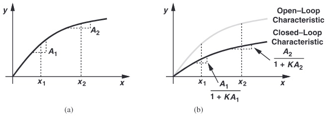

# 장말문제 12.13 — x1, x2에서 폐루프 이득 차 5% 미만을 보장하는 K

## 원문
In Fig. 12.14, $A_1 = 500$ and $A_2 = 420$. What value of $K$ guarantees that the closed-loop gains at $x_1$ and $x_2$ differ by less than 5%? What closed-loop gain is achieved under this condition?

## 조건
- Fig 12.14의 비선형 개루프 특성: $x = x_1$ 근처의 소신호 이득(기울기) $A_1$, $x = x_2$ 근처의 소신호 이득 $A_2$
- $A_1 = 500$, $A_2 = 420$
- 식 (12.46): $x_1$에서 폐루프 이득 $= \dfrac{A_1}{1 + KA_1}$ (본문 식, 원문에 없음)
- 식 (12.48): $x_2$에서 폐루프 이득 $= \dfrac{A_2}{1 + KA_2}$ (본문 식, 원문에 없음)

## 구할 것
- $x_1$과 $x_2$에서의 폐루프 이득 차이가 5% 미만이 되도록 보장하는 $K$ 값
- 이 조건에서 얻는 폐루프 이득

## 상속·참조
- 12.2.4절 선형성 개선 (교재 657–658쪽): 귀환 루프에 넣으면 $x_1$ 근처 이득 $\dfrac{A_1}{1 + KA_1} \approx \dfrac{1}{K}\left(1 - \dfrac{1}{KA_1}\right)$ (식 12.46, 12.47), $x_2$ 근처 이득 $\dfrac{A_2}{1 + KA_2} \approx \dfrac{1}{K}\left(1 - \dfrac{1}{KA_2}\right)$ (식 12.48, 12.49), 근사는 $KA \gg 1$일 때
- 본문 Fig 12.14 (교재 657쪽, PDF 9 오른쪽): 특성 그래프 (회로 그림 아님)
  - (a) 증폭기의 비선형 개루프 특성. 가로축 $x$, 세로축 $y$. 원점에서 시작해 위로 볼록하게 올라가며 기울기가 점점 줄어드는 곡선. $x_1$, $x_2$ ($x_1 < x_2$)에서 곡선까지 세로 점선, 각 점에 작은 점선 직각삼각형(기울기 표시)과 라벨 $A_1$ ($x_1$), $A_2$ ($x_2$)
  - (b) 귀환에 의한 선형성 개선. 같은 축. 회색 곡선 "Open–Loop Characteristic"(위, (a)의 곡선)과 검은 곡선 "Closed–Loop Characteristic"(아래, 덜 휘어 더 곧음). $x_1$, $x_2$에서 세로 점선, 검은 곡선 위 각 점에 기울기 삼각형과 화살표 라벨 $\dfrac{A_1}{1 + KA_1}$ ($x_1$ 아래쪽), $\dfrac{A_2}{1 + KA_2}$ ($x_2$ 오른쪽)

## 회로 — 없음 (특성 그래프 문제, 그림 12.14는 회로가 아닌 그래프로 상속·참조에 적음)
