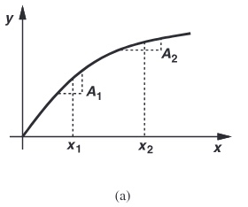

# 장말문제 12.14 — 3차 다항식 특성의 개루프·폐루프 소신호 이득

## 원문
The characteristic in Fig. 12.14(a) is sometimes approximated as

$$y = \alpha_1 x - \alpha_3 x^3, \qquad (12.201)$$

where $\alpha_1$ and $\alpha_3$ are constant.

(a) Determine the small-signal gain $\partial y/\partial x$ at $x = 0$ and $x = \Delta x$.

(b) Determine the closed-loop gain at $x = 0$ and $x = \Delta x$ for a feedback factor of $K$.

## 조건
- Fig 12.14(a)의 비선형 입출력 특성을 다음 식으로 근사함: $y = \alpha_1 x - \alpha_3 x^3$ (식 12.201)
- $\alpha_1$, $\alpha_3$은 상수
- 귀환율: $K$
- 식 (12.46): 개루프 이득이 $A_1$인 점에서 폐루프 이득 $= \dfrac{A_1}{1 + KA_1}$ (본문 식, 원문에 없음)

## 구할 것
- (a) $x = 0$과 $x = \Delta x$에서의 소신호 이득 $\partial y/\partial x$
- (b) 귀환율이 $K$일 때 $x = 0$과 $x = \Delta x$에서의 폐루프 이득

## 상속·참조
- 본문 Fig 12.14(a) (교재 657쪽, PDF 9, 12.2.4 선형성 개선): 증폭기의 비선형 개루프 특성 그래프 (회로 그림 아님)
  - 가로축 $x$, 세로축 $y$. 곡선은 원점에서 출발해 올라가며 기울기가 점점 줄어드는 (위로 볼록한) 모양
  - $x_1$ 근처의 기울기를 점선 작은 삼각형과 라벨 $A_1$로, 더 큰 $x_2$ 근처의 기울기를 라벨 $A_2$로 표시. $x_1$, $x_2$에서 가로축까지 세로 점선. $A_2 < A_1$로 그려짐
- 본문 식 (12.46): 폐루프 시스템에서 $x_1$의 이득 $= \dfrac{A_1}{1 + KA_1}$

> 참고: Fig 12.14는 본문 그림(교재 657쪽, PDF 9)

## 회로 — 없음 (특성 그래프 문제, 그림 12.14(a)는 회로가 아닌 그래프로 상속·참조에 적음)
