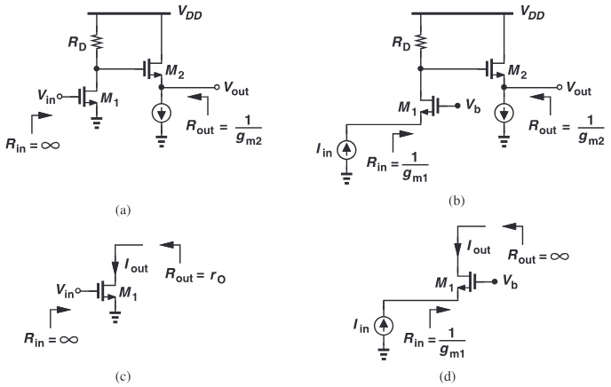

# 장말문제 12.15 — 그림 12.19 네 단의 증폭기 모델

## 원문
Using the developments in Fig. 12.18, draw the amplifier model for each stage in Fig. 12.19.

## 조건
- 회로: Fig 12.19 (a)–(d)의 네 단 (본문의 증폭기 형태 예: (a) 전압, (b) 트랜스임피던스, (c) 트랜스컨덕턴스, (d) 전류 증폭기) (괄호 안은 원문에 없음)
- 참고 모델 (본문 Fig 12.18): 입력 쪽은 $R_{in}$, 출력 쪽은 $R_{out}$과 종속 전원($A_0 v_{in}$, $R_0 i_{in}$, $G_m v_{in}$, $A_I i_{in}$)으로 나타낸 네 가지 증폭기의 실제 모델. 전압 출력은 종속 전압원에 $R_{out}$ 직렬, 전류 출력은 종속 전류원에 $R_{out}$ 병렬. 전압 입력은 $R_{in}$을 입력 포트에 병렬, 전류 입력은 $i_{in}$이 $R_{in}$으로 흘러 들어감 (원문에 없음)
- 그림에 인쇄된 값: (a) $R_{in} = \infty$, $R_{out} = 1/g_{m2}$ / (b) $R_{in} = 1/g_{m1}$, $R_{out} = 1/g_{m2}$ / (c) $R_{in} = \infty$, $R_{out} = r_O$ / (d) $R_{in} = 1/g_{m1}$, $R_{out} = \infty$

## 구할 것
- Fig 12.19의 각 단 (a)–(d)에 대한 증폭기 모델 그리기

## 상속·참조
- 본문 Fig 12.18 (교재 661쪽, PDF 11, 12.3.1 간단한 증폭기 모델): 크롭 안 함
  - (a) 전압 증폭기의 실제 모델: $v_{in}$ 단자와 접지 사이에 $R_{in}$. 출력 쪽은 접지 기준 종속 전압원 $A_0 v_{in}$ (+ 위) → 직렬 $R_{out}$ → $v_{out}$
  - (b) 부정확한 전압 증폭기 모델: $v_{in}$ → 직렬 $R_{in}$ → 끝. 출력 쪽은 종속 전압원 $A_0 v_{in}$에 $R_{out}$이 병렬로 $v_{out}$ 노드와 접지 사이
  - (c) 트랜스임피던스 증폭기의 실제 모델: 입력 전류 $i_{in}$이 $R_{in}$(접지로)으로 흘러 들어감. 출력 쪽은 종속 전압원 $R_0 i_{in}$ → 직렬 $R_{out}$ → $v_{out}$
  - (d) 부정확한 트랜스임피던스 증폭기 모델: $i_{in}$ → $R_{in}$(접지로). 출력 쪽은 종속 전압원 $R_0 i_{in}$이 바로 $v_{out}$ ($R_{out}$ 없음)
  - (e) 트랜스컨덕턴스 증폭기의 실제 모델: $v_{in}$ 단자와 접지 사이 $R_{in}$. 출력 쪽은 종속 전류원 $G_m v_{in}$(아래 방향)과 $R_{out}$이 출력 노드와 접지 사이에 병렬
  - (f) 전류 증폭기의 실제 모델: $i_{in}$ → $R_{in}$(접지로). 출력 쪽은 종속 전류원 $A_I i_{in}$(아래 방향)과 $R_{out}$이 출력 노드와 접지 사이에 병렬
- 본문 12.3.2: 그림 12.19의 소신호 이득은 (a) 전압 이득 $A_0$ (λ = 0이면 $-g_{m1} R_D$), (b) 트랜스임피던스 $R_T = v_{out}/i_{in} = R_D$, (c) 트랜스컨덕턴스 $G_m = g_m$, (d) 전류 이득 $A_I = 1$

## 회로 — Fig 12.19(a)
```spice
RD  VDD   n1    {R_D}
M1  n1    Vin   0     nmos
M2  VDD   n1    Vout  nmos
I1  Vout  0                  ; 라벨·값 없음
```
- 단자: VDD = 전원, 값 미지정 (가로 레일) / Vin = 입력 (개방 원) / Vout = 출력 (개방 원)
- 표시: 노드 라벨 VDD (레일 오른쪽 끝), V_in (입력 원 왼쪽), V_out (출력 원 오른쪽) / 소자 라벨 R_D (저항 왼쪽), M1, M2 (각 트랜지스터 오른쪽), I1 (라벨 없음) / 부호 없음 / 화살표 "R_in = ∞": V_in 원 아래에서 회로 쪽(오른쪽)을 들여다봄, 오른쪽 방향, 도선 옆 별도 화살표 (┌ 꺾임: 세로선 위 끝에서 오른쪽으로 꺾여 화살촉, 라벨은 아래); "R_out = 1/g_m2": Vout 선 아래에서 회로 쪽(왼쪽)을 들여다봄, 왼쪽 방향, 도선 옆 별도 화살표 (┌ 꺾임을 좌우 반전, 라벨은 아래) / 수치·면적 라벨 없음 (R_in = ∞, R_out = 1/g_m2 값은 화살표 라벨에 포함)
- 배치: 위에 VDD 가로 레일 / 왼쪽 세로줄 위→아래 R_D, n1 접속점, M1, 접지 / 오른쪽 세로줄 위→아래 M2(드레인이 레일에), Vout 접속점, I1 전류원(아래 방향 화살표), 접지 / M1, M2 nmos 보통 방향(게이트 왼쪽) / n1에서 가로선이 오른쪽으로 M2 게이트 / Vin 원 → 가로선 → M1 게이트 / 접속점 (세 갈래 이상, 2곳): n1 = 위 R_D + 아래 M1 드레인 + 오른쪽 M2 게이트선 (점), Vout = 위 M2 소스 + 아래 I1 + 오른쪽 V_out 선 (점) / 교차: 없음

## 회로 — Fig 12.19(b)
```spice
RD   VDD   n1    {R_D}
M1   n1    Vb    n2    nmos   ; 좌우 반전 (게이트 오른쪽)
IIN  0     n2                 ; 라벨 I_in
M2   VDD   n1    Vout  nmos
I1   Vout  0                  ; 라벨·값 없음
```
- 단자: VDD = 전원, 값 미지정 (가로 레일) / Vb = 이상적 DC 바이어스, 값 미지정 (점 단자) / Vout = 출력 (개방 원)
- 표시: 노드 라벨 VDD (레일 오른쪽 끝), V_b (점 단자 오른쪽), V_out (출력 원 오른쪽) / 소자 라벨 R_D (저항 왼쪽), M1 (트랜지스터 왼쪽), M2 (트랜지스터 오른쪽), I_in (전류원 왼쪽), I1 (라벨 없음) / 부호 없음 / 화살표 "R_in = 1/g_m1": M1 소스로 가는 I_in 선 아래에서 M1 소스 쪽(오른쪽)을 들여다봄, 오른쪽 방향, 도선 옆 별도 화살표 (┌ 꺾임, 라벨은 아래); "R_out = 1/g_m2": Vout 선 아래에서 왼쪽을 들여다봄, 왼쪽 방향, 도선 옆 별도 화살표 (┌ 꺾임을 좌우 반전, 라벨은 아래) / 수치·면적 라벨 없음
- 배치: 위에 VDD 가로 레일 / 왼쪽 세로줄 위→아래 R_D, n1 접속점, M1 / M1 nmos 좌우 반전 (게이트가 오른쪽으로 V_b 점 단자, 소스 왼쪽 아래·화살표 바깥) / M1 소스에서 아래로 내려가 가로선이 왼쪽으로 뻗어 I_in 전류원 위 끝으로 (I_in 화살표 위 방향, 아래 끝 접지) / 오른쪽 세로줄 위→아래 M2(드레인이 레일에), Vout 접속점, I1 전류원(아래 방향), 접지 / n1에서 가로선이 오른쪽으로 M2 게이트 / 접속점 (세 갈래 이상, 2곳): n1 = 위 R_D + 아래 M1 드레인 + 오른쪽 M2 게이트선 (점), Vout = 위 M2 소스 + 아래 I1 + 오른쪽 V_out 선 (점) / 교차: 없음

## 회로 — Fig 12.19(c)
```spice
M1  out  Vin  0  nmos
```
- 단자: Vin = 입력 (개방 원) / out = 출력 전류 단자, 원 없이 선이 끝남 (선 끝)
- 표시: 노드 라벨 V_in (입력 원 왼쪽) / 소자 라벨 M1 (트랜지스터 오른쪽) / 부호 없음 / 화살표 "I_out": M1 드레인 세로선, 아래 방향 (드레인으로 들어감), 도선 위; "R_in = ∞": V_in 원 아래에서 오른쪽을 들여다봄, 오른쪽 방향, 도선 옆 별도 화살표 (┌ 꺾임, 라벨은 아래); "R_out = r_O": out 선 끝 오른쪽에서 왼쪽(드레인 쪽)을 들여다봄, 왼쪽 방향, 도선 옆 별도 화살표 (┌ 꺾임을 좌우 반전, 라벨은 아래) / 수치·면적 라벨 없음
- 배치: M1 nmos 보통 방향(게이트 왼쪽), 소스 아래 접지 / 드레인에서 세로선이 위로 올라가 모서리에서 오른쪽으로 꺾여 짧은 가로선으로 끝남 (out) / 접속점: 없음 / 교차: 없음

## 회로 — Fig 12.19(d)
```spice
M1   out  Vb  n1  nmos   ; 좌우 반전 (게이트 오른쪽)
IIN  0    n1             ; 라벨 I_in
```
- 단자: Vb = 이상적 DC 바이어스, 값 미지정 (점 단자) / out = 출력 전류 단자, 원 없이 선이 끝남 (선 끝)
- 표시: 노드 라벨 V_b (점 단자 오른쪽) / 소자 라벨 M1 (트랜지스터 왼쪽), I_in (전류원 왼쪽) / 부호 없음 / 화살표 "I_out": M1 드레인 세로선, 아래 방향, 도선 위; "R_out = ∞": out 선 끝 오른쪽에서 왼쪽을 들여다봄, 왼쪽 방향, 도선 옆 별도 화살표 (┌ 꺾임을 좌우 반전, 라벨은 아래); "R_in = 1/g_m1": I_in에서 M1 소스로 가는 선 아래에서 오른쪽을 들여다봄, 오른쪽 방향, 도선 옆 별도 화살표 (┌ 꺾임, 라벨은 아래) / 수치·면적 라벨 없음
- 배치: M1 nmos 좌우 반전 (게이트 오른쪽으로 V_b 점 단자, 드레인 위, 소스 왼쪽 아래·화살표 바깥) / 드레인에서 세로선이 위로 올라가 모서리에서 오른쪽으로 꺾여 짧은 가로선으로 끝남 (out) / M1 소스에서 아래로 내려가 가로선이 왼쪽으로 뻗어 I_in 전류원 위 끝으로 (I_in 화살표 위 방향, 아래 끝 접지) / 접속점: 없음 / 교차: 없음


> 참고: Fig 12.19는 본문 그림(교재 662쪽, PDF 12). 그림에 R_in, R_out 값이 함께 인쇄돼 있음
