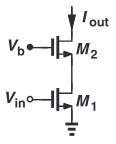

# 장말문제 12.16 — NMOS 캐스코드의 증폭기 모델

## 원문
Determine the amplifier model for the circuit depicted in Fig. 12.84. Assume $\lambda > 0$.

## 조건
- 회로: Fig 12.84 ($M_1$, $M_2$ 캐스코드, 출력은 $M_2$ 드레인 전류 $I_{out}$)
- $\lambda > 0$
- 증폭기 모델: 본문 Fig 12.18처럼 입력 저항 $R_{in}$, 출력 저항 $R_{out}$, 종속 전원 이득($A_0$, $R_0$, $G_m$, $A_I$ 중 해당하는 것)으로 나타낸 모델 (원문에 없음)

## 구할 것
- Fig 12.84 회로의 증폭기 모델

## 상속·참조
- 본문 Fig 12.18 (교재 661쪽, PDF 11): 네 가지 증폭기의 실제 모델. 크롭 안 함, 이 파일의 그림 목록에는 넣지 않음
  - 전압 입력: $v_{in}$ 단자와 접지 사이 $R_{in}$ / 전류 입력: $i_{in}$이 $R_{in}$(접지로)으로 흘러 들어감
  - 전압 출력: 종속 전압원($A_0 v_{in}$ 또는 $R_0 i_{in}$)에 $R_{out}$ 직렬 / 전류 출력: 종속 전류원($G_m v_{in}$ 또는 $A_I i_{in}$)과 $R_{out}$이 출력 노드와 접지 사이에 병렬

## 회로 — Fig 12.84
```spice
M2  out  Vb   n1  nmos
M1  n1   Vin  0   nmos
```
- 단자: out = 출력 전류 단자, 원 없이 선이 끝남 (선 끝) / Vb = 이상적 DC 바이어스, 값 미지정 (점 단자) / Vin = 입력 (개방 원)
- 표시: 노드 라벨 V_b (점 단자 왼쪽), V_in (입력 원 왼쪽) / 소자 라벨 M2, M1 (각 트랜지스터 오른쪽) / 부호 없음 / 화살표 "I_out": M2 드레인 위 세로선, 아래 방향 (드레인으로 들어감), 도선 위 / 수치·면적 라벨 없음
- 배치: 한 세로줄 위→아래 out 선 끝, M2, M1, 접지 / M2, M1 nmos 보통 방향(게이트 왼쪽, 드레인 위, 소스 아래·화살표 바깥) / M2 소스에서 곧은 세로선이 M1 드레인으로 (n1, 라벨 없음) / V_b 점 단자 → 가로선 → M2 게이트, V_in 원 → 가로선 → M1 게이트 / M1 소스 아래 접지 / 접속점: 없음 / 교차: 없음


