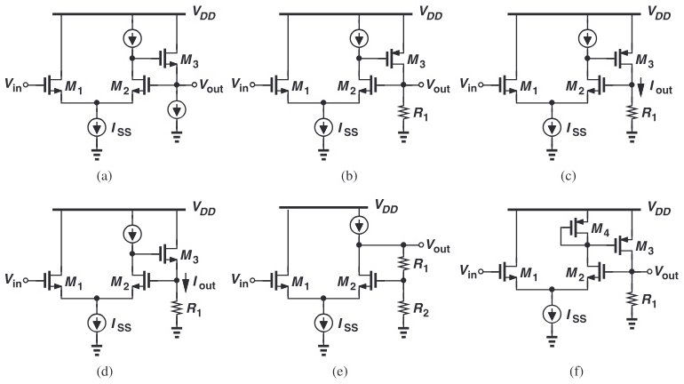

# 장말문제 12.18 — 여섯 가지 차동 입력 귀환 증폭기의 감지·반송 방식

## 원문
Identify the sense and return mechanisms in each amplifier depicted in Fig. 12.85.

## 조건
- 회로: Fig 12.85 (a)–(f)의 여섯 증폭기
- 감지 방식: 출력 전압을 감지하는지(병렬) 출력 전류를 감지하는지(직렬), 반송 방식: 입력에 전압으로 반송하는지(직렬) 전류로 반송하는지(병렬)를 가림 (원문에 없음)

## 구할 것
- (a)–(f) 각 증폭기의 감지 방식과 반송 방식

## 회로 — Fig 12.85(a)
```spice
M1   VDD   Vin   n1    nmos
M2   n2    Vout  n1    nmos   ; 좌우 반전 (게이트 오른쪽)
I1   VDD   n2                 ; 라벨·값 없음
M3   VDD   n2    Vout  nmos
I2   Vout  0                  ; 라벨·값 없음
ISS  n1    0
```
- 단자: VDD = 전원, 값 미지정 (가로 레일) / Vin = 입력 (개방 원) / Vout = 출력 (개방 원)
- 표시: 노드 라벨 VDD (레일 오른쪽 끝), V_in (입력 원 왼쪽), V_out (출력 원 오른쪽) / 소자 라벨 M1 (트랜지스터 오른쪽), M2 (트랜지스터 왼쪽), M3 (트랜지스터 오른쪽), I_SS (전류원 오른쪽), I1, I2 (라벨 없음) / 부호 없음 / 화살표 없음 / 수치·면적 라벨 없음
- 배치: 위에 VDD 가로 레일 / 왼쪽 M1 nmos 보통 방향(게이트 왼쪽), 드레인이 곧게 레일로 / 가운데 세로줄 위→아래 I1(레일에서, 아래 방향), n2 접속점, M2 / M2 nmos 좌우 반전 (게이트 오른쪽, 드레인 위, 소스 왼쪽 아래·화살표 바깥) / M1 소스와 M2 소스가 아래 가로선으로 이어지고 가운데 n1 접속점에서 I_SS 전류원(아래 방향) → 접지 / n2에서 가로선이 오른쪽으로 M3 게이트 / 오른쪽 세로줄 위→아래 M3(nmos 보통 방향, 드레인이 레일에), Vout 접속점, I2 전류원(아래 방향), 접지 / Vout 접속점에서 가로선이 왼쪽으로 M2 게이트, 오른쪽으로 V_out 원 / 접속점 (세 갈래 이상, 3곳): n1 = 왼쪽 M1 소스 + 오른쪽 M2 소스 + 아래 I_SS (점), n2 = 위 I1 + 아래 M2 드레인 + 오른쪽 M3 게이트선 (점), Vout = 위 M3 소스 + 아래 I2 + 왼쪽 M2 게이트선 + 오른쪽 V_out 선 (점) / 교차: 없음

## 회로 — Fig 12.85(b)
```spice
M1   VDD   Vin   n1    nmos
M2   n2    Vout  n1    nmos   ; 좌우 반전 (게이트 오른쪽)
I1   VDD   n2                 ; 라벨·값 없음
M3   Vout  n2    VDD   pmos
R1   Vout  0     {R_1}
ISS  n1    0
```
- 단자: VDD = 전원, 값 미지정 (가로 레일) / Vin = 입력 (개방 원) / Vout = 출력 (개방 원)
- 표시: 노드 라벨 VDD (레일 오른쪽 끝), V_in (입력 원 왼쪽), V_out (출력 원 오른쪽) / 소자 라벨 M1 (트랜지스터 오른쪽), M2 (트랜지스터 왼쪽), M3 (트랜지스터 오른쪽), R1 (저항 오른쪽), I_SS (전류원 오른쪽), I1 (라벨 없음) / 부호 없음 / 화살표 없음 / 수치·면적 라벨 없음
- 배치: (a)와 같은 모양에서 오른쪽 줄만 다름 / M3 pmos (게이트 왼쪽, 소스 위·화살표가 막대 쪽으로 들어감, 소스가 레일에, 드레인 아래) / 오른쪽 세로줄 위→아래 M3, Vout 접속점, R1, 접지 / M2 nmos 좌우 반전 / 접속점 (세 갈래 이상, 3곳): n1 = M1 소스 + M2 소스 + 아래 I_SS (점), n2 = 위 I1 + 아래 M2 드레인 + 오른쪽 M3 게이트선 (점), Vout = 위 M3 드레인 + 아래 R1 + 왼쪽 M2 게이트선 + 오른쪽 V_out 선 (점) / 교차: 없음

## 회로 — Fig 12.85(c)
```spice
M1   VDD   Vin   n1    nmos
M2   n2    n3    n1    nmos   ; 좌우 반전 (게이트 오른쪽)
I1   VDD   n2                 ; 라벨·값 없음
M3   n3    n2    VDD   pmos
R1   n3    0     {R_1}
ISS  n1    0
```
- 단자: VDD = 전원, 값 미지정 (가로 레일) / Vin = 입력 (개방 원)
- 표시: 노드 라벨 VDD (레일 오른쪽 끝), V_in (입력 원 왼쪽) / 소자 라벨 M1 (트랜지스터 오른쪽), M2 (트랜지스터 왼쪽), M3 (트랜지스터 오른쪽), R1 (저항 오른쪽), I_SS (전류원 오른쪽), I1 (라벨 없음) / 부호 없음 / 화살표 "I_out": n3에서 R1으로 내려가는 세로선, 아래 방향, 도선 옆 별도 화살표 (직선, 선 오른쪽) / 수치·면적 라벨 없음
- 배치: (b)와 같은 모양, 출력 원 없음 / M3 pmos (소스가 레일에) / 오른쪽 세로줄 위→아래 M3, n3 접속점, R1, 접지 / M2 nmos 좌우 반전 / 접속점 (세 갈래 이상, 3곳): n1 = M1 소스 + M2 소스 + 아래 I_SS (점), n2 = 위 I1 + 아래 M2 드레인 + 오른쪽 M3 게이트선 (점), n3 = 위 M3 드레인 + 아래 R1 + 왼쪽 M2 게이트선 (점) / 교차: 없음

## 회로 — Fig 12.85(d)
```spice
M1   VDD   Vin   n1    nmos
M2   n2    n3    n1    nmos   ; 좌우 반전 (게이트 오른쪽)
I1   VDD   n2                 ; 라벨·값 없음
M3   VDD   n2    n3    nmos
R1   n3    0     {R_1}
ISS  n1    0
```
- 단자: VDD = 전원, 값 미지정 (가로 레일) / Vin = 입력 (개방 원)
- 표시: 노드 라벨 VDD (레일 오른쪽 끝), V_in (입력 원 왼쪽) / 소자 라벨 M1 (트랜지스터 오른쪽), M2 (트랜지스터 왼쪽), M3 (트랜지스터 오른쪽), R1 (저항 오른쪽), I_SS (전류원 오른쪽), I1 (라벨 없음) / 부호 없음 / 화살표 "I_out": n3에서 R1으로 내려가는 세로선, 아래 방향, 도선 옆 별도 화살표 (직선, 선 오른쪽) / 수치·면적 라벨 없음
- 배치: (a)와 같은 모양에서 I2 대신 R1, 출력 원 없음 / M3 nmos 보통 방향(드레인이 레일에, 소스 아래) / 오른쪽 세로줄 위→아래 M3, n3 접속점, R1, 접지 / M2 nmos 좌우 반전 / 접속점 (세 갈래 이상, 3곳): n1 = M1 소스 + M2 소스 + 아래 I_SS (점), n2 = 위 I1 + 아래 M2 드레인 + 오른쪽 M3 게이트선 (점), n3 = 위 M3 소스 + 아래 R1 + 왼쪽 M2 게이트선 (점) / 교차: 없음

## 회로 — Fig 12.85(e)
```spice
M1   VDD   Vin   n1    nmos
M2   Vout  n3    n1    nmos   ; 좌우 반전 (게이트 오른쪽)
I1   VDD   Vout               ; 라벨·값 없음
R1   Vout  n3    {R_1}
R2   n3    0     {R_2}
ISS  n1    0
```
- 단자: VDD = 전원, 값 미지정 (가로 레일) / Vin = 입력 (개방 원) / Vout = 출력 (개방 원)
- 표시: 노드 라벨 VDD (레일 오른쪽 끝 위), V_in (입력 원 왼쪽), V_out (출력 원 오른쪽) / 소자 라벨 M1 (트랜지스터 오른쪽), M2 (트랜지스터 왼쪽), R1, R2 (각 저항 오른쪽), I_SS (전류원 오른쪽), I1 (라벨 없음) / 부호 없음 / 화살표 없음 / 수치·면적 라벨 없음
- 배치: 위에 VDD 가로 레일 (M1 드레인 선에서 I1까지, 레일 오른쪽 끝이 I1) / 왼쪽 M1 nmos 보통 방향, 드레인이 레일로 / 가운데 세로줄 위→아래 I1(아래 방향), 왼쪽 위 접속점, M2 / M2 nmos 좌우 반전 / M1·M2 소스가 아래 가로선으로 이어지고 n1에서 I_SS → 접지 / 왼쪽 위 접속점에서 가로선이 오른쪽으로 Vout 접속점 → V_out 원 / 오른쪽 세로줄 위→아래 Vout 접속점, R1, n3 접속점, R2, 접지 / n3에서 가로선이 왼쪽으로 M2 게이트 / 접속점 (세 갈래 이상, 4곳): n1 = M1 소스 + M2 소스 + 아래 I_SS (점), I1 아래 = 위 I1 + 아래 M2 드레인 + 오른쪽 가로선 (점), Vout = 왼쪽 가로선 + 아래 R1 + 오른쪽 V_out 선 (점), n3 = 위 R1 + 아래 R2 + 왼쪽 M2 게이트선 (점) / 교차: 없음

## 회로 — Fig 12.85(f)
```spice
M1   VDD   Vin   n1    nmos
M2   n2    Vout  n1    nmos   ; 좌우 반전 (게이트 오른쪽)
M4   n2    n2    VDD   pmos   ; 다이오드 연결 (게이트 = 드레인)
M3   Vout  n2    VDD   pmos
R1   Vout  0     {R_1}
ISS  n1    0
```
- 단자: VDD = 전원, 값 미지정 (가로 레일) / Vin = 입력 (개방 원) / Vout = 출력 (개방 원)
- 표시: 노드 라벨 VDD (레일 오른쪽 끝), V_in (입력 원 왼쪽), V_out (출력 원 오른쪽) / 소자 라벨 M1 (트랜지스터 오른쪽), M2 (트랜지스터 왼쪽), M4, M3 (각 트랜지스터 오른쪽), R1 (저항 오른쪽), I_SS (전류원 오른쪽) / 부호 없음 / 화살표 없음 / 수치·면적 라벨 없음
- 배치: 위에 VDD 가로 레일 / 왼쪽 M1 nmos 보통 방향, 드레인이 레일로 / 가운데 세로줄 위→아래 M4, n2 접속점, M2 / M4 pmos 보통 방향 (게이트 왼쪽, 소스 위·화살표가 막대 쪽으로 들어감, 소스가 레일에, 드레인 아래) / M4 게이트선이 왼쪽으로 나가 아래로 꺾이고 n2 높이에서 오른쪽으로 꺾여 n2 접속점 / n2에서 가로선이 오른쪽으로 M3 게이트 / 오른쪽 세로줄 위→아래 M3(pmos, 소스가 레일에), Vout 접속점, R1, 접지 / M2 nmos 좌우 반전, M1·M2 소스가 아래 가로선으로 이어지고 n1에서 I_SS → 접지 / Vout 접속점에서 가로선이 왼쪽으로 M2 게이트, 오른쪽으로 V_out 원 / 접속점 (세 갈래 이상, 3곳): n1 = M1 소스 + M2 소스 + 아래 I_SS (점), n2 = 위 M4 드레인 + 왼쪽 M4 게이트 귀환선 + 아래 M2 드레인 + 오른쪽 M3 게이트선 (점), Vout = 위 M3 드레인 + 아래 R1 + 왼쪽 M2 게이트선 + 오른쪽 V_out 선 (점) / 교차: 없음


