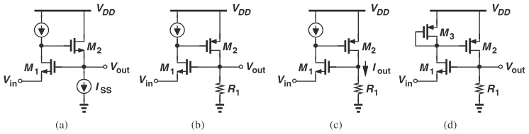

# 장말문제 12.19 — 공통 게이트 입력 귀환 증폭기 네 개의 감지·반송 방식

## 원문
Identify the sense and return mechanisms in each amplifier depicted in Fig. 12.86.

## 조건
- 회로: Fig 12.86 (a)–(d)의 네 증폭기
- 감지 방식: 출력 전압을 감지하는지(병렬) 출력 전류를 감지하는지(직렬), 반송 방식: 입력에 전압으로 반송하는지(직렬) 전류로 반송하는지(병렬)를 가림 (원문에 없음)

## 구할 것
- (a)–(d) 각 증폭기의 감지 방식과 반송 방식

## 회로 — Fig 12.86(a)
```spice
I1   VDD   n1                 ; 라벨·값 없음
M1   n1    Vout  Vin   nmos   ; 좌우 반전 (게이트 오른쪽)
M2   VDD   n1    Vout  nmos
ISS  Vout  0
```
- 단자: VDD = 전원, 값 미지정 (가로 레일) / Vin = 입력 (개방 원) / Vout = 출력 (개방 원)
- 표시: 노드 라벨 VDD (레일 오른쪽 끝), V_in (입력 원 왼쪽), V_out (출력 원 오른쪽) / 소자 라벨 M1 (트랜지스터 왼쪽), M2 (트랜지스터 오른쪽), I_SS (전류원 오른쪽), I1 (라벨 없음) / 부호 없음 / 화살표 없음 / 수치·면적 라벨 없음
- 배치: 위에 VDD 가로 레일 / 왼쪽 세로줄 위→아래 I1(레일에서, 아래 방향), n1 접속점, M1 / M1 nmos 좌우 반전 (게이트 오른쪽, 드레인 위, 소스 왼쪽 아래·화살표 바깥) / M1 소스에서 아래로 내려가 왼쪽으로 꺾여 V_in 원 / n1에서 가로선이 오른쪽으로 M2 게이트 / 오른쪽 세로줄 위→아래 M2(nmos 보통 방향, 드레인이 레일에), Vout 접속점, I_SS 전류원(아래 방향), 접지 / Vout 접속점에서 가로선이 왼쪽으로 M1 게이트, 오른쪽으로 V_out 원 / 접속점 (세 갈래 이상, 2곳): n1 = 위 I1 + 아래 M1 드레인 + 오른쪽 M2 게이트선 (점), Vout = 위 M2 소스 + 아래 I_SS + 왼쪽 M1 게이트선 + 오른쪽 V_out 선 (점) / 교차: 없음

## 회로 — Fig 12.86(b)
```spice
I1   VDD   n1                 ; 라벨·값 없음
M1   n1    Vout  Vin   nmos   ; 좌우 반전 (게이트 오른쪽)
M2   Vout  n1    VDD   pmos
R1   Vout  0     {R_1}
```
- 단자: VDD = 전원, 값 미지정 (가로 레일) / Vin = 입력 (개방 원) / Vout = 출력 (개방 원)
- 표시: 노드 라벨 VDD (레일 오른쪽 끝), V_in (입력 원 왼쪽), V_out (출력 원 오른쪽) / 소자 라벨 M1 (트랜지스터 왼쪽), M2 (트랜지스터 오른쪽), R1 (저항 오른쪽), I1 (라벨 없음) / 부호 없음 / 화살표 없음 / 수치·면적 라벨 없음
- 배치: (a)와 같은 모양에서 오른쪽 줄만 다름 / M2 pmos (게이트 왼쪽, 소스 위·화살표가 막대 쪽으로 들어감, 소스가 레일에, 드레인 아래) / 오른쪽 세로줄 위→아래 M2, Vout 접속점, R1, 접지 / 접속점 (세 갈래 이상, 2곳): n1 = 위 I1 + 아래 M1 드레인 + 오른쪽 M2 게이트선 (점), Vout = 위 M2 드레인 + 아래 R1 + 왼쪽 M1 게이트선 + 오른쪽 V_out 선 (점) / 교차: 없음

## 회로 — Fig 12.86(c)
```spice
I1   VDD   n1                 ; 라벨·값 없음
M1   n1    n2    Vin   nmos   ; 좌우 반전 (게이트 오른쪽)
M2   n2    n1    VDD   pmos
R1   n2    0     {R_1}
```
- 단자: VDD = 전원, 값 미지정 (가로 레일) / Vin = 입력 (개방 원)
- 표시: 노드 라벨 VDD (레일 오른쪽 끝), V_in (입력 원 왼쪽) / 소자 라벨 M1 (트랜지스터 왼쪽), M2 (트랜지스터 오른쪽), R1 (저항 오른쪽), I1 (라벨 없음) / 부호 없음 / 화살표 "I_out": n2에서 R1으로 내려가는 세로선, 아래 방향, 도선 옆 별도 화살표 (직선, 선 오른쪽) / 수치·면적 라벨 없음
- 배치: (b)와 같은 모양, 출력 원 없음 / 오른쪽 세로줄 위→아래 M2(pmos, 소스가 레일에), n2 접속점, R1, 접지 / n2에서 가로선이 왼쪽으로 M1 게이트 / 접속점 (세 갈래 이상, 2곳): n1 = 위 I1 + 아래 M1 드레인 + 오른쪽 M2 게이트선 (점), n2 = 위 M2 드레인 + 아래 R1 + 왼쪽 M1 게이트선 (점) / 교차: 없음

## 회로 — Fig 12.86(d)
```spice
M3   n1    n1    VDD   pmos   ; 다이오드 연결 (게이트 = 드레인)
M1   n1    Vout  Vin   nmos   ; 좌우 반전 (게이트 오른쪽)
M2   Vout  n1    VDD   pmos
R1   Vout  0     {R_1}
```
- 단자: VDD = 전원, 값 미지정 (가로 레일) / Vin = 입력 (개방 원) / Vout = 출력 (개방 원)
- 표시: 노드 라벨 VDD (레일 오른쪽 끝), V_in (입력 원 왼쪽), V_out (출력 원 오른쪽) / 소자 라벨 M3, M2 (각 트랜지스터 오른쪽), M1 (트랜지스터 왼쪽), R1 (저항 오른쪽) / 부호 없음 / 화살표 없음 / 수치·면적 라벨 없음
- 배치: (b)와 같은 모양에서 I1 자리에 M3 / M3 pmos 보통 방향 (게이트 왼쪽, 소스 위·화살표가 막대 쪽으로 들어감, 소스가 레일에, 드레인 아래) / M3 게이트선이 왼쪽으로 나가 아래로 꺾이고 n1 높이에서 오른쪽으로 꺾여 n1 접속점 / 왼쪽 세로줄 위→아래 M3, n1 접속점, M1(좌우 반전) / M1 소스에서 아래로 내려가 왼쪽으로 꺾여 V_in 원 / 오른쪽 세로줄 위→아래 M2(pmos), Vout 접속점, R1, 접지 / 접속점 (세 갈래 이상, 2곳): n1 = 위 M3 드레인 + 왼쪽 M3 게이트 귀환선 + 아래 M1 드레인 + 오른쪽 M2 게이트선 (점), Vout = 위 M2 드레인 + 아래 R1 + 왼쪽 M1 게이트선 + 오른쪽 V_out 선 (점) / 교차: 없음


