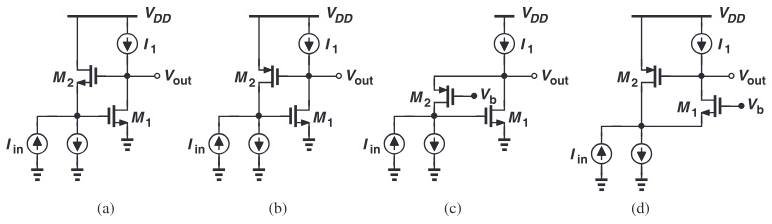

# 장말문제 12.20 — 전류 입력 귀환 증폭기 네 개의 감지·반송 방식

## 원문
Identify the sense and return mechanisms in each amplifier depicted in Fig. 12.87.

## 조건
- 회로: Fig 12.87 (a)–(d)의 네 증폭기 (입력은 전류원 $I_{in}$)
- 감지 방식: 출력 전압을 감지하는지(병렬) 출력 전류를 감지하는지(직렬), 반송 방식: 입력에 전압으로 반송하는지(직렬) 전류로 반송하는지(병렬)를 가림 (원문에 없음)

## 구할 것
- (a)–(d) 각 증폭기의 감지 방식과 반송 방식

## 회로 — Fig 12.87(a)
```spice
I1   VDD   Vout
M2   VDD   Vout  n1    nmos   ; 좌우 반전 (게이트 오른쪽)
M1   Vout  n1    0     nmos
IIN  0     n1                 ; 라벨 I_in
I2   n1    0                  ; 라벨·값 없음
```
- 단자: VDD = 전원, 값 미지정 (가로 레일) / Vout = 출력 (개방 원)
- 표시: 노드 라벨 VDD (레일 오른쪽 끝), V_out (출력 원 오른쪽) / 소자 라벨 I_1 (전류원 오른쪽), M2 (트랜지스터 왼쪽), M1 (트랜지스터 오른쪽), I_in (전류원 왼쪽), I2 (라벨 없음) / 부호 없음 / 화살표 없음 / 수치·면적 라벨 없음
- 배치: 위에 VDD 가로 레일 / 가운데 세로줄 위→아래 M2(드레인이 레일에), n1 접속점, I2 전류원(아래 방향), 접지 / M2 nmos 좌우 반전 (게이트 오른쪽, 드레인 위, 소스 왼쪽 아래·화살표 바깥) / 오른쪽 세로줄 위→아래 I_1(레일에서, 아래 방향), Vout 접속점, M1(nmos 보통 방향, 게이트 왼쪽), 접지 / Vout 접속점에서 가로선이 왼쪽으로 M2 게이트, 오른쪽으로 V_out 원 / n1에서 가로선이 오른쪽으로 M1 게이트, 왼쪽으로 뻗어 아래로 꺾여 I_in 전류원(위 방향) → 접지 / 접속점 (세 갈래 이상, 2곳): Vout = 위 I_1 + 아래 M1 드레인 + 왼쪽 M2 게이트선 + 오른쪽 V_out 선 (점), n1 = 위 M2 소스 + 아래 I2 + 왼쪽 I_in 선 + 오른쪽 M1 게이트선 (점) / 교차: 없음

## 회로 — Fig 12.87(b)
```spice
I1   VDD   Vout
M2   n1    Vout  VDD   pmos   ; 좌우 반전 (게이트 오른쪽)
M1   Vout  n1    0     nmos
IIN  0     n1                 ; 라벨 I_in
I2   n1    0                  ; 라벨·값 없음
```
- 단자: VDD = 전원, 값 미지정 (가로 레일) / Vout = 출력 (개방 원)
- 표시: 노드 라벨 VDD (레일 오른쪽 끝), V_out (출력 원 오른쪽) / 소자 라벨 I_1 (전류원 오른쪽), M2 (트랜지스터 왼쪽), M1 (트랜지스터 오른쪽), I_in (전류원 왼쪽), I2 (라벨 없음) / 부호 없음 / 화살표 없음 / 수치·면적 라벨 없음
- 배치: (a)와 같은 모양에서 M2만 다름 / M2 pmos 좌우 반전 (게이트 오른쪽, 소스 왼쪽 위·화살표가 막대 쪽으로 들어감, 소스가 레일에, 드레인 아래가 n1) / 접속점 (세 갈래 이상, 2곳): Vout = 위 I_1 + 아래 M1 드레인 + 왼쪽 M2 게이트선 + 오른쪽 V_out 선 (점), n1 = 위 M2 드레인 + 아래 I2 + 왼쪽 I_in 선 + 오른쪽 M1 게이트선 (점) / 교차: 없음

## 회로 — Fig 12.87(c)
```spice
I1   VDD   Vout
M2   n1    Vb    Vout  pmos   ; 좌우 반전 (게이트 오른쪽)
M1   Vout  n1    0     nmos
IIN  0     n1                 ; 라벨 I_in
I2   n1    0                  ; 라벨·값 없음
```
- 단자: VDD = 전원, 값 미지정 (T 전원 기호) / Vb = 이상적 DC 바이어스, 값 미지정 (점 단자) / Vout = 출력 (개방 원)
- 표시: 노드 라벨 VDD (T 기호 오른쪽), V_b (점 단자 오른쪽), V_out (출력 원 오른쪽) / 소자 라벨 I_1 (전류원 오른쪽), M2 (트랜지스터 왼쪽), M1 (트랜지스터 오른쪽), I_in (전류원 왼쪽), I2 (라벨 없음) / 부호 없음 / 화살표 없음 / 수치·면적 라벨 없음
- 배치: 오른쪽 세로줄 위→아래 VDD T 기호, I_1(아래 방향), Vout 접속점, M1(nmos 보통 방향), 접지 / Vout 접속점에서 가로선이 왼쪽으로 뻗어 M2 소스 x에서 아래로 꺾여 M2 소스, 오른쪽으로 V_out 원 / M2 pmos 좌우 반전 (게이트 오른쪽으로 V_b 점 단자, 소스 왼쪽 위·화살표가 막대 쪽으로 들어감, 드레인 아래) / M2 드레인 → 세로선 → n1 접속점 → I2(아래 방향) → 접지 / n1에서 가로선이 오른쪽으로 M1 게이트, 왼쪽으로 뻗어 아래로 꺾여 I_in 전류원(위 방향) → 접지 / 접속점 (세 갈래 이상, 2곳): Vout = 위 I_1 + 아래 M1 드레인 + 왼쪽 M2 소스선 + 오른쪽 V_out 선 (점), n1 = 위 M2 드레인 + 아래 I2 + 왼쪽 I_in 선 + 오른쪽 M1 게이트선 (점) / 교차: 없음

## 회로 — Fig 12.87(d)
```spice
I1   VDD   Vout
M2   n1    Vout  VDD   pmos   ; 좌우 반전 (게이트 오른쪽)
M1   Vout  Vb    n1    nmos   ; 좌우 반전 (게이트 오른쪽)
IIN  0     n1                 ; 라벨 I_in
I2   n1    0                  ; 라벨·값 없음
```
- 단자: VDD = 전원, 값 미지정 (가로 레일) / Vb = 이상적 DC 바이어스, 값 미지정 (점 단자) / Vout = 출력 (개방 원)
- 표시: 노드 라벨 VDD (레일 오른쪽 끝), V_b (점 단자 오른쪽), V_out (출력 원 오른쪽) / 소자 라벨 I_1 (전류원 오른쪽), M2 (트랜지스터 왼쪽), M1 (트랜지스터 왼쪽), I_in (전류원 왼쪽), I2 (라벨 없음) / 부호 없음 / 화살표 없음 / 수치·면적 라벨 없음
- 배치: 위에 VDD 가로 레일 / 왼쪽 세로줄 위→아래 M2(소스가 레일에), n1 접속점, I2(아래 방향), 접지 / M2 pmos 좌우 반전 (게이트 오른쪽, 소스 왼쪽 위·화살표가 막대 쪽으로 들어감, 드레인 아래) / 오른쪽 세로줄 위→아래 I_1(레일에서, 아래 방향), Vout 접속점, M1 / M1 nmos 좌우 반전 (게이트 오른쪽으로 V_b 점 단자, 드레인 위, 소스 왼쪽 아래·화살표 바깥) / M1 소스에서 아래로 내려가 가로선이 왼쪽으로 n1 접속점 / Vout 접속점에서 가로선이 왼쪽으로 M2 게이트, 오른쪽으로 V_out 원 / n1에서 가로선이 왼쪽으로 뻗어 아래로 꺾여 I_in 전류원(위 방향) → 접지 / 접속점 (세 갈래 이상, 2곳): Vout = 위 I_1 + 아래 M1 드레인 + 왼쪽 M2 게이트선 + 오른쪽 V_out 선 (점), n1 = 위 M2 드레인 + 아래 I2 + 왼쪽 I_in 선 + 오른쪽 M1 소스선 (점) / 교차: 없음


