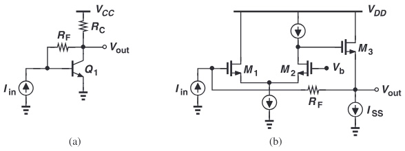

# 장말문제 12.21 — R_F 귀환 증폭기 두 개(BJT, MOS)의 감지·반송 방식

## 원문
Identify the sense and return mechanisms in each amplifier depicted in Fig. 12.88.

## 조건
- 회로: Fig 12.88 (a), (b)의 두 증폭기 (입력은 전류원 $I_{in}$, 귀환 저항 $R_F$)
- 감지 방식: 출력 전압을 감지하는지(병렬) 출력 전류를 감지하는지(직렬), 반송 방식: 입력에 전압으로 반송하는지(직렬) 전류로 반송하는지(병렬)를 가림 (원문에 없음)

## 구할 것
- (a), (b) 각 증폭기의 감지 방식과 반송 방식

## 회로 — Fig 12.88(a)
```spice
RC   VCC   Vout  {R_C}
RF   n1    Vout  {R_F}
Q1   Vout  n1    0     npn
IIN  0     n1                 ; 라벨 I_in
```
- 단자: VCC = 전원, 값 미지정 (T 전원 기호) / Vout = 출력 (개방 원)
- 표시: 노드 라벨 VCC (T 기호 오른쪽), V_out (출력 원 오른쪽) / 소자 라벨 R_C (저항 오른쪽), R_F (가로 저항 위), Q1 (트랜지스터 오른쪽), I_in (전류원 왼쪽) / 부호 없음 / 화살표 없음 / 수치·면적 라벨 없음
- 배치: 오른쪽 세로줄 위→아래 VCC T 기호, R_C, Vout 접속점, Q1(npn 보통 방향, 베이스 왼쪽), 접지 / Vout 접속점에서 가로선이 오른쪽으로 V_out 원, 왼쪽으로 가로 저항 R_F를 지나 모서리에서 아래로 꺾여 n1 접속점 / n1에서 가로선이 오른쪽으로 Q1 베이스, 왼쪽으로 뻗어 아래로 꺾여 I_in 전류원(위 방향) → 접지 / 접속점 (세 갈래 이상, 2곳): Vout = 위 R_C + 아래 Q1 컬렉터 + 왼쪽 R_F + 오른쪽 V_out 선 (점), n1 = 위 R_F 선 + 왼쪽 I_in 선 + 오른쪽 Q1 베이스선 (점) / 교차: 없음

## 회로 — Fig 12.88(b)
```spice
M1   VDD   n1    n2    nmos
M2   n3    Vb    n2    nmos   ; 좌우 반전 (게이트 오른쪽)
I1   VDD   n3                 ; 라벨·값 없음
M3   VDD   n3    Vout  nmos
I2   n2    0                  ; 라벨·값 없음
IIN  0     n1                 ; 라벨 I_in
RF   n1    Vout  {R_F}
ISS  Vout  0
```
- 단자: VDD = 전원, 값 미지정 (가로 레일) / Vb = 이상적 DC 바이어스, 값 미지정 (점 단자) / Vout = 출력 (개방 원)
- 표시: 노드 라벨 VDD (레일 오른쪽 끝), V_b (점 단자 오른쪽), V_out (출력 원 오른쪽) / 소자 라벨 M1 (트랜지스터 오른쪽), M2 (트랜지스터 왼쪽), M3 (트랜지스터 오른쪽), R_F (가로 저항 아래), I_in (전류원 왼쪽), I_SS (전류원 오른쪽), I1, I2 (라벨 없음) / 부호 없음 / 화살표 없음 / 수치·면적 라벨 없음
- 배치: 위에 VDD 가로 레일 / 왼쪽 M1 nmos 보통 방향(게이트 왼쪽), 드레인이 곧게 레일로 / 가운데 세로줄 위→아래 I1(레일에서, 아래 방향), n3 접속점, M2 / M2 nmos 좌우 반전 (게이트 오른쪽으로 V_b 점 단자, 드레인 위, 소스 왼쪽 아래·화살표 바깥) / M1·M2 소스가 아래 가로선으로 이어지고 가운데 n2 접속점에서 세로선이 아래로 I2 전류원(아래 방향) → 접지 / n3에서 가로선이 오른쪽으로 M3 게이트 / 오른쪽 세로줄 위→아래 M3(nmos 보통 방향, 드레인이 레일에), Vout 접속점, I_SS 전류원(아래 방향), 접지 / n1 접속점(M1 게이트 왼쪽)에서 오른쪽으로 M1 게이트, 왼쪽으로 뻗어 아래로 꺾여 I_in 전류원(위 방향) → 접지, 아래로 세로선이 내려가 꼬리 가로선보다 낮은 높이에서 오른쪽으로 꺾여 긴 가로선 → 가로 저항 R_F → Vout 접속점 / Vout 접속점에서 오른쪽으로 V_out 원 / 접속점 (세 갈래 이상, 4곳): n1 = 왼쪽 I_in 선 + 오른쪽 M1 게이트선 + 아래 R_F 선 (점), n2 = 왼쪽 M1 소스 + 오른쪽 M2 소스 + 아래 I2 (점), n3 = 위 I1 + 아래 M2 드레인 + 오른쪽 M3 게이트선 (점), Vout = 위 M3 소스 + 아래 I_SS + 왼쪽 R_F + 오른쪽 V_out 선 (점) / 교차: R_F 가로선이 n2에서 I2로 내려가는 세로선과 점 없이 교차


