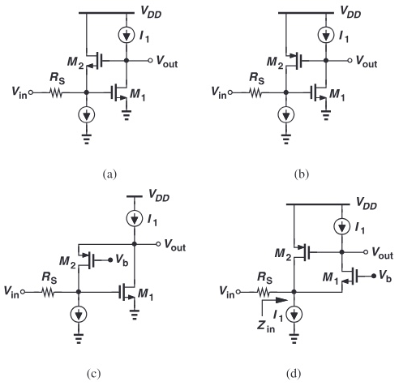

# 장말문제 12.22 — R_S 입력 귀환 단 네 개의 귀환 극성

## 원문
Determine the polarity of feedback in each of the stages illustrated in Fig. 12.89.

## 조건
- 회로: Fig 12.89 (a)–(d)의 네 단 (입력 $V_{in}$이 저항 $R_S$를 거쳐 들어감)

## 구할 것
- (a)–(d) 각 단의 귀환 극성 (부귀환인지 정귀환인지)

## 회로 — Fig 12.89(a)
```spice
I1   VDD   Vout
M2   VDD   Vout  n1    nmos   ; 좌우 반전 (게이트 오른쪽)
M1   Vout  n1    0     nmos
RS   Vin   n1    {R_S}
I2   n1    0                  ; 라벨·값 없음
```
- 단자: VDD = 전원, 값 미지정 (가로 레일) / Vin = 입력 (개방 원) / Vout = 출력 (개방 원)
- 표시: 노드 라벨 VDD (레일 오른쪽 끝), V_in (입력 원 왼쪽), V_out (출력 원 오른쪽) / 소자 라벨 I_1 (전류원 오른쪽), M2 (트랜지스터 왼쪽), M1 (트랜지스터 오른쪽), R_S (가로 저항 위), I2 (라벨 없음) / 부호 없음 / 화살표 없음 / 수치·면적 라벨 없음
- 배치: 위에 VDD 가로 레일 / 가운데 세로줄 위→아래 M2(드레인이 레일에), n1 접속점, I2 전류원(아래 방향), 접지 / M2 nmos 좌우 반전 (게이트 오른쪽, 드레인 위, 소스 왼쪽 아래·화살표 바깥) / 오른쪽 세로줄 위→아래 I_1(레일에서, 아래 방향), Vout 접속점, M1(nmos 보통 방향, 게이트 왼쪽), 접지 / Vout 접속점에서 가로선이 왼쪽으로 M2 게이트, 오른쪽으로 V_out 원 / V_in 원 → 가로선 → 가로 저항 R_S → n1 접속점 → 오른쪽 M1 게이트 / 접속점 (세 갈래 이상, 2곳): Vout = 위 I_1 + 아래 M1 드레인 + 왼쪽 M2 게이트선 + 오른쪽 V_out 선 (점), n1 = 위 M2 소스 + 아래 I2 + 왼쪽 R_S + 오른쪽 M1 게이트선 (점) / 교차: 없음

## 회로 — Fig 12.89(b)
```spice
I1   VDD   Vout
M2   n1    Vout  VDD   pmos   ; 좌우 반전 (게이트 오른쪽)
M1   Vout  n1    0     nmos
RS   Vin   n1    {R_S}
I2   n1    0                  ; 라벨·값 없음
```
- 단자: VDD = 전원, 값 미지정 (가로 레일) / Vin = 입력 (개방 원) / Vout = 출력 (개방 원)
- 표시: 노드 라벨 VDD (레일 오른쪽 끝), V_in (입력 원 왼쪽), V_out (출력 원 오른쪽) / 소자 라벨 I_1 (전류원 오른쪽), M2 (트랜지스터 왼쪽), M1 (트랜지스터 오른쪽), R_S (가로 저항 위), I2 (라벨 없음) / 부호 없음 / 화살표 없음 / 수치·면적 라벨 없음
- 배치: (a)와 같은 모양에서 M2만 다름 / M2 pmos 좌우 반전 (게이트 오른쪽, 소스 왼쪽 위·화살표가 막대 쪽으로 들어감, 소스가 레일에, 드레인 아래가 n1) / 접속점 (세 갈래 이상, 2곳): Vout = 위 I_1 + 아래 M1 드레인 + 왼쪽 M2 게이트선 + 오른쪽 V_out 선 (점), n1 = 위 M2 드레인 + 아래 I2 + 왼쪽 R_S + 오른쪽 M1 게이트선 (점) / 교차: 없음

## 회로 — Fig 12.89(c)
```spice
I1   VDD   Vout
M2   n1    Vb    Vout  pmos   ; 좌우 반전 (게이트 오른쪽)
M1   Vout  n1    0     nmos
RS   Vin   n1    {R_S}
I2   n1    0                  ; 라벨·값 없음
```
- 단자: VDD = 전원, 값 미지정 (T 전원 기호) / Vb = 이상적 DC 바이어스, 값 미지정 (점 단자) / Vin = 입력 (개방 원) / Vout = 출력 (개방 원)
- 표시: 노드 라벨 VDD (T 기호 오른쪽), V_b (점 단자 오른쪽), V_in (입력 원 왼쪽), V_out (출력 원 오른쪽) / 소자 라벨 I_1 (전류원 오른쪽), M2 (트랜지스터 왼쪽), M1 (트랜지스터 오른쪽), R_S (가로 저항 위), I2 (라벨 없음) / 부호 없음 / 화살표 없음 / 수치·면적 라벨 없음
- 배치: 오른쪽 세로줄 위→아래 VDD T 기호, I_1(아래 방향), Vout 접속점, M1(nmos 보통 방향), 접지 / Vout 접속점에서 가로선이 왼쪽으로 뻗어 M2 소스 x에서 아래로 꺾여 M2 소스, 오른쪽으로 V_out 원 / M2 pmos 좌우 반전 (게이트 오른쪽으로 V_b 점 단자, 소스 왼쪽 위·화살표가 막대 쪽으로 들어감, 드레인 아래) / M2 드레인 → 세로선 → n1 접속점 → I2(아래 방향) → 접지 / V_in 원 → 가로 저항 R_S → n1 → 오른쪽 M1 게이트 / 접속점 (세 갈래 이상, 2곳): Vout = 위 I_1 + 아래 M1 드레인 + 왼쪽 M2 소스선 + 오른쪽 V_out 선 (점), n1 = 위 M2 드레인 + 아래 I2 + 왼쪽 R_S + 오른쪽 M1 게이트선 (점) / 교차: 없음

## 회로 — Fig 12.89(d)
```spice
I1A  VDD   Vout               ; 인쇄 라벨 I_1
M2   n1    Vout  VDD   pmos   ; 좌우 반전 (게이트 오른쪽)
M1   Vout  Vb    n1    nmos   ; 좌우 반전 (게이트 오른쪽)
RS   Vin   n1    {R_S}
I1B  n1    0                  ; 인쇄 라벨 I_1 (같은 라벨이 두 번 인쇄됨)
```
- 단자: VDD = 전원, 값 미지정 (가로 레일) / Vb = 이상적 DC 바이어스, 값 미지정 (점 단자) / Vin = 입력 (개방 원) / Vout = 출력 (개방 원)
- 표시: 노드 라벨 VDD (레일 오른쪽 끝), V_b (점 단자 오른쪽), V_in (입력 원 왼쪽), V_out (출력 원 오른쪽) / 소자 라벨 I_1 (위 전류원 오른쪽), I_1 (아래 전류원 왼쪽 위), M2 (트랜지스터 왼쪽), M1 (트랜지스터 왼쪽), R_S (가로 저항 위) / 부호 없음 / 화살표 "Z_in": R_S 오른쪽 끝과 n1 사이 도선 아래에서 n1 쪽(오른쪽)을 들여다봄, 오른쪽 방향, 도선 옆 별도 화살표 (┌ 꺾임: 세로선 위 끝에서 오른쪽으로 꺾여 화살촉, 라벨 Z_in은 세로선 아래) / 수치·면적 라벨 없음
- 배치: 위에 VDD 가로 레일 / 왼쪽 세로줄 위→아래 M2(소스가 레일에), n1 접속점, I_1 아래 전류원(아래 방향), 접지 / M2 pmos 좌우 반전 (게이트 오른쪽, 소스 왼쪽 위·화살표가 막대 쪽으로 들어감, 드레인 아래) / 오른쪽 세로줄 위→아래 I_1 위 전류원(레일에서, 아래 방향), Vout 접속점, M1 / M1 nmos 좌우 반전 (게이트 오른쪽으로 V_b 점 단자, 드레인 위, 소스 왼쪽 아래·화살표 바깥) / M1 소스에서 아래로 내려가 가로선이 왼쪽으로 n1 접속점 / Vout 접속점에서 가로선이 왼쪽으로 M2 게이트, 오른쪽으로 V_out 원 / V_in 원 → 가로 저항 R_S → n1 / 접속점 (세 갈래 이상, 2곳): Vout = 위 I_1 + 아래 M1 드레인 + 왼쪽 M2 게이트선 + 오른쪽 V_out 선 (점), n1 = 위 M2 드레인 + 아래 I_1 + 왼쪽 R_S + 오른쪽 M1 소스선 (점) / 교차: 없음


> 참고: (d)의 두 전류원은 원본에서 모두 I_1로 인쇄됨 (넷리스트는 I1A, I1B로 구분)
