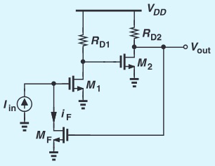

# 장말문제 12.23 — 예제 12.11 회로(M_F 전류 귀환)의 귀환 극성

## 원문
Determine the polarity of feedback in the circuit of Example 12-11.

## 조건
- 회로: 예제 12.11의 회로 (Fig 12.26, 원문 표기 "Example 12-11")
- 예제 12.11에서 이어받는 가정: $\lambda = 0$ (원문에 없음)

## 구할 것
- 회로의 귀환 극성 (부귀환인지 정귀환인지)

## 상속·참조
- 예제 12.11 (교재 666쪽, PDF 14, 12.4 감지 및 반송 기술): 그림 12.26의 회로에 대하여 귀환율 $K$를 계산하라. $\lambda = 0$이라고 가정하라
- 예제 12.11 풀이 (참고): 트랜지스터 $M_F$가 출력 전압을 감지하고 입력에 전류를 반송한다. 귀환율 $K = i_F/v_{out} = g_{mF}$ (식 12.53)

## 회로 — Fig 12.26
```spice
RD1  VDD   n1    {R_D1}
RD2  VDD   Vout  {R_D2}
M1   n1    n2    0     nmos
M2   Vout  n1    0     nmos
IIN  0     n2                 ; 라벨 I_in
MF   n2    Vout  0     nmos   ; 좌우 반전 (게이트 오른쪽)
```
- 단자: VDD = 전원, 값 미지정 (가로 레일) / Vout = 출력 (개방 원)
- 표시: 노드 라벨 VDD (레일 오른쪽 끝), V_out (출력 원 오른쪽) / 소자 라벨 R_D1, R_D2 (각 저항 오른쪽), M1, M2 (각 트랜지스터 오른쪽), M_F (트랜지스터 왼쪽), I_in (전류원 왼쪽) / 부호 없음 / 화살표 "i_F": n2에서 M_F 드레인으로 내려가는 세로선, 아래 방향, 도선 위 / 수치·면적 라벨 없음
- 배치: 위에 VDD 가로 레일 / 가운데 세로줄 위→아래 R_D1, n1 접속점, M1(nmos 보통 방향, 게이트 왼쪽), 접지 / 오른쪽 세로줄 위→아래 R_D2, Vout 접속점(R_D2 바로 아래), M2(nmos 보통 방향), 접지 / n1에서 가로선이 오른쪽으로 M2 게이트 / R_D2 아래 접속점에서 가로선이 오른쪽으로 두 번째 접속점을 지나 V_out 원, 두 번째 접속점에서 세로선이 아래로 M_F 게이트 높이까지 내려가 왼쪽으로 꺾여 M_F 게이트 / 왼쪽 아래 M_F nmos 좌우 반전 (게이트 오른쪽, 드레인 위, 소스 왼쪽 아래·화살표 바깥), 소스 아래 접지 / n2 접속점(M1 게이트 왼쪽)에서 오른쪽으로 M1 게이트, 왼쪽으로 뻗어 아래로 꺾여 I_in 전류원(위 방향) → 접지, 아래로 세로선이 M_F 드레인으로 / 접속점 (세 갈래 이상, 4곳): n1 = 위 R_D1 + 아래 M1 드레인 + 오른쪽 M2 게이트선 (점), R_D2 아래 = 위 R_D2 + 아래 M2 드레인 + 오른쪽 가로선 (점), 두 번째 Vout 접속점 = 왼쪽 가로선 + 오른쪽 V_out 선 + 아래 M_F 게이트선 (점), n2 = 왼쪽 I_in 선 + 오른쪽 M1 게이트선 + 아래 M_F 드레인선 (점) / 교차: 없음


> 참고: Fig 12.26은 본문 그림(교재 666쪽, PDF 14, 예제 12.11)
